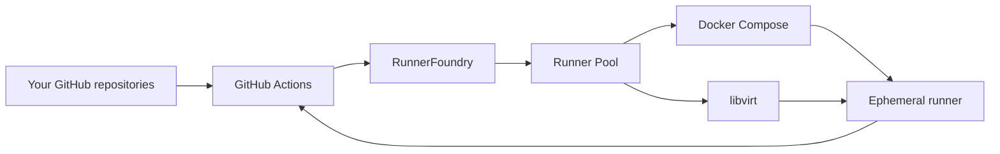

# RunnerFoundry

**Shared, ephemeral GitHub Actions runners for personal accounts.**

If your repositories live under a personal GitHub account, GitHub gives you no organization-level runner pool to share self-hosted capacity between them. RunnerFoundry fills that gap without requiring you to move those repositories into an organization.

Define a pool once, use its name from any repository you want it to serve, and let RunnerFoundry create disposable runners on your own infrastructure as work arrives.

Docker and full virtual machines are supported today. Start with one host or spread capacity across several. No Kubernetes or Actions Runner Controller required.

[Quick start](#quick-start) | [Standalone](#standalone-deployment) | [Clustered](#clustered-deployment) | [Runner providers](#runner-providers) | [Configuration](#configuration-reference) | [Operations](#operations) | [Contributing](CONTRIBUTING.md) | [Licensing](LICENSING.md)

## Is RunnerFoundry for you?

RunnerFoundry exists for a fairly specific problem.

Suppose you have several repositories under your personal GitHub account and some machines you want to use for GitHub Actions. GitHub lets you attach self-hosted runners to individual repositories, but personal accounts do not get the organization-level runner infrastructure normally used to share capacity across repositories.

RunnerFoundry gives those repositories a shared pool instead.

A pool called `linux-docker`, for example, can be used from every repository you choose to serve:

```yaml
jobs:
  test:
    runs-on: linux-docker
    steps:
      - run: uname -a
```

Those repositories do not each need their own permanently registered runner. RunnerFoundry makes the pool available to GitHub, creates a runner when a job needs one, and removes it afterwards.

RunnerFoundry is a good fit when:

* your repositories live under a personal GitHub account;
* you want several repositories to share self-hosted capacity;
* you prefer disposable runners over permanently registered machines;
* you want to run jobs in Docker containers or libvirt virtual machines; and
* you are comfortable operating the infrastructure those runners use.

RunnerFoundry is probably unnecessary if GitHub-hosted runners already meet your needs, or if attaching a permanent self-hosted runner to a single repository solves your problem.

GitHub Actions is currently the only supported Git source.

## How it works

The useful mental model is small:



A **Runner Pool** is a named collection of capacity. The pool name is what your workflows use in `runs-on`.

When GitHub has work for a pool, RunnerFoundry queues it. Jobs are handled in FIFO order within each Runner Pool. When capacity is available, RunnerFoundry creates an ephemeral runner using the provider configured for that pool.

If creating the runner fails before it accepts the job, RunnerFoundry cleans up the failed attempt and returns the job to the back of the queue. It keeps trying while GitHub still considers that job active.

Once a runner accepts the job, it behaves like a normal GitHub Actions runner. The runner communicates the workflow result directly to GitHub. RunnerFoundry remains responsible for cleaning up the runner resource afterwards.

RunnerFoundry is therefore a control plane for runner capacity. It is not another workflow engine and it does not replace the GitHub Actions runner.

## Quick start

This is the shortest path to a working RunnerFoundry installation.

It creates one RunnerFoundry member on a Debian or Ubuntu AMD64 host, stores its state in SQLite, and runs jobs in Docker containers.

If you already know that you want to operate several RunnerFoundry hosts, skip to [Clustered deployment](#clustered-deployment).

### What you need

You need:

* a Debian or Ubuntu AMD64 host;
* Docker Engine with Docker Compose;
* permission to create and install a GitHub App;
* outbound HTTPS access to GitHub; and
* a RunnerFoundry Debian package from [GitHub Releases](https://github.com/stateshifters/runnerfoundry/releases).

Self-hosted runners execute workflow code on your infrastructure. If repositories can run untrusted code, read GitHub's [secure use guidance](https://docs.github.com/en/actions/reference/security/secure-use#hardening-for-self-hosted-runners) before exposing host resources or credentials.

### 1. Install RunnerFoundry

Install the downloaded package:

```sh
sudo apt install ./runnerfoundry_*.deb
```

The package installs RunnerFoundry as a systemd service and creates a dedicated `runnerfoundry` account.

It does not start a usable service until you provide valid configuration and GitHub credentials.

### 2. Create a GitHub App

Create a GitHub App for RunnerFoundry and grant it repository **Administration: Read and write** permission.

Install the App on the personal-account repositories that should have access to your runners. You can limit the installation to selected repositories.

Record the App's numeric App ID and generate a private key.

Install the private key on the RunnerFoundry host:

```sh
sudo install -m 0640 -o root -g runnerfoundry \
  github-app.pem /etc/runnerfoundry/github-app.pem
```

RunnerFoundry discovers repositories through the GitHub App installation. You do not need to maintain a repository list in its configuration.

### 3. Create a Docker runner

Create `/etc/runnerfoundry/compose.yaml`:

```yaml
services:
  runner:
    image: ghcr.io/actions/actions-runner:latest
    user: runner
    working_dir: /home/runner
    command: ["/home/runner/run.sh"]
```

This is enough for a simple evaluation.

For a maintained environment, use an image containing the tools your workflows need and pin that image to a reviewed version or digest.

### 4. Configure RunnerFoundry

Replace `/etc/runnerfoundry/config.yaml` with:

```yaml
github:
  apps:
    - app_id: 123456
      private_key_file: /etc/runnerfoundry/github-app.pem

state:
  path: /var/lib/runnerfoundry/state.db

scale_sets:
  - name: linux-docker
    max_runners: 2
    docker:
      compose_file: /etc/runnerfoundry/compose.yaml
      service: runner
```

Replace `123456` with your GitHub App ID.

This creates a Runner Pool called `linux-docker` with capacity for two concurrent runners.

### 5. Start RunnerFoundry

```sh
sudo systemctl enable --now runnerfoundry
```

Check its status:

```sh
sudo systemctl status runnerfoundry
sudo journalctl -u runnerfoundry -f
```

### 6. Run a job

In one of the repositories on which the GitHub App is installed:

```yaml
name: RunnerFoundry test

on:
  workflow_dispatch:

jobs:
  verify:
    runs-on: linux-docker
    steps:
      - run: uname -a
```

Start the workflow from GitHub Actions.

RunnerFoundry should create a container for the job. The runner executes it, reports the result to GitHub, and the container is removed afterwards.

Install the same GitHub App on another personal repository and that repository can use `runs-on: linux-docker` too.

## Standalone deployment

A standalone deployment is one RunnerFoundry member.

It can use either SQLite or PostgreSQL for its durable state. The choice of database does not change the runner model.

For most single-host installations, SQLite is the simplest choice.

### Standalone with SQLite

SQLite needs no separate database service.

A complete standalone configuration can be as small as:

```yaml
github:
  apps:
    - app_id: 123456
      private_key_file: /etc/runnerfoundry/github-app.pem

state:
  path: /var/lib/runnerfoundry/state.db

scale_sets:
  - name: linux-docker
    max_runners: 4
    docker:
      compose_file: /etc/runnerfoundry/compose.yaml
      service: runner
```

Start the member normally:

```sh
sudo systemctl enable --now runnerfoundry
```

Only one RunnerFoundry member may use a SQLite database. RunnerFoundry exclusively owns the live database while it is running.

If all of your capacity lives on one machine, this is usually the right deployment.

### Standalone with PostgreSQL

A single RunnerFoundry member can also use PostgreSQL.

This can be useful when PostgreSQL already fits your operational environment, when you want PostgreSQL-backed state, or when you expect to add more RunnerFoundry hosts later.

PostgreSQL 17 and 18 are the currently supported versions.

Create a stable role and a login identity:

```sql
CREATE ROLE runnerfoundry
  NOLOGIN NOSUPERUSER NOCREATEDB NOCREATEROLE NOREPLICATION;

CREATE ROLE runnerfoundry_login
  LOGIN NOSUPERUSER NOCREATEDB NOCREATEROLE NOREPLICATION;

GRANT runnerfoundry TO runnerfoundry_login;

CREATE DATABASE runnerfoundry OWNER runnerfoundry;
```

Configure authentication for `runnerfoundry_login` according to your PostgreSQL environment.

Store the credentials somewhere readable by the RunnerFoundry service account. For example:

```sh
sudo install -d -m 0750 -o root -g runnerfoundry /etc/runnerfoundry/secrets

printf '%s' 'runnerfoundry_login' | \
  sudo tee /etc/runnerfoundry/secrets/postgres-user >/dev/null

printf '%s' 'your-password' | \
  sudo tee /etc/runnerfoundry/secrets/postgres-password >/dev/null

sudo chown root:runnerfoundry /etc/runnerfoundry/secrets/*
sudo chmod 0640 /etc/runnerfoundry/secrets/*
```

Then use PostgreSQL instead of `state.path`:

```yaml
github:
  apps:
    - app_id: 123456
      private_key_file: /etc/runnerfoundry/github-app.pem

state:
  postgres:
    role: runnerfoundry
    host: postgresql.example.net
    port: "5432"
    name: runnerfoundry
    user: file:///etc/runnerfoundry/secrets/postgres-user
    password: file:///etc/runnerfoundry/secrets/postgres-password

scale_sets:
  - name: linux-docker
    max_runners: 4
    docker:
      compose_file: /etc/runnerfoundry/compose.yaml
      service: runner
```

Start RunnerFoundry normally:

```sh
sudo systemctl enable --now runnerfoundry
```

RunnerFoundry applies its known forward PostgreSQL migrations during startup.

One member using PostgreSQL is still a standalone deployment. It becomes clustered only when several RunnerFoundry members share that PostgreSQL state.

## Clustered deployment

A clustered deployment consists of two or more RunnerFoundry members sharing the same PostgreSQL database.

Clustering lets you spread runner capacity across machines.

For example, you might have:

* one host providing Linux Docker runners;
* another providing Windows virtual machines;
* several identical hosts contributing to one large Linux pool; or
* a mixture of pools spread across whichever machines are suited to run them.

There is no separate cluster service and there is no leader address to configure. The members coordinate through PostgreSQL.

### 1. Prepare PostgreSQL

Use PostgreSQL 17 or 18.

Create the database and stable role:

```sql
CREATE ROLE runnerfoundry
  NOLOGIN NOSUPERUSER NOCREATEDB NOCREATEROLE NOREPLICATION;

CREATE ROLE runnerfoundry_login
  LOGIN NOSUPERUSER NOCREATEDB NOCREATEROLE NOREPLICATION;

GRANT runnerfoundry TO runnerfoundry_login;

CREATE DATABASE runnerfoundry OWNER runnerfoundry;
```

You may use one login identity for all members or separate login identities for different hosts.

Every login used by RunnerFoundry must be able to assume the stable `runnerfoundry` role.

### 2. Give every member a unique hostname

RunnerFoundry uses the operating-system hostname as the stable identity of a cluster member.

Each host must therefore have a stable, unique hostname.

Do not run two RunnerFoundry daemons using the same hostname against the same cluster.

### 3. Use the same ordered GitHub App list

Every cluster member uses the same ordered GitHub App list and the same PostgreSQL database. App order must match on every member so repository precedence is consistent.

Install the private key on each member:

```sh
sudo install -m 0640 -o root -g runnerfoundry \
  github-app.pem /etc/runnerfoundry/github-app.pem
```

### 4. Configure the shared PostgreSQL state

Each member points at the same database:

```yaml
state:
  postgres:
    role: runnerfoundry
    host: postgresql.example.net
    port: "5432"
    name: runnerfoundry
    user: env://RUNNERFOUNDRY_POSTGRES_USER
    password: env://RUNNERFOUNDRY_POSTGRES_PASSWORD
```

The credentials do not have to be identical if you use separate PostgreSQL login identities. They only need access to the same database and permission to assume the configured stable role.

If your primary PostgreSQL endpoint cannot preserve the sessions required by RunnerFoundry, configure a separate session-affine endpoint:

```yaml
state:
  postgres:
    role: runnerfoundry
    host: postgresql-pool.example.net
    port: "5432"
    name: runnerfoundry
    user: env://RUNNERFOUNDRY_POSTGRES_USER
    password: env://RUNNERFOUNDRY_POSTGRES_PASSWORD

    direct:
      host: postgresql-direct.example.net
```

The remaining `direct` fields inherit the primary structured connection settings when omitted.

See [PostgreSQL configuration](#postgresql-configuration) for the complete rules.

### 5. Configure the capacity on each member

Members do not need identical Runner Pool configuration.

Host `runner01` might provide Docker capacity:

```yaml
github:
  apps:
    - app_id: 123456
      private_key_file: /etc/runnerfoundry/github-app.pem

state:
  postgres:
    role: runnerfoundry
    host: postgresql.example.net
    port: "5432"
    name: runnerfoundry
    user: env://RUNNERFOUNDRY_POSTGRES_USER
    password: env://RUNNERFOUNDRY_POSTGRES_PASSWORD

scale_sets:
  - name: linux
    max_runners: 8
    docker:
      compose_file: /etc/runnerfoundry/compose.yaml
      service: runner
```

Host `runner02` might provide Windows capacity:

```yaml
github:
  apps:
    - app_id: 123456
      private_key_file: /etc/runnerfoundry/github-app.pem

state:
  postgres:
    role: runnerfoundry
    host: postgresql.example.net
    port: "5432"
    name: runnerfoundry
    user: env://RUNNERFOUNDRY_POSTGRES_USER
    password: env://RUNNERFOUNDRY_POSTGRES_PASSWORD

scale_sets:
  - name: windows
    max_runners: 2
    libvirt:
      connection_uri: qemu:///system
      domain_xml_template: /etc/runnerfoundry/windows-domain.xml
```

Those two pools are both available through the cluster.

Members can also contribute capacity to the same pool:

```yaml
scale_sets:
  - name: linux
    max_runners: 4
    docker:
      compose_file: /etc/runnerfoundry/compose.yaml
      service: runner
```

If two live members each contribute four runners to `linux`, the cluster has eight configured runners of capacity for that pool before queued or active work is accounted for.

Members declaring the same Runner Pool must use the same GitHub `runner_group`.

They may technically use different local providers for the same pool, but jobs in that pool can then land on either environment. Only do this when those environments are intentionally interchangeable.

### 6. Start the members

Start RunnerFoundry on each host:

```sh
sudo systemctl enable --now runnerfoundry
```

No member needs to be designated as leader.

The cluster coordinates shared state, GitHub-facing responsibilities, and available capacity automatically.

## Runner providers

Every Runner Pool uses exactly one execution provider on each member that declares it.

RunnerFoundry currently supports Docker Compose and libvirt.

RunnerFoundry owns creation and cleanup of runner instances. You own the environment inside those instances.

### Docker Compose

Docker is the easiest provider for Linux jobs that fit comfortably inside a container.

A Docker-backed Runner Pool looks like:

```yaml
scale_sets:
  - name: linux-docker
    max_runners: 2
    docker:
      compose_file: /etc/runnerfoundry/compose.yaml
      service: runner
```

The Compose file might contain:

```yaml
services:
  runner:
    image: ghcr.io/actions/actions-runner:latest
    user: runner
    working_dir: /home/runner
    command: ["/home/runner/run.sh"]
```

RunnerFoundry validates that the configured Compose service exists before activating the pool.

When a job needs a runner, RunnerFoundry starts a detached one-job container and supplies the GitHub JIT configuration through `ACTIONS_RUNNER_INPUT_JITCONFIG`.

The container uses Docker's `--rm` lifecycle and normally removes itself after the runner exits. RunnerFoundry still issues `docker rm --force` during cleanup. A failed or interrupted runner might not terminate by itself. Cleanup succeeds when Docker reports that removal of that exact container is already in progress. Docker then owns completing the removal, and RunnerFoundry does not retry it. Other removal failures require RunnerFoundry to confirm that the container is absent.

The image, tools, command, volumes, networks and security policy remain yours to define.

See [`examples/docker-runner`](examples/docker-runner/README.md) for the minimal example included with the repository.

### libvirt

Use libvirt when a job needs a complete virtual machine.

Typical reasons include:

* Windows runners;
* workloads that require a full operating system;
* VM-specific networking, firmware or storage behavior; or
* cases where a VM boundary is preferable to a container boundary.

A libvirt-backed pool looks like:

```yaml
scale_sets:
  - name: linux-vm
    max_runners: 2
    libvirt:
      connection_uri: qemu:///system
      domain_xml_template: /etc/runnerfoundry/domain.xml
```

RunnerFoundry renders and starts a transient domain from the supplied XML.

The GitHub JIT configuration is made available to the guest through an SMBIOS type 11 value named `runnerfoundry.jit`.

The guest is responsible for:

1. reading that value without logging or persisting it;
2. exposing it to the GitHub Actions runner as `ACTIONS_RUNNER_INPUT_JITCONFIG`;
3. starting the unregistered runner once;
4. cleaning up transient runner and work state; and
5. shutting down after the attempt.

RunnerFoundry does not build or maintain your VM images.

The repository contains working examples for:

* [Ubuntu](examples/libvirt-ubuntu-runner/README.md)
* [Windows Server](examples/libvirt-windows-runner/README.md)

Those examples use Packer, but Packer is not required by RunnerFoundry. Any image-building process is fine as long as the resulting guest satisfies the runner contract.

## Configuration reference

RunnerFoundry reads YAML from the file supplied with `--config`.

The packaged systemd service uses:

```text
/etc/runnerfoundry/config.yaml
```

Configuration is strict. Unknown fields are rejected instead of being silently ignored.

The keys documented in this section are the complete valid YAML configuration surface.

### Top-level settings

| Setting             | Type    | Default          | Requirements                 |
| ------------------- | ------- | ---------------- | ---------------------------- |
| `autoUpdateRunners` | boolean | `false`          | `true` or `false`            |
| `github`            | mapping | none             | Required                     |
| `log`               | mapping | defaults applied | Optional                     |
| `state`             | mapping | none             | Required                     |
| `prune`             | boolean | `false`          | `true` or `false`            |
| `scale_sets`        | list    | none             | Required, at least one entry |

A complete PostgreSQL-backed example showing all major configuration areas looks like:

```yaml
github:
  apps:
    - app_id: 123456
      private_key_file: /etc/runnerfoundry/github-app.pem
  discovery_interval: 5m

log:
  format: text
  level: info
  file:
    path: /var/log/runnerfoundry/runnerfoundry.log
    max_size_mb: 100
    max_backups: 5

state:
  postgres:
    role: runnerfoundry
    host: postgresql.example.net
    port: "5432"
    name: runnerfoundry
    user: env://RUNNERFOUNDRY_POSTGRES_USER
    password: file:///run/secrets/runnerfoundry-postgres-password
    direct:
      host: postgresql-direct.example.net
      port: "5432"
      name: runnerfoundry
      user: env://RUNNERFOUNDRY_POSTGRES_USER
      password: file:///run/secrets/runnerfoundry-postgres-password

autoUpdateRunners: false
prune: false

scale_sets:
  - name: linux
    runner_group: default
    max_runners: 4
    docker:
      compose_file: /etc/runnerfoundry/compose.yaml
      service: runner
```

### Runner software updates

#### `autoUpdateRunners`

Optional boolean.

Default:

```yaml
autoUpdateRunners: false
```

Set this to `true` to allow automatic GitHub Actions runner software updates:

```yaml
autoUpdateRunners: true
```

This setting controls the GitHub runner scale-set setting. Changing it does not restart or replace runner instances.

When this is `false`, RunnerFoundry disables automatic runner software updates on every GitHub runner scale set it manages.

You must then keep the GitHub Actions runner software current in every Docker or libvirt runner image. GitHub requires an update within 30 days of each new runner release and stops queueing jobs to outdated runners. A required critical security update can stop job queueing sooner. See [GitHub's runner software update requirements](https://docs.github.com/en/actions/reference/runners/self-hosted-runners#runner-software-updates-on-self-hosted-runners).

This global setting applies to every configured GitHub App, repository and Runner Pool. It applies to Docker-backed and libvirt-backed pools.

Reload the configuration or restart RunnerFoundry after changing the setting. RunnerFoundry applies it as each repository's Runner Pools are reconciled. It updates existing scale sets when their current setting differs and uses the setting when it creates new scale sets.

If the GitHub API update fails, reconciliation for that repository fails and RunnerFoundry reports the error in its logs.

### GitHub configuration

#### `github.apps`

```yaml
github:
  apps:
    - app_id: 4273059
      private_key_file: /run/secrets/meza-runner.pem
    - app_id: 7654321
      private_key_file: /run/secrets/stateshifters-runner.pem
```

Required.

Must contain at least one GitHub App. List order is repository precedence: when more than one App can see the same repository, the first successfully authoritative App owns every route for that repository. Lower-priority Apps continue serving repositories that do not overlap.

Every entry requires:

- `app_id`: a unique positive numeric GitHub App ID;
- `private_key_file`: a readable path containing non-empty private-key material.

RunnerFoundry applies every configured Runner Pool and its `runner_group` to every App. Repository URLs remain the unique job namespace; App identity does not change queued job identity or FIFO behavior.

RunnerFoundry prepares every key before accepting startup or reload. App discovery runs independently with a one-minute bound. Repository work receives a fresh one-minute bound after admission, so time spent waiting for shared capacity does not consume another App's opportunity to reconcile. One App's later authentication, discovery, session, or rate-limit failure degrades overall health while trustworthy routes from other Apps continue operating.

Repository reconciliation shares a four-repository limit across all Apps and reserves admission between configured Apps so one App cannot consume every slot. Session creation retains its global limit of 16, partitions admission between configured Apps so one App cannot consume every slot, and cancels an individual open attempt after one minute.

Removing an App closes its sessions and removes its active bootstrap and polling routes. RunnerFoundry retains that App's scale-set ownership evidence and does not delete its remote scale sets. Re-add the App to resume management, or uninstall it in GitHub when those scale sets are no longer required.

Duplicate or non-positive App IDs, missing key paths, inline private keys, and the former singular `github.app` form are rejected.

#### `github.discovery_interval`

```yaml
github:
  discovery_interval: 5m
```

Optional.

Default:

```text
5m
```

The value is a Go duration string and must resolve to at least one minute.

Examples:

```text
1m
5m
30m
1h
1h30m
```

RunnerFoundry uses this interval when rediscovering repositories independently through each configured GitHub App.

#### Unsupported GitHub authentication settings

RunnerFoundry supports GitHub App authentication only.

These older or unsafe fields are explicitly rejected:

```yaml
github:
  token: ...
  token_env: ...
  token_file: ...

  app: # former singular form is not supported
    app_id: ...

  apps:
    - app_id: 123456
      private_key: ...
```

Use `github.apps` with `app_id` and `private_key_file` for every entry.

### Logging configuration

If `log` is omitted entirely, RunnerFoundry behaves as if you configured:

```yaml
log:
  format: text
  level: info
```

Without `log.file`, logs are written to standard output.

#### `log.format`

Allowed values:

```text
text
json
```

Default:

```text
text
```

#### `log.level`

Allowed values:

```text
debug
info
warn
error
```

Default:

```text
info
```

#### `log.file`

Optional.

When present, RunnerFoundry writes daemon logs to the configured rotating file instead of standard output.

```yaml
log:
  file:
    path: /var/log/runnerfoundry/runnerfoundry.log
    max_size_mb: 100
    max_backups: 5
```

#### `log.file.path`

Required when `log.file` is present.

Must be an absolute filesystem path.

#### `log.file.max_size_mb`

Optional.

Default:

```text
100
```

Must be a positive integer.

The value controls the maximum size of a log file in MiB before rotation.

#### `log.file.max_backups`

Optional.

Default:

```text
5
```

Must be a positive integer.

Controls how many rotated log files are retained.

Do not configure multiple RunnerFoundry members to write to the same file.

### State configuration

Exactly one state backend must be configured:

* SQLite through `state.path`; or
* PostgreSQL through `state.postgres`.

These are mutually exclusive.

This is valid:

```yaml
state:
  path: /var/lib/runnerfoundry/state.db
```

This is also valid:

```yaml
state:
  postgres:
    role: runnerfoundry
    host: postgresql.example.net
```

This is not valid:

```yaml
state:
  path: /var/lib/runnerfoundry/state.db
  postgres:
    role: runnerfoundry
```

### SQLite configuration

#### `state.path`

```yaml
state:
  path: /var/lib/runnerfoundry/state.db
```

Required when PostgreSQL is not configured.

Must be a non-empty filesystem path.

SQLite supports one RunnerFoundry member only.

### PostgreSQL configuration

The PostgreSQL form is:

```yaml
state:
  postgres:
    role: runnerfoundry
    dsn: ...
    host: ...
    port: ...
    name: ...
    user: ...
    password: ...
    direct:
      dsn: ...
      host: ...
      port: ...
      name: ...
      user: ...
      password: ...
```

`role` is required.

The connection itself can be supplied either through `dsn` or through the structured connection fields.

#### PostgreSQL value sources

Every non-empty PostgreSQL configuration value can be supplied in one of three ways.

A literal value:

```yaml
user: runnerfoundry_login
```

An environment variable:

```yaml
user: env://RUNNERFOUNDRY_POSTGRES_USER
```

Or a file:

```yaml
password: file:///run/secrets/runnerfoundry-postgres-password
```

This applies to:

* `state.postgres.role`
* `state.postgres.dsn`
* `state.postgres.host`
* `state.postgres.port`
* `state.postgres.name`
* `state.postgres.user`
* `state.postgres.password`
* `state.postgres.direct.dsn`
* `state.postgres.direct.host`
* `state.postgres.direct.port`
* `state.postgres.direct.name`
* `state.postgres.direct.user`
* `state.postgres.direct.password`

An `env://` reference must name an existing, non-empty environment variable.

A `file://` reference must resolve to an absolute filesystem path. The file must exist, be readable and contain a non-empty value. Surrounding whitespace is removed from file contents.

For example:

```yaml
state:
  postgres:
    role: runnerfoundry
    host: env://RUNNERFOUNDRY_POSTGRES_HOST
    port: "5432"
    name: runnerfoundry
    user: file:///run/secrets/postgres-user
    password: file:///run/secrets/postgres-password
```

#### `state.postgres.role`

Required.

The PostgreSQL role RunnerFoundry assumes after connecting.

For example:

```yaml
role: runnerfoundry
```

The login identity used by `user` must have permission to assume this role.

The role is configured separately even when a DSN is used. Do not rely on a `role` connection parameter embedded in the DSN.

#### `state.postgres.dsn`

Optional.

Provides the primary PostgreSQL connection as a DSN instead of separate connection fields.

For example:

```yaml
state:
  postgres:
    role: runnerfoundry
    dsn: env://RUNNERFOUNDRY_DATABASE_URL
```

When `dsn` is used, it cannot be combined with these primary structured settings:

* `host`
* `port`
* `name`
* `user`
* `password`

`role` remains required.

#### `state.postgres.host`

Optional structured connection field.

```yaml
host: postgresql.example.net
```

#### `state.postgres.port`

Optional structured connection field.

```yaml
port: "5432"
```

The resolved value must be a positive valid TCP port number from 1 through 65535.

#### `state.postgres.name`

Optional structured connection field containing the database name.

```yaml
name: runnerfoundry
```

#### `state.postgres.user`

Optional structured connection field containing the PostgreSQL login identity.

```yaml
user: runnerfoundry_login
```

Literal, environment and file values are supported.

#### `state.postgres.password`

Optional structured connection field containing the PostgreSQL login password.

```yaml
password: env://RUNNERFOUNDRY_POSTGRES_PASSWORD
```

Literal values are supported, but an environment or protected file reference is preferable for credentials.

#### Omitted PostgreSQL connection fields

RunnerFoundry itself does not require every structured connection field to be populated.

Values not supplied by RunnerFoundry are left to the underlying PostgreSQL client configuration.

For predictable production configuration, explicitly provide the connection information your environment requires rather than depending on ambient PostgreSQL client defaults.

### Direct PostgreSQL connection

`state.postgres.direct` is optional.

It provides a separate session-affine PostgreSQL endpoint for operations that cannot safely use a primary endpoint which does not preserve sessions.

If `direct` is omitted, RunnerFoundry uses the primary connection settings for those operations too.

#### Structured primary connection

When the primary connection uses structured fields:

```yaml
state:
  postgres:
    role: runnerfoundry
    host: postgresql-pool.example.net
    port: "5432"
    name: runnerfoundry
    user: runnerfoundry_login
    password: env://RUNNERFOUNDRY_POSTGRES_PASSWORD

    direct:
      host: postgresql-direct.example.net
```

Any omitted structured `direct` field inherits its primary value.

The effective direct connection above therefore uses:

```text
host     = postgresql-direct.example.net
port     = 5432
name     = runnerfoundry
user     = runnerfoundry_login
password = primary password
role     = runnerfoundry
```

The role always comes from `state.postgres.role`.

#### DSN primary connection

If the primary connection uses a DSN:

```yaml
state:
  postgres:
    role: runnerfoundry
    dsn: env://RUNNERFOUNDRY_DATABASE_URL
```

and the direct connection needs to be different, it must also use a DSN:

```yaml
state:
  postgres:
    role: runnerfoundry
    dsn: env://RUNNERFOUNDRY_DATABASE_URL

    direct:
      dsn: env://RUNNERFOUNDRY_DIRECT_DATABASE_URL
```

You cannot use structured direct overrides such as `direct.host` on top of a primary DSN.

#### `state.postgres.direct.dsn`

Optional.

Cannot be combined with:

* `state.postgres.direct.host`
* `state.postgres.direct.port`
* `state.postgres.direct.name`
* `state.postgres.direct.user`
* `state.postgres.direct.password`

#### `state.postgres.direct.host`

Optional.

Overrides or inherits the primary structured `host`.

#### `state.postgres.direct.port`

Optional.

Overrides or inherits the primary structured `port`.

The resolved value must be from 1 through 65535.

#### `state.postgres.direct.name`

Optional.

Overrides or inherits the primary structured database name.

#### `state.postgres.direct.user`

Optional.

Overrides or inherits the primary structured login identity.

The direct login may differ from the primary login, but it must still be able to assume `state.postgres.role`.

#### `state.postgres.direct.password`

Optional.

Overrides or inherits the primary structured password.

### Runner Pool configuration

Runner Pools are configured through the top-level `scale_sets` list.

At least one entry is required.

```yaml
scale_sets:
  - name: linux
    runner_group: default
    max_runners: 4
    docker:
      compose_file: /etc/runnerfoundry/compose.yaml
      service: runner
```

Each entry must configure exactly one provider:

* `docker`; or
* `libvirt`.

#### `scale_sets[].name`

Required.

Must be a non-empty string and unique within the member's configuration.

```yaml
name: linux
```

This is the Runner Pool name inside RunnerFoundry and the value workflows use through GitHub:

```yaml
runs-on: linux
```

#### `scale_sets[].runner_group`

Optional.

Default:

```text
default
```

Example:

```yaml
runner_group: default
```

The value is the GitHub runner-group name used when publishing the pool.

Members in the same PostgreSQL cluster that declare the same Runner Pool must use the same `runner_group`.

#### `scale_sets[].max_runners`

Required.

Must be a positive integer.

```yaml
max_runners: 4
```

This is the amount of capacity contributed by this RunnerFoundry member.

In a standalone deployment it is the member's full configured capacity for that pool.

In a cluster, live members declaring the same pool contribute their capacities to the shared pool.

### Docker provider configuration

The Docker provider has exactly two settings:

```yaml
docker:
  compose_file: /etc/runnerfoundry/compose.yaml
  service: runner
```

#### `scale_sets[].docker.compose_file`

Required for a Docker-backed pool.

Must be a non-empty string identifying the Docker Compose file.

#### `scale_sets[].docker.service`

Required for a Docker-backed pool.

Must be a non-empty Compose service name.

RunnerFoundry validates that this service exists in the configured Compose model before activating the provider.

### libvirt provider configuration

The libvirt provider has exactly two settings:

```yaml
libvirt:
  connection_uri: qemu:///system
  domain_xml_template: /etc/runnerfoundry/domain.xml
```

#### `scale_sets[].libvirt.connection_uri`

Required for a libvirt-backed pool.

Must be a non-empty libvirt connection URI.

Example:

```text
qemu:///system
```

#### `scale_sets[].libvirt.domain_xml_template`

Required for a libvirt-backed pool.

Must be a non-empty path to the domain XML template used to create runner VMs.

### Pruning

#### `prune`

Optional boolean.

Default:

```yaml
prune: false
```

Allowed values:

```yaml
prune: false
```

or:

```yaml
prune: true
```

With pruning disabled, removing a Runner Pool from configuration does not cause RunnerFoundry to remove the GitHub runner scale sets it previously created.

With pruning enabled, a previously owned scale set becomes eligible for removal once no live RunnerFoundry cluster member declares that Runner Pool.

The default is intentionally conservative.

### Daemon command-line configuration

Some runtime behavior is deliberately not part of the YAML document.

#### `--config`

Required when running the daemon:

```sh
runnerfoundry --config /etc/runnerfoundry/config.yaml
```

The packaged systemd service already supplies this argument.

#### `--active-runner-policy`

Optional.

Allowed values:

```text
leave
terminate
```

Default:

```text
leave
```

Example:

```sh
runnerfoundry \
  --config /etc/runnerfoundry/config.yaml \
  --active-runner-policy=terminate
```

`leave` preserves active runner resources during graceful shutdown and configuration replacement.

`terminate` actively destroys affected runner resources. Unstarted jobs return to their Runner Pool only after cleanup succeeds. Jobs already accepted by a runner remain part of the GitHub lifecycle rather than becoming provisioning retries.

This is a daemon option rather than a YAML setting so a replacement configuration cannot change the policy governing resources created by the configuration it is replacing.

## Operations

### Check the service

```sh
sudo systemctl status runnerfoundry
```

Follow the logs:

```sh
sudo journalctl -u runnerfoundry -f
```

At the default `info` level, RunnerFoundry reports the operational events needed to understand discovery, available capacity, queued work, runner provisioning, cleanup and failures.

Use:

```yaml
log:
  level: debug
```

when diagnosing a problem that is not clear at `info`.

### Reload configuration

```sh
sudo systemctl reload runnerfoundry
```

RunnerFoundry validates and prepares the replacement configuration before activating it.

A configuration or provider-validation failure rejects the replacement instead of partially applying invalid configuration.

Changing the state backend requires a restart rather than a reload.

### PostgreSQL migrations

RunnerFoundry applies known forward migrations automatically when a PostgreSQL-backed daemon starts.

You can inspect the database explicitly:

```sh
runnerfoundry migrate status \
  --config /etc/runnerfoundry/config.yaml
```

Apply known forward migrations:

```sh
runnerfoundry migrate up \
  --config /etc/runnerfoundry/config.yaml
```

For a controlled cluster upgrade:

1. back up PostgreSQL;
2. stop all RunnerFoundry members;
3. install the new RunnerFoundry version on every host;
4. run `migrate status`;
5. run `migrate up` from one host; and
6. restart the members.

Starting a new member before the explicit `migrate up` will apply those same forward migrations automatically.

Migration 006 introduces App-scoped GitHub adapter state. Use the stopped-cluster procedure above. The migration preserves queued and processing jobs, tombstones, membership, capacity, and Runner Pool declarations, but intentionally clears active GitHub registrations and scale-set ownership that lack an App ID. Expect a brief route-recreation period after restart. The migration keeps the prior adapter rows only for rollback to schema 005.

A rollback to a known schema version is available through:

```sh
runnerfoundry migrate down --to <version> \
  --config /etc/runnerfoundry/config.yaml
```

Stop all cluster members and back up PostgreSQL before rolling the schema backwards. Install the RunnerFoundry release that matches the selected schema version before bringing the cluster back online.

### Upgrade

RunnerFoundry is currently pre-1.0. Read the release notes before upgrading.

PostgreSQL deployments use the migration system described above.

SQLite schema 108 performs the same adapter-state replacement automatically while preserving core job, tombstone, membership, capacity, and Runner Pool declaration data. Reuse the existing database and expect GitHub routes to reappear after discovery.

Recreating the SQLite database discards RunnerFoundry's durable state. Back it up before doing so.

## Troubleshooting

### RunnerFoundry does not start

Check:

```sh
sudo journalctl -u runnerfoundry
```

Configuration is strict, so RunnerFoundry will reject problems such as:

* unknown fields;
* a missing or invalid GitHub App ID;
* an unreadable private key;
* both SQLite and PostgreSQL being configured;
* no Runner Pools;
* duplicate Runner Pool names;
* non-positive capacity;
* both providers or neither provider being configured for a pool; or
* invalid provider settings.

### My Runner Pool does not appear in GitHub

Check that:

* the GitHub App is installed on the repository;
* the App has repository Administration read/write permission;
* the configured App ID matches the private key;
* the private-key file is readable by RunnerFoundry;
* the configured runner group exists; and
* RunnerFoundry can reach GitHub.

Then inspect the logs for discovery or registration failures.

### Jobs stay queued

Check that:

* the workflow's `runs-on` value exactly matches the Runner Pool name;
* the pool has available capacity;
* the provider is healthy; and
* the RunnerFoundry service account can access that provider.

For Docker:

```sh
sudo -u runnerfoundry \
  docker compose -f /etc/runnerfoundry/compose.yaml config --services
```

For libvirt:

```sh
sudo -u runnerfoundry \
  virsh --connect qemu:///system list --all
```

### Docker works as my user but not RunnerFoundry

The daemon runs as the `runnerfoundry` service account.

The Debian package adds that account to the `docker` group when the group already exists during package installation.

If Docker was installed afterwards:

```sh
sudo usermod -aG docker runnerfoundry
sudo systemctl restart runnerfoundry
```

### libvirt works as my user but not RunnerFoundry

Make sure the `runnerfoundry` account has access to the configured libvirt connection and to any host resources referenced by the domain template.

If the `libvirt` group was created after RunnerFoundry was installed, add the account manually:

```sh
sudo usermod -aG libvirt runnerfoundry
sudo systemctl restart runnerfoundry
```

The QEMU process may also need filesystem, ACL, SELinux or AppArmor access to VM images and their parent directories.

### A provisioning attempt keeps being retried

Before a GitHub Actions runner accepts a job, RunnerFoundry treats a failed runner start as a provisioning problem.

It cleans up the failed resource and returns the same job to the end of its Runner Pool queue.

This is intentional. GitHub does not provide RunnerFoundry with an operation for reporting an individual provisioning failure as the workflow result.

Once a runner accepts the job, execution failures belong to the normal GitHub Actions lifecycle and are not provisioning retries.

### PostgreSQL will not connect

Check:

* the configured login identity;
* its password or credential reference;
* the host and port;
* the database name;
* permission for the login identity to assume `state.postgres.role`; and
* whether a separate `direct` endpoint is needed for session-affine operations.

If a value uses `env://`, make sure the variable exists in the RunnerFoundry service environment, not only in your interactive shell.

If a value uses `file://`, make sure the path is absolute and readable by the service account.

## Security

Self-hosted runners execute repository workflow code on infrastructure you control.

An ephemeral runner is easier to clean up than a long-lived runner, but ephemerality is not a security boundary by itself.

Treat runner images, networks, credentials, mounted volumes, Docker access, libvirt access and host permissions as part of your security model.

In particular:

* do not expose sensitive host resources to workflows that do not need them;
* isolate untrusted repositories from trusted infrastructure;
* avoid privileged containers unless they are genuinely required;
* protect the GitHub App private key;
* protect PostgreSQL credentials;
* do not log or persist GitHub JIT configuration; and
* review what software and credentials are built into runner images.

RunnerFoundry passes JIT configuration to Docker runners through their environment rather than command-line arguments. The libvirt guest contract requires the same treatment inside virtual machines.

The environment you create around the runner remains your responsibility.

## Building from source

The official build currently targets Linux AMD64.

The required Go version is declared in [`go.mod`](go.mod).

Build with:

```sh
make build
```

The resulting executable is:

```text
build/linux/amd64/runnerfoundry
```

Build the Debian package and release metadata with:

```sh
make package-deb VERSION=<version>
```

Development, testing, linting and contribution requirements are documented in [CONTRIBUTING.md](CONTRIBUTING.md).

## Deeper documentation

This README is intended to take you from "what is RunnerFoundry?" through choosing, configuring and operating a deployment.

The repository also contains documentation for people who need to understand or change the implementation:

* [Product contract](docs/PRD.md) defines RunnerFoundry's job lifecycle and terminology.
* [Architecture](docs/architecture.md) describes the source-neutral system boundaries.
* [GitHub adapter](docs/github-adapter.md) documents GitHub-specific discovery, runner scale sets, message handling and persistence.
* [GitHub runner scale-set mechanics](docs/references/github-scaleset-mechanics.md) documents the upstream protocol used by the GitHub integration.
* [Docker runner example](examples/docker-runner/README.md) provides a minimal container setup.
* [Ubuntu libvirt example](examples/libvirt-ubuntu-runner/README.md) provides an example Linux VM image.
* [Windows libvirt example](examples/libvirt-windows-runner/README.md) provides an example Windows VM image.

You do not need to understand those internals to operate a normal RunnerFoundry installation.

## Support

Use [GitHub Issues](https://github.com/stateshifters/runnerfoundry/issues) for bugs and operator questions.

For a useful bug report, include:

* the RunnerFoundry version;
* deployment mode;
* runner provider;
* host operating system;
* expected behavior;
* observed behavior; and
* relevant logs.

Remove private keys, passwords, PostgreSQL DSNs, JIT configuration and other credentials before posting configuration or logs publicly.

## License

RunnerFoundry is free and open-source software licensed under [AGPL-3.0-or-later](LICENSE).

Personal, internal and commercial use is welcome, including managed services.

See [LICENSING.md](LICENSING.md) for source-availability obligations, commercial licensing, custom work, attribution and sponsorship.

Use of the RunnerFoundry name and branding is covered separately by [TRADEMARKS.md](TRADEMARKS.md).
