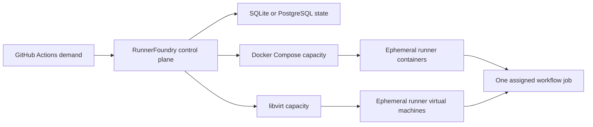

# RunnerFoundry: shared control plane for self-hosted ephemeral CI runners

> Shape infrastructure into runner capacity.
>
> Shared control plane for self-hosted ephemeral CI runners.
>
> Pool runner capacity across repositories and hosts.

RunnerFoundry turns infrastructure into one elastic pool of self-hosted ephemeral CI runners across repositories and hosts. It coordinates runner demand and capacity so operators can run CI runners as a shared service instead of maintaining disconnected setups. Today, RunnerFoundry supports GitHub Actions, including shared capacity for personal-account repositories, and provisions runners through Docker Compose or libvirt.

RunnerFoundry operates in standalone mode with SQLite or clustered mode with PostgreSQL. Both modes retain repository authority, confirmed scale-set registrations, and demand in their state backend. A standalone service provides the shortest path to a shared runner pool. A cluster combines compatible capacity from multiple hosts and retains repository control, demand, and assignments through leader failover.

> Project status: Active development. Releases are pre-1.0, and the project does not publish a supported-version policy. GitHub Actions is the only supported forge integration.

[Quick start](#quick-start) | [Installation](#installation) | [Usage](#usage) | [Deployment choices](#choose-a-deployment) | [Configuration](#configure-runnerfoundry) | [Operations](#operate-runnerfoundry) | [Documentation](#documentation) | [Releases](https://github.com/meza/RunnerFoundry/releases) | [Support](#support) | [Contributing](CONTRIBUTING.md) | [MIT license](LICENSE)

## Why RunnerFoundry exists

Self-hosted runners are often deployed one repository at a time. That approach leaves each repository with separate capacity, lifecycle rules, and operational failure modes. It is especially limiting for repositories under a personal GitHub account, where GitHub does not provide an account-level self-hosted runner pool.

RunnerFoundry creates one operational boundary for runner capacity:

1. **Operate runners as a shared service.** One configured runner pool serves every repository exposed through the GitHub App installation.
2. **Make capacity elastic.** RunnerFoundry provisions short-lived capacity when GitHub Actions reports demand, up to explicit operator limits.
3. **Keep runners ephemeral.** Docker containers and libvirt virtual machines execute transient work and leave the pool when their assigned job ends.
4. **Keep operators in control.** Infrastructure, images, networking, credentials, isolation, and cost limits remain under operator control.
5. **Coordinate reliably.** Durable demand, FIFO admission, explicit assignment states, and leader failover make scheduling and recovery deliberate.
6. **Adapt without changing the promise.** Operators can start with one host and SQLite, then move to PostgreSQL and multiple hosts while continuing to run capacity as one service.

RunnerFoundry is a control plane between GitHub Actions demand and operator-managed execution infrastructure. It is not a hosted runner service, a general-purpose job platform, or a replacement for the GitHub Actions workflow engine. Its product name does not imply support for every forge or execution substrate.

## Quick start

This path creates a standalone Docker Compose runner pool on a Debian or Ubuntu AMD64 host. It uses the packaged systemd service and SQLite state.

### Before you start

You need:

- a Debian or Ubuntu AMD64 host with Docker Engine and Docker Compose;
- permission to create a GitHub App and install it on the repositories RunnerFoundry should serve;
- outbound HTTPS access from the host and runner containers to GitHub Actions;
- a RunnerFoundry Debian package from [GitHub Releases](https://github.com/meza/RunnerFoundry/releases).

Self-hosted runners execute repository workflow code on your infrastructure. Review GitHub's [secure use guidance for self-hosted runners](https://docs.github.com/en/actions/reference/security/secure-use#hardening-for-self-hosted-runners) before exposing a runner pool to untrusted workflows or public pull requests.

### 1. Install the service

Download the current AMD64 Debian package from the release page and save it as `runnerfoundry.deb`, then install it:

```sh
sudo apt install ./runnerfoundry.deb
```

The package creates the `runnerfoundry` service account, installs the executable and systemd unit, and creates the default configuration and state directories. When the `docker` or `libvirt` group exists, installation also adds the service account to that group. A provider installed later requires a subsequent package configure or upgrade before that membership is applied. The package does not start the service before you supply valid configuration and credentials.

### 2. Create the GitHub App

Create a GitHub App owned by the personal account or organization that will install it by following GitHub's [GitHub App registration instructions](https://docs.github.com/en/apps/creating-github-apps/registering-a-github-app/registering-a-github-app). Configure the repository permission [**Administration: Read and write**](https://docs.github.com/en/rest/actions/self-hosted-runners#create-a-registration-token-for-a-repository). RunnerFoundry uses that permission to create registration tokens and manage repository runner scale sets.

Generate a private key for the App. Install the App on either all repositories or a selected set. That installation selection is the repository opt-in boundary: RunnerFoundry discovers only repositories exposed to an App installation.

Record the numeric App ID, then place the downloaded private key on the host:

```sh
sudo install -m 0640 -o root -g runnerfoundry \
  github-app.pem /etc/runnerfoundry/github-app.pem
```

Do not put the private key in YAML. RunnerFoundry rejects plaintext App keys and personal access token configuration.

### 3. Prepare the Docker runner

Save this Compose file as `/etc/runnerfoundry/compose.yaml`:

```yaml
services:
  runner:
    image: ghcr.io/actions/actions-runner:latest
    user: runner
    working_dir: /home/runner
    command: ["/home/runner/run.sh"]
```

The mutable `latest` tag keeps this evaluation path short. For production, pin a reviewed runner image tag or digest and update it deliberately after testing.

The Compose service is the runner template. Add the images, tools, environment files, volumes, networks, and other Docker settings required by your workflows. Do not set runner matching labels in the Compose environment.

### 4. Configure a standalone runner pool

Replace `/etc/runnerfoundry/config.yaml` with the following configuration. Set `app_id` to the App ID recorded earlier.

```yaml
github:
  app:
    app_id: 123456
    private_key_file: /etc/runnerfoundry/github-app.pem
  discovery_interval: 5m

log:
  format: text
  level: info

state:
  path: /var/lib/runnerfoundry/state.db

prune: false

scale_sets:
  - name: linux-docker
    runner_group: default
    max_runners: 2
    docker:
      compose_file: /etc/runnerfoundry/compose.yaml
      service: runner
```

Protect the configuration and verify that the service account can read both files:

```sh
sudo chown root:runnerfoundry /etc/runnerfoundry/config.yaml
sudo chmod 0640 /etc/runnerfoundry/config.yaml
sudo -u runnerfoundry test -r /etc/runnerfoundry/config.yaml
sudo -u runnerfoundry test -r /etc/runnerfoundry/github-app.pem
```

### 5. Start RunnerFoundry

```sh
sudo systemctl enable --now runnerfoundry
sudo systemctl status runnerfoundry
sudo journalctl -u runnerfoundry -f
```

RunnerFoundry validates the configuration, credentials, SQLite state, and Docker Compose service before reporting ready. Repository control then reconnects sessions from any durable catalog while fresh discovery runs independently. Each repository begins polling only after every configured runner scale set is confirmed and its complete session group is ready.

### 6. Send a workflow to the pool

Use the configured scale-set name in `runs-on`:

```yaml
jobs:
  verify:
    runs-on: linux-docker
    steps:
      - uses: actions/checkout@v7
      - run: uname -a
```

The expected result is one ephemeral container for the queued job. The container receives a just-in-time (JIT) runner configuration, executes the workflow, exits after the job, and is removed by Docker. RunnerFoundry never writes that JIT value to SQLite.

You can stop here if one Docker host provides enough capacity. Continue with the deployment and configuration sections for libvirt, multiple hosts, PostgreSQL, reload behavior, and recovery boundaries.

## Installation

### Debian package

The AMD64 Debian package installs:

- `/usr/bin/runnerfoundry`;
- `/lib/systemd/system/runnerfoundry.service`;
- `/etc/runnerfoundry/config.yaml`;
- `/var/lib/runnerfoundry` for packaged SQLite state;
- software notices and a software bill of materials under `/usr/share/doc/runnerfoundry`.

Package upgrades, reinstalls, and `apt remove` preserve `/var/lib/runnerfoundry/state.db`. `apt purge runnerfoundry` removes the package-managed database and its sidecar files. A custom `state.path` remains operator-owned and is not removed by purge.

### Source-built executable

Source builds can install the executable on another host. Put the executable on the system service path and create a dedicated service account with access to the selected execution infrastructure:

```sh
sudo install -m 0755 runnerfoundry /usr/local/bin/runnerfoundry
sudo useradd --system --home /nonexistent --shell /usr/sbin/nologin runnerfoundry
sudo install -d -m 0750 -o root -g runnerfoundry /etc/runnerfoundry
sudo install -d -m 0750 -o runnerfoundry -g runnerfoundry /var/lib/runnerfoundry
```

Use the packaged unit as the service definition, adjusting `ExecStart` to `/usr/local/bin/runnerfoundry`. The daemon requires `--config <path>` and has no required working directory. Use absolute production paths for state databases, Compose files, and libvirt domain templates.

## Usage

RunnerFoundry discovers every repository exposed through every installation of its GitHub App. Each configured scale-set definition is created in each discovered repository. Workflows select a pool by using `scale_sets[].name` as the `runs-on` value.

The GitHub App installation controls which repositories participate. To add a repository, expose it to the App installation. To withdraw one, remove its installation access after considering the interruption behavior described under [repository access changes](#repository-access-changes).

### How capacity is shared

In standalone mode, `max_runners` is one shared limit for a scale-set definition across every discovered installation and repository. A value of `2` means that at most two runners visible through the configured infrastructure provider may be active, regardless of which repositories requested them.

In clustered mode, `max_runners` is a per-host contribution. Compatible live hosts that declare the same scale-set name contribute to one effective pool. For example, a host contributing `4` runners and another contributing `2` runners provide an effective capacity of `6`, while each host remains bounded by its own configured maximum.

For libvirt pools, a runner whose cleanup is still pending continues to consume capacity. RunnerFoundry also fences that request identity until libvirt confirms that the exact owned domain is absent.

Jobs enter one durable FIFO admission queue per configured runner pool, ordered by GitHub queue time and then by durable observation order across repositories and hosts. The queue contains both identified `JobAvailable` requests and identity-free capacity obligations derived from assigned-job statistics. RunnerFoundry gives capacity to the oldest obligation that is due and runnable; an entry waiting for its retry time does not block later runnable work. GitHub selects the exact job for aggregate assigned capacity.

A positive request ID is optional in this queue because GitHub's aggregate `TotalAssignedJobs` statistic is a count, not a list of requests. Identified obligations retain their positive request ID and use GitHub request acquisition. Aggregate obligations retain their assigned observation and controller epoch, never invent a request ID, and use lifecycle request ID `0` only after assignment reaches provider execution. Durable attempt and next-attempt state preserve retry eligibility through restart or leader failover.

## Compatibility and supported versions

RunnerFoundry publishes pre-1.0 releases. The project does not currently publish a supported-version window. Review [GitHub Releases](https://github.com/meza/RunnerFoundry/releases) for current packages and release notes before upgrading.

| Area | Current support | Boundary |
| --- | --- | --- |
| Forge integration | GitHub Actions | No other forge integration is implemented. |
| Repository scope | Repositories exposed through GitHub App installations | Includes selected repositories under personal accounts and organizations. |
| Container infrastructure provider | Docker Compose | Requires a reachable Docker Engine and a valid Compose service. |
| Virtual-machine infrastructure provider | libvirt with QEMU/KVM | Requires `virsh`; unavailable on Windows hosts. |
| Standalone mode | One RunnerFoundry process with SQLite | Only one process may open a SQLite state database. |
| Clustered mode | Multiple RunnerFoundry processes with PostgreSQL | Requires session-affine PostgreSQL connections for migrations and leadership. |
| Packaged host | Debian or Ubuntu on AMD64 | Other hosts require a source-built executable. |
| Runner guest | Any GitHub Actions runner operating system supported by the chosen infrastructure | The image must implement the JIT handoff and one-job lifecycle. |

The control-plane flow is the same in both deployment modes:



## Choose a deployment

### Standalone mode

Use standalone mode when one RunnerFoundry process and one infrastructure host provide enough capacity. SQLite retains the last conclusive repository catalog, confirmed scale-set registrations, unified capacity obligations, FIFO and retry order, assigned observations, and runner lifecycle state. Put `state.path` on durable local storage so a replacement service can reconnect repository sessions and resume queued work. Stop the service before copying, backing up, or moving the database.

Standalone mode is the simplest operating shape, but it has no control-plane failover. Only one process may open a given SQLite database.

### Clustered mode

Use clustered mode when capacity spans multiple hosts or the control plane needs leader failover. Every node publishes local capacity to PostgreSQL and contends for leadership. One active leader owns GitHub-facing discovery and scale-set sessions. Every live host can execute assignments directed to its operating-system hostname.

PostgreSQL retains the last conclusive repository catalog, confirmed scale-set registrations, global capacity obligations and their retry state, assigned-job observations, host contributions, and assignment state. A replacement leader can reconnect GitHub-facing sessions from that catalog while fresh discovery runs independently. PostgreSQL availability is required for shared scheduling and leadership.

### Docker Compose or libvirt

Both providers run the same one-job JIT runner contract. They differ in the execution environment the operator supplies:

| | Docker Compose | libvirt |
| --- | --- | --- |
| Execution environment | A container created from an operator-defined Compose service. | A complete virtual machine created from an operator-defined domain XML and prepared guest image. |
| JIT handoff | Environment variable injected into the container. | SMBIOS type 11 OEM string injected into the transient domain. |
| Operator responsibility | Container image, command, user, tools, volumes, networks, and container security policy. | Guest image, domain XML, firmware, tools, networking, storage, guest cleanup, and shutdown. |
| Choose it when | A Linux container supplies the required toolchain and isolation boundary. | The workflow requires a complete VM, another guest operating system, or a VM-specific isolation boundary. |

Docker and libvirt execute the operator's definitions. RunnerFoundry supplies JIT configuration, ownership identity, capacity accounting, and lifecycle orchestration; it does not build either execution environment.

## Configure RunnerFoundry

RunnerFoundry reads one strict YAML document. Unknown fields and unsafe combinations fail validation. The service reads the configuration at startup and on an explicit reload; it does not watch the file.

### Complete standalone example

```yaml
github:
  app:
    app_id: 123456
    private_key_file: /etc/runnerfoundry/github-app.pem
  discovery_interval: 5m

log:
  format: json
  level: info

state:
  path: /var/lib/runnerfoundry/state.db

prune: false

scale_sets:
  - name: linux-docker
    runner_group: default
    max_runners: 4
    job_start_timeout: 10m
    docker:
      compose_file: /etc/runnerfoundry/linux-runner.yaml
      service: runner

  - name: linux-vm
    runner_group: default
    max_runners: 2
    job_start_timeout: 10m
    libvirt:
      connection_uri: qemu:///system
      domain_xml_template: /etc/runnerfoundry/domain.xml
```

### GitHub App settings

| Setting | Required and default | Purpose and constraints |
| --- | --- | --- |
| `github.app.app_id` | Required; positive integer | Numeric ID of the GitHub App. |
| `github.app.private_key_file` | Required | Path to the App private key. The file is read at startup and reload. |
| `github.discovery_interval` | Optional; default `5m`, minimum `1m` | Interval for installation, repository, and scale-set reconciliation. Uses Go duration syntax. |

The App requires repository **Administration: Read and write** permission. Install it on all repositories or a selected set. RunnerFoundry does not accept `github.app.private_key`, legacy token fields, or plaintext credentials in the configuration.

The private key remains in process memory after it is read. It is not written to SQLite or PostgreSQL. Replacing the key file affects a subsequent start or successful reload.

### Logging settings

| Setting | Required and default | Purpose and constraints |
| --- | --- | --- |
| `log.format` | Optional; default `text` | Accepts `text` or `json`. |
| `log.level` | Optional; default `info` | Accepts `debug`, `info`, `warn`, or `error`. |
| `log.file` | Optional; omitted by default | When present, sends normal daemon logs only to the configured rotating file instead of standard output and journald. |
| `log.file.path` | Required with `log.file` | Absolute path to the active log file. One RunnerFoundry process may use a given path. |
| `log.file.max_size_mb` | Optional; default `100` | Positive active-file size limit in MiB before rotation. |
| `log.file.max_backups` | Optional; default `5` | Positive number of rotated files to retain. |

`info` records lifecycle milestones. `debug` adds repository discovery, polling, scheduling, recovery, migration, reload, infrastructure-provider, and cleanup actions. Logs may contain non-secret repository, scale-set, node, request, assignment, operation, and PostgreSQL SQLSTATE values.

RunnerFoundry deliberately excludes App keys, PostgreSQL credentials, JIT values, generated connection strings, secret-reference paths, SQL bodies, and raw PostgreSQL connection errors from logs.

Omitting `log.file` preserves standard-output logging, which the packaged systemd service collects in journald. To select file-only daemon logging, configure the file block:

```yaml
log:
  format: json
  level: info
  file:
    path: /var/log/runnerfoundry/runnerfoundry.log
    max_size_mb: 100
    max_backups: 5
```

RunnerFoundry creates missing parent directories with mode `0750` and creates the active file with mode `0600`. Existing directory permissions and ownership are preserved. The active file rotates at the configured size and retains the configured number of backups. Rotation does not compress files and does not remove them by age. Do not configure multiple RunnerFoundry processes to write to the same path.

The packaged systemd service provisions `/var/log/runnerfoundry` with mode `0750` and ownership matching the `runnerfoundry` service account before every start. The example path therefore requires no separate directory setup.

For a custom path or a non-systemd deployment, the daemon can create the parent only when its service identity can write to an existing ancestor. If it cannot, provision the directory with appropriate ownership before starting RunnerFoundry, for example:

```sh
sudo install -d -m 0750 -o runnerfoundry -g runnerfoundry /var/log/runnerfoundry
```

A successful reload atomically applies destination, format, level, and rotation changes. If the replacement directory or file cannot be prepared, the existing logger remains active. Startup and reload return a clear error when directory creation fails; they do not change existing directory permissions or ownership. A failure while closing the replaced destination fails the reload so the service manager can restart RunnerFoundry and release resources. Bootstrap failures, file-open and rotation-maintenance failures, and terminal lifecycle failures still appear on standard error and may therefore remain visible in journald even when normal daemon logs use a file.

### State settings

Exactly one state backend is required.

| Setting | Required and default | Purpose and constraints |
| --- | --- | --- |
| `state.path` | Required in standalone mode | SQLite database path. Use an absolute path in production. Only one process may open it. |
| `state.postgres` | Required in clustered mode | PostgreSQL connection and stable-role settings. Cannot be combined with `state.path`. |

Changing state backends or any `state.postgres` configuration requires a restart. A clustered reload rejects those changes.

### Scale-set settings

At least one scale set is required. Names must be unique in one configuration.

| Setting | Required and default | Purpose and constraints |
| --- | --- | --- |
| `scale_sets[].name` | Required | GitHub runner scale-set name and the value workflows use in `runs-on`. |
| `scale_sets[].runner_group` | Optional; default `default` | GitHub runner group for the scale set. |
| `scale_sets[].max_runners` | Required; positive integer | Standalone shared limit or clustered per-host contribution. Omit a scale set instead of setting zero. |
| `scale_sets[].job_start_timeout` | Optional; default `10m`; strictly positive Go duration | Maximum time a confirmed provider runner may wait for `JobStarted`. It cannot be disabled. Reloaded values apply to existing waiting runners from their persisted start time. |
| `scale_sets[].docker` | Exactly one infrastructure provider required | Docker Compose settings for the local host. |
| `scale_sets[].libvirt` | Exactly one infrastructure provider required | libvirt settings for the local host. |

The `default` runner group requires no separate setup. Before using another `runner_group`, create that group in the GitHub organization or enterprise account that owns the repositories and allow the intended repositories to use it.

Each scale set must configure exactly one of `docker` and `libvirt`.

### Docker Compose settings

| Setting | Required and default | Purpose and constraints |
| --- | --- | --- |
| `scale_sets[].docker.compose_file` | Required | Path to a valid Compose file. Use an absolute production path. |
| `scale_sets[].docker.service` | Required | Service name used as the runner template. |

RunnerFoundry validates the service with `docker compose config --services`. For each admitted runner it starts the service in detached, auto-remove mode, supplies a stable container name and ownership labels, and injects `ACTIONS_RUNNER_INPUT_JITCONFIG`.

### libvirt settings

| Setting | Required and default | Purpose and constraints |
| --- | --- | --- |
| `scale_sets[].libvirt.connection_uri` | Required | URI passed to `virsh`, such as `qemu:///system`. |
| `scale_sets[].libvirt.domain_xml_template` | Required | Path to operator-owned libvirt domain XML. Use an absolute production path. |

RunnerFoundry parses the template, replaces the domain name, adds ownership metadata, enables SMBIOS system information, injects one `runnerfoundry.jit=` OEM string, and sends the rendered XML to `virsh create /dev/stdin`. The rendered XML and JIT value remain in memory.

### Pruning

`prune` is optional and defaults to `false`.

Set `prune: true` only when RunnerFoundry owns every runner scale set in the discovered repositories and runner groups. Pruning deletes GitHub runner scale sets that are absent from the current configuration, but only within repository authority established by a conclusive discovery result. A failed installation listing retains that installation's durable repositories and registrations instead of triggering broad pruning. Leave pruning disabled when another controller or a human-managed scale set shares those repositories.

## Deploy clustered mode

Every cluster node uses PostgreSQL state and contributes its local infrastructure capacity. Nodes may declare the same or different scale sets.

### 1. Prepare PostgreSQL ownership

Create a stable, non-login role for RunnerFoundry. Limit it to the RunnerFoundry database or schema and its objects:

```sql
CREATE ROLE runnerfoundry
  NOLOGIN
  NOSUPERUSER
  NOCREATEDB
  NOCREATEROLE
  NOREPLICATION;

CREATE DATABASE runnerfoundry OWNER runnerfoundry;
```

Create or provision the login identity separately, then grant it membership in the stable role. This direct SQL example is suitable for an initial deployment; replace the sample password with a generated secret and keep it out of source control and shell history:

```sql
CREATE ROLE runnerfoundry_login
  LOGIN
  NOSUPERUSER
  NOCREATEDB
  NOCREATEROLE
  NOREPLICATION
  PASSWORD 'replace-with-generated-secret';

GRANT runnerfoundry TO runnerfoundry_login;
```

RunnerFoundry assumes the stable role on every session. Database objects and migration metadata remain owned by that role even when login credentials rotate. RunnerFoundry does not create roles, databases, memberships, grants, or role attributes.

### 2. Configure PostgreSQL state

Use structured connection settings:

```yaml
state:
  postgres:
    role: runnerfoundry
    host: postgresql.example.net
    port: "5432"
    name: runnerfoundry
    user: file:///run/secrets/runnerfoundry-postgres-user
    password: file:///run/secrets/runnerfoundry-postgres-password
    direct:
      host: postgresql-direct.example.net
      port: "5432"
```

The supported PostgreSQL fields are:

| Setting | Required and default | Purpose and constraints |
| --- | --- | --- |
| `state.postgres.role` | Required | Stable role assumed by every session. |
| `state.postgres.dsn` | Optional | PostgreSQL connection string. Cannot be combined with primary structured fields. |
| `state.postgres.host` | Optional | Primary host. Omission uses PostgreSQL or pgx defaults. |
| `state.postgres.port` | Optional | Primary port. Omission uses PostgreSQL or pgx defaults. |
| `state.postgres.name` | Optional | Database name. Omission uses PostgreSQL or pgx defaults. |
| `state.postgres.user` | Optional | Login user. Omission uses PostgreSQL or pgx defaults. |
| `state.postgres.password` | Optional | Login password. Omission uses PostgreSQL or pgx defaults. |
| `state.postgres.direct` | Optional | Session-affine endpoint for migrations and advisory locks. |
| `state.postgres.direct.dsn` | Optional | Complete direct endpoint DSN. Required when the primary uses `dsn` and the direct endpoint differs. |
| `state.postgres.direct.host` | Optional | Direct host override; omitted structured fields inherit primary structured values. |
| `state.postgres.direct.port` | Optional | Direct port override. |
| `state.postgres.direct.name` | Optional | Direct database override. |
| `state.postgres.direct.user` | Optional | Direct login-user override. |
| `state.postgres.direct.password` | Optional | Direct password override. |

Every non-empty PostgreSQL value may be a literal, an `env://VARIABLE` reference, or a `file:///absolute/path` reference. A `file://` reference must contain an absolute path valid for the host operating system. File contents are trimmed. Missing, unreadable, malformed, and empty references fail without a fallback.

Create the example password file from the same generated password assigned to `runnerfoundry_login`, and make it readable only by root and the service group:

```sh
sudo install -d -m 0750 -o root -g runnerfoundry /run/secrets
sudo install -m 0640 -o root -g runnerfoundry \
  /secure/path/runnerfoundry-postgres-password \
  /run/secrets/runnerfoundry-postgres-password
sudo -u runnerfoundry test -r /run/secrets/runnerfoundry-postgres-password
```

Replace `/secure/path/runnerfoundry-postgres-password` with the output path from the operator's secret-management process. Because `/run` is normally ephemeral, recreate the file before RunnerFoundry starts after a host reboot.

References are resolved immediately before opening each new connection and are not cached. Existing connections are not recycled when a referenced file changes. In particular, an active leader retains its connection until PostgreSQL or RunnerFoundry closes it.

A primary or direct DSN cannot be mixed with structured fields for the same endpoint. When all primary connection values come from standard PostgreSQL environment settings such as `PGHOST`, `PGPORT`, `PGDATABASE`, `PGUSER`, and `PGPASSWORD`, `state.postgres` may contain only the required `role`.

Ordinary state calls use the primary endpoint. Migrations and leadership advisory locks use `direct` when configured. Without a direct endpoint, the primary endpoint must be PostgreSQL itself or a session-mode pooler. Transaction-mode pooling is suitable only for ordinary primary traffic when a session-affine direct endpoint is configured.

Clustered RunnerFoundry does not make PostgreSQL highly available. Operate PostgreSQL, backups, transport security, replication, and failover as separate database responsibilities. RunnerFoundry requires the configured primary and direct endpoints to preserve their documented connection semantics after a database failover.

### 3. Configure every host

Each node uses its operating-system hostname as its cluster identity. The identity is not configurable. Use stable, unique hostnames.

Nodes sharing a scale-set name must agree on the current compatibility key, `runner_group`. Their infrastructure-provider settings and `max_runners` remain local. A host can also declare scale sets absent from the active leader's local configuration.

For example, this complete configuration lets host `runner-host-a` contribute four Docker runners. The password file contains only the login password, with no trailing configuration syntax:

```yaml
github:
  app:
    app_id: 123456
    private_key_file: /etc/runnerfoundry/github-app.pem
  discovery_interval: 5m

log:
  format: text
  level: info

state:
  postgres:
    role: runnerfoundry
    host: postgresql.example.net
    port: "5432"
    name: runnerfoundry
    user: runnerfoundry_login
    password: file:///run/secrets/runnerfoundry-postgres-password
    direct:
      host: postgresql-direct.example.net
      port: "5432"

prune: false

scale_sets:
  - name: linux-build
    runner_group: default
    max_runners: 4
    job_start_timeout: 10m
    docker:
      compose_file: /etc/runnerfoundry/linux-build.yaml
      service: runner
```

Host `runner-host-b` uses the same `github`, `log`, `state`, and `prune` settings, and can contribute two libvirt runners to the same pool by replacing `scale_sets` with:

```yaml
scale_sets:
  - name: linux-build
    runner_group: default
    max_runners: 2
    job_start_timeout: 10m
    libvirt:
      connection_uri: qemu:///system
      domain_xml_template: /etc/runnerfoundry/linux-build.xml
```

Together they advertise capacity of six. Neither host receives more assignments than its local maximum. If any live declaration for a named scale set uses a different `runner_group`, the entire named pool contributes zero capacity. RunnerFoundry logs the conflict until all live declarations agree.

### 4. Start and verify the cluster

Startup automatically migrates an empty or outdated database before the node publishes capacity or reports ready. Concurrent nodes serialize migration and compatibility checks with a PostgreSQL advisory lock. Migration 007 unifies identified and assigned-count capacity obligations in `scaler_demand`, makes its request identity optional, and persists retry eligibility. It advances the compatibility floor and must be applied while every RunnerFoundry node is stopped. The equivalent standalone model is SQLite schema version 6 and migrates automatically under SQLite's exclusive process ownership.

```sh
sudo systemctl enable --now runnerfoundry
sudo systemctl status runnerfoundry
```

Start clustered nodes sequentially. The first node reports `leader reconciling`, then `leader operational` after it establishes repository authority and converges its repository sessions. Start the second node only after that convergence and verify that exactly one node reports `leader operational` while the other reports `standby`. An initialized durable catalog is sufficient to establish repository authority when fresh discovery fails; the leader logs that catalog as stale and remains operational. Repository registration or session failures remain isolated repair work and retry with bounded backoff. A discovery failure before the first durable catalog exists, a repository-state publication failure, or a clustered-state aggregation failure reports `leader degraded`.

### PostgreSQL migration commands

Inspect or apply migrations explicitly:

```sh
runnerfoundry migrate status --config /etc/runnerfoundry/config.yaml
runnerfoundry migrate up --config /etc/runnerfoundry/config.yaml
```

`migrate status` is read-only. An empty database reports version zero without creating migration metadata. Migration commands load only the `state.postgres` subtree, so an unrelated daemon setting does not block database inspection or recovery.

For a downgrade, use the currently deployed executable because an older release does not contain migrations introduced later. Stop every cluster node, wait at least 30 seconds for node heartbeats to expire, and run:

```sh
runnerfoundry migrate down --to <version> \
  --config /etc/runnerfoundry/config.yaml
```

Rollback refuses to run while a leader lease or live node heartbeat remains. Deploy the older executable only after the rollback succeeds.

## Prepare Docker Compose capacity

The Compose service is fully operator-owned. Put the image, user, command, environment files, volumes, networks, and workflow toolchain in that service. The [minimal Docker runner example](examples/docker-runner/README.md) is an optional starting point, not a required RunnerFoundry artifact.

For each runner, RunnerFoundry performs the equivalent of:

```text
docker compose -f <compose-file> run --detach --rm \
  --name <runner-name> \
  --label runnerfoundry.scale-set=<scale-set> \
  --label runnerfoundry.runner=<runner-name> \
  --env ACTIONS_RUNNER_INPUT_JITCONFIG=<jit-value> \
  <service>
```

The runner process must consume `ACTIONS_RUNNER_INPUT_JITCONFIG` and exit after its assigned job. Docker's `--rm` lifecycle removes the container. RunnerFoundry uses its labels to discover running containers after restart. It removes dead owned containers during reconciliation and force-removes only selected owned containers during explicit teardown.

The `runnerfoundry` service account needs access to the Docker socket. Treat that access as privileged host control and restrict service-account credentials and membership accordingly.

## Prepare libvirt and QEMU/KVM capacity

The libvirt infrastructure provider starts transient virtual machines from an operator-owned domain XML template and prepared guest image. How those artifacts are created is entirely up to the operator. RunnerFoundry does not invoke Packer, build guest images, prescribe an image pipeline, or remove operator-managed storage.

### Prepare the host

The host needs:

- QEMU/KVM acceleration;
- libvirt and `virsh`;
- a network that gives the guest outbound HTTPS access to GitHub Actions;
- a prepared base disk image;
- a domain XML template readable by the `runnerfoundry` service account;
- service-account permission for the configured libvirt connection URI.

For a system libvirt connection, verify the package-applied group access:

```sh
sudo -u runnerfoundry virsh --connect qemu:///system list --all
```

Libvirt socket access can provide broad control over host virtual machines. Apply the narrowest host policy that still lets RunnerFoundry list, create, inspect, and destroy its transient domains.

### Supply a domain template

RunnerFoundry overwrites the template domain name and metadata. It also adds `<smbios mode="sysinfo"/>` and an SMBIOS type 11 OEM string containing the JIT handoff.

RunnerFoundry renders a unique domain name, ownership metadata under `urn:runnerfoundry`, and the following in-memory JIT contract:

```text
runnerfoundry.jit=<encoded-jit-configuration>
```

Before starting the domain with `virsh create`, RunnerFoundry stores a durable lifecycle record for the runner. When GitHub reports terminal `JobCompleted`, RunnerFoundry commits the cleanup request before acknowledging that message. It retains the request until an ownership-filtered libvirt inspection confirms that the exact runner domain is absent.

An active owned domain is stopped with `virsh destroy`, then inspected again. Command success alone does not complete cleanup. Listing, destruction, verification, timeout, and connection failures retain the lifecycle record for another attempt. RunnerFoundry never requests storage removal.

### Prepare the guest image

The guest image must be ready to execute one GitHub Actions job without interactive setup. Bake these responsibilities into the image:

1. Install the GitHub Actions runner files and every tool required by the intended workflows. Do not register the runner while building the image.
2. Install a boot launcher with permission to read SMBIOS type 11 OEM strings, run the GitHub Actions runner as the intended guest identity, erase transient state, and power off the guest.
3. Give the guest outbound HTTPS and DNS access required by GitHub Actions. Add Docker inside a Linux guest only when workflows use container actions or service containers.
4. At boot, find the OEM string beginning with `runnerfoundry.jit=`. Treat the remainder as sensitive JIT configuration.
5. Copy a clean runner template into a writable runtime directory. Pass the JIT value to `run.sh --jitconfig` for exactly one job.
6. Remove the runtime runner directory and work directory after the process exits or startup fails.
7. Power off after success, failure, or missing JIT data so the transient domain returns capacity.

Do not write the JIT value to logs, files, image metadata, crash output, or persistent diagnostics.

The guest image and domain XML may be produced with any image-building and infrastructure tools that satisfy this contract. The [Ubuntu](examples/libvirt-ubuntu-runner/README.md) and [Windows Server 2025](examples/libvirt-windows-runner/README.md) Packer examples are optional operator illustrations. RunnerFoundry does not invoke Packer or require either example.

### Windows guest requirements

A Windows guest implements the same contract with Windows-native mechanisms:

- read raw SMBIOS firmware data with `GetSystemFirmwareTable` using the `RSMB` firmware-table source and parse type 11 OEM strings;
- run the boot launcher as a dedicated service identity or `LocalSystem` startup task;
- copy an unconfigured runner template into a writable runtime directory;
- call `run.cmd --jitconfig <jit-value>` for one job;
- remove the runtime and work directories in a `finally` block;
- allow the one-job runner process at most six hours and terminate its process tree on timeout;
- call `Stop-Computer -Force` after success, failure, timeout, or missing JIT data, then use `shutdown.exe /s /t 0 /f` if that call fails;
- keep the JIT value out of event logs, transcripts, command echoes, files, and persistent diagnostics.

Windows Management Instrumentation does not reliably expose every type 11 OEM string. Validate the raw firmware-table reader against the QEMU-generated SMBIOS data before sealing the image.

The required `run.cmd --jitconfig` interface places the JIT value on a Windows process command line. Configure process-creation auditing and endpoint telemetry for the startup task so they do not persist its command-line arguments.

Operators who want a minimal reference can adapt the [optional Windows Server 2025 Packer example](examples/libvirt-windows-runner/README.md). The image pipeline and its artifacts remain operator-owned.

## Operate RunnerFoundry

### Readiness and status

Standalone readiness means the configuration, GitHub App credentials, SQLite state, and local infrastructure providers passed startup validation. Clustered readiness additionally means PostgreSQL migration and initial capacity publication succeeded.

Readiness does not prove that GitHub discovery or scale-set reconciliation succeeded. Clustered systemd status reports the GitHub-facing phase separately:

- `standby`: another node holds leadership;
- `leader reconciling`: the leader is rebuilding GitHub-facing sessions;
- `leader operational`: durable or freshly discovered repository authority and clustered scale-set declarations are available; discovery may be stale and individual repository repairs may still be pending;
- `leader degraded`: the leader has no usable repository authority, cannot publish repository state, or cannot aggregate clustered scale-set declarations.

Inspect both service status and logs:

```sh
sudo systemctl status runnerfoundry
sudo journalctl -u runnerfoundry -f
```

### Reload configuration

After changing the configuration or replacing the App private-key file, reload the service:

```sh
sudo systemctl reload runnerfoundry
```

Reload validates the complete replacement configuration and credentials before applying them.

In standalone mode, RunnerFoundry confirms the replacement registration set before beginning the session handover. It stops the old pollers and closes their GitHub message sessions without deleting registrations. The replacement controller persists the confirmed catalog and rebuilds process-local sessions independently without waiting for provider runners to exit or delaying reload completion. Existing containers or virtual machines continue until their jobs finish. A reload that changes the Docker or libvirt definition of a retained scale-set name briefly suspends provisioning for that scale set while polling continues to retain demand. The reload is rejected if the scale set has provider-visible runners or its current provider cannot be inspected; rejection resumes provisioning through the old durable catalog and registration set. Failures while closing an old session or deleting stale demand are reported, but do not roll repository control back after the handover has begun.

Demand for repositories or scale sets removed from the replacement configuration is deleted. Durable Docker and libvirt cleanup records remain until provider and GitHub absence are confirmed, including when their scale-set configuration is temporarily removed. A changed `job_start_timeout` is evaluated against each waiting runner's persisted start time after reload. Optional pruning runs only after replacement activation succeeds.

In clustered mode, the node atomically replaces its contribution set. Running assignments continue. An active leader immediately reconciles the changed union. When reconciliation replaces repository or message sessions, RunnerFoundry cancels every affected local poller before attempting bounded remote session close. A clustered reload cannot switch state backends or change PostgreSQL configuration.

To drain one clustered host, remove its scale-set contributions from that host's configuration and reload it. Wait for its existing assignments and local runners to finish, then stop the service for maintenance. Restore the contributions and reload or restart the host when it is ready to accept new work.

### Restart and failover behavior

RunnerFoundry commits every GitHub message's lifecycle events and statistics in one atomic SQLite or PostgreSQL transaction before acknowledging that message. Only a successful commit wakes scheduling. Duplicate delivery updates existing state instead of creating another obligation. A message from an obsolete controller epoch is rejected and terminates that poller instead of mutating current state.

Both demand sources share one FIFO ordered by queue time and durable observation ID. Scheduling selects the oldest due, runnable obligation. Provider, GitHub, or coordination failures increment the durable attempt and set its next retry time; an entry in backoff is skipped until due, so it does not hold unused capacity ahead of runnable work. This recovery boundary does not depend on a fixed worker count. A lower assigned count reaps only excess waiting identity-free runners, while busy runners remain protected.

On standalone restart, RunnerFoundry reopens SQLite and increments a controller epoch that fences late writes from the previous controller. It reconnects process-local message sessions from durable repository and registration records while fresh discovery runs independently, then schedules the retained queue. A runner visible through the local infrastructure provider with the stable request-derived name suppresses duplicate provisioning without falsely completing the demand.

Standalone runner cleanup is checked once per second and before new provisioning. If GitHub reports that a runner still has a job running, RunnerFoundry retains the durable cleanup record and retries that runner after 5, 10, 20, 40, and then at most 60 seconds. The retained lifecycle continues to consume capacity and reserve its runner name across repositories until provider and GitHub absence are confirmed. Other repositories can use remaining capacity without attempting to replace the busy registration. The owning host must regain the matching scale-set configuration and provider access, and GitHub must become reachable, before RunnerFoundry can release the retained capacity and name.

In clustered mode, repository and message sessions belong to one leadership term. PostgreSQL persists assigned-job observations under that term's controller epoch and materializes their missing capacity as `assigned_count` rows in the same `scaler_demand` queue used by `job_available`. A successor adopts retained aggregate obligations into its epoch without changing their durable demand ID, FIFO position, attempt, or next-attempt time. Positive-ID assignments move through `reserved`, `acquiring`, `ready`, `starting`, `running`, and `complete`; aggregate assignments reference both their demand row and assigned observation and begin at `ready` because there is no request to acquire. Their provider runner names derive from the durable assignment identity, while lifecycle request ID `0` records that no GitHub request identity exists. PostgreSQL separately retains provider-independent runner states through process and leader failure. Runner-name-only lifecycle messages correlate by exact name without inventing or rewriting a request ID. A replacement leader retries interrupted positive-ID acquisition only when GitHub confirms the requested identity. An unconfirmed acquisition does not become executable.

Before starting a `starting` assignment, the selected host checks for its stable runner name. It checks again after an ambiguous infrastructure-provider error. A process restart repairs local `starting` assignments before claiming new work.

Each clustered executor checks its node-owned runner cleanup before provisioning. A GitHub registration that still has a running job uses the same bounded 5-to-60-second retry schedule as standalone mode. Cleanup failures retain the PostgreSQL record and its capacity charge. If the node is unavailable or its local scale-set configuration is missing, the same operating-system hostname must return with working provider access before cleanup can be confirmed.

When a host heartbeat expires, its active assignments complete while their demand remains available for another compatible live host. This favors retained or retried demand over silent loss. GitHub acquisition, database transitions, and infrastructure startup remain separate transaction boundaries, so operators should expect visible retries during partial failure.

### Repository access changes

When a successful discovery confirms that a repository or installation is no longer exposed to the GitHub App, RunnerFoundry updates durable authority and schedules scoped removal of queued demand, active local runners, message sessions, and managed scale sets. A failed installation repository listing retains that installation's previous authority and does not trigger broad cleanup. A confirmed access change can interrupt active jobs, so drain or schedule it accordingly.

On a normal standalone shutdown, active jobs remain running while message sessions close and scale sets unregister. On leadership loss or clustered shutdown, the leader immediately cancels every leadership-term poller before attempting bounded remote session close, then stops scheduling new obligations and cancels its other bounded active calls. Active jobs remain running, and the node publishes itself unhealthy on shutdown. A clustered leader does not delete the shared scale sets when its term ends.

### Upgrade and downgrade

For a normal standalone package upgrade, review release notes, stop the service, install the new package, and start the service.

The project does not publish a mixed-version cluster compatibility policy. Migration 007 advances the schema compatibility floor for unified capacity obligations. Use a full-cluster maintenance window: back up PostgreSQL through the operator's database process, stop every RunnerFoundry node, retain a session-affine `state.postgres.direct` management endpoint, and install the new package on every node. Start one node and wait for migration 007, repository-session convergence, and `leader operational`. Then start the second node and verify that one node is `leader operational` and the other is `standby` before starting any remaining nodes. Cluster startup applies forward PostgreSQL migrations automatically, and the service resumes normal multi-node operation after the coordinated upgrade.

Before downgrading a cluster:

1. keep the currently deployed newer executable available;
2. stop every node;
3. wait at least 30 seconds for heartbeats to expire;
4. run `migrate down --to` with the newer executable;
5. install and start the older release only after rollback succeeds.

Rolling back migration 006 to version 5 additionally requires every identity-free libvirt lifecycle row to finish or be safely reaped. Rollback refuses while any retained libvirt lifecycle has request ID `0`; it never deletes those cleanup obligations.

Rolling back below migration 007 also refuses to discard unified capacity obligations that the target schema cannot represent. Drain or complete those obligations with the current executable before retrying the rollback.

SQLite backups and moves require the standalone service to be stopped.

## Troubleshooting

### Configuration is rejected

Read the first validation error from `journalctl`. Common causes are unknown YAML fields, a missing App ID or key file, a discovery interval shorter than `1m`, no scale sets, a non-positive `max_runners`, a zero, negative, malformed, or disabled `job_start_timeout`, both state backends being configured, or a scale set containing both infrastructure providers.

### The service is ready but scale sets are missing

Readiness covers local preflight, not GitHub reconciliation. Check the operational status and structured `repository_registration_audit`, `runner_scale_set_registration`, and `repository_registration_drift` actions. Verify the GitHub App's repository Administration write permission, App installation scope, selected repositories, private-key file, and discovery interval. RunnerFoundry retains successful registrations when another scale set fails, retries only the missing definitions, and activates no sessions until the repository set is complete.

If a scale set was deleted or replaced externally, the next discovery-cadence audit suspends that repository's admission, recreates the missing registration, and replaces its complete session group. An audit timeout leaves an already healthy generation active and schedules bounded repository repair without degrading established leader authority. Do not manually delete provider instances or lifecycle rows to repair registration drift.

### Jobs remain queued

Confirm that workflow `runs-on` exactly matches `scale_sets[].name`. Check that the local infrastructure provider is healthy, the configured limit has free capacity, and the runner group exists. In a cluster, confirm that live hosts sharing the scale-set name use the same `runner_group`.

If capacity appears full but no job is running, inspect structured logs for `runner_orphan_detect`, `runner_timeout`, and `runner_reap`. RunnerFoundry verifies GitHub registration when waiting capacity blocks demand, retains the exact cleanup obligation until both provider and GitHub absence are confirmed, and then schedules retained demand. A debug-level `runner_reap` event with phase `deferred` means GitHub still considers the registration busy; this is expected incomplete cleanup and does not degrade repository polling. A `completed` phase means the retained capacity and runner name were released. A `failed` phase remains an actionable provider, GitHub, or lifecycle-store error. Do not manually delete the lifecycle database row.

For clustered assigned capacity, inspect scheduling errors for the obligation source, attempt, and next-attempt time. A backed-off obligation remains durable and becomes eligible again when due; later runnable obligations can continue. Repeated failures indicate a PostgreSQL, capacity, provider, session, or leader-epoch problem rather than a need to recreate a clean message session.

### Docker capacity is unhealthy

Run the configured Compose validation as the service account:

```sh
sudo -u runnerfoundry docker compose \
  -f /etc/runnerfoundry/compose.yaml config --services
```

Confirm that the configured service appears, the Docker socket is accessible, the image can be pulled, and the runner command exits after one job.

### libvirt capacity is unhealthy

Run `virsh list` as the service account with the configured URI, then validate that the XML template and every referenced disk and network exist:

```sh
sudo -u runnerfoundry virsh --connect qemu:///system list --all
sudo -u runnerfoundry virsh domxml-validate \
  /etc/runnerfoundry/domain.xml
```

The authoritative startup validation is RunnerFoundry's parse-and-render check followed by its connection check. Inspect its error for the failing boundary.

### A VM starts but no runner connects

Use the guest console or offline disk diagnostics. Confirm that the boot launcher ran, `dmidecode --type 11` or the Windows raw firmware reader found `runnerfoundry.jit=`, the runner template exists, DNS and outbound HTTPS work, and system time is correct. Do not print the JIT value while diagnosing the guest.

The RunnerFoundry control plane does not impose a guest job timeout or watchdog. A guest image may add one; the optional Windows example enforces six hours. Set an appropriate GitHub Actions job timeout, monitor domains that outlive it, and use the configured libvirt connection to destroy a stuck transient domain after confirming that its job is no longer running. Investigate guest cleanup and shutdown before returning that image to service.

### PostgreSQL connections fail

Confirm that the login identity can connect, belongs to the stable role, and can assume it. Check file-reference ownership and permissions as the `runnerfoundry` service account. If a pooler is used, verify that migrations and advisory locks use a session-affine connection.

### PostgreSQL rollback is refused

A leader lease, live node heartbeat, or Docker cleanup obligation that the older schema cannot represent still exists. Stop all nodes, wait at least 30 seconds, run `migrate status`, and inspect `runner_reap` failures. Retry with the currently deployed executable only after durable cleanup completes.

### Repository repairs remain pending

Inspect structured `repository_repair` events for the affected repository and attempt number. Correct App access, GitHub permissions, scale-set conflicts, or network access. Repository work is bounded and prioritized so urgent reconnect or repair is not starved by routine reconciliation. Each GitHub attempt is limited to 30 seconds. RunnerFoundry retries only pending repositories after 5, 10, 20, 40, and then 60 seconds until the complete configured registration and session group is active. A pending repository repair does not change an otherwise healthy leader from `leader operational`.

If the service reports `leader degraded`, inspect initial repository discovery, repository-state publication, and clustered scale-set aggregation errors. Those failures prevent the leader from establishing desired state and retry on the discovery interval. Once a durable catalog exists, a later discovery failure is logged as stale discovery while the leader remains operational.

## Migrating from personal access token authentication

Personal access token configuration is not supported. Replace legacy token settings with `github.app.app_id` and `github.app.private_key_file`. Remove repository lists from scale-set definitions, then install the GitHub App on the repositories RunnerFoundry should manage.

This changes capacity from a per-repository model to one shared `max_runners` limit per scale-set definition in standalone mode, or one contribution per host in clustered mode.

## Documentation

- [Architecture](docs/architecture.md) explains system boundaries, scheduling, state, leadership, recovery, and security mechanisms behind the operator behavior summarized here.
- [Architecture decisions](docs/arch/decisions.md) record why RunnerFoundry uses GitHub App installations, SQLite demand state, and PostgreSQL multi-host coordination.
- [Registration-recovery validation](docs/registration-recovery-validation.md) is the operator checklist for a later authorized deployment test.
- [Releases](https://github.com/meza/RunnerFoundry/releases) provide current packages and release notes.

## Security

Self-hosted runners execute workflow code inside operator-controlled infrastructure. Ephemerality limits runner lifetime but does not make untrusted workflow code safe. Isolate runner networks and credentials according to repository trust, and avoid exposing privileged host sockets inside runner workloads unless the workflow requires them.

RunnerFoundry reads the GitHub App key from a file and keeps it in process memory. It resolves PostgreSQL credentials when opening connections. It does not persist GitHub credentials, PostgreSQL credentials, or JIT values in SQLite or PostgreSQL.

The project does not currently publish a verified private vulnerability-reporting route or `SECURITY.md`. Do not disclose sensitive vulnerability details through public issues, pull requests, or discussions. This is a known repository-hygiene gap, not an invitation to report vulnerabilities publicly.

## Contributing

The README is for operators. Development setup, tests, review expectations, and project contribution rules live in [CONTRIBUTING.md](CONTRIBUTING.md).

## Support

Use [GitHub Issues](https://github.com/meza/RunnerFoundry/issues) for reproducible bugs and operator support questions. Include the RunnerFoundry version, host operating system, deployment mode, infrastructure provider, redacted configuration, expected behavior, observed behavior, and relevant non-secret logs.

Do not post App keys, PostgreSQL credentials, JIT values, secret-reference paths, or sensitive vulnerability details. The repository does not currently provide GitHub Discussions or a separate support policy.

## License

RunnerFoundry is open-source software available under the [MIT License](LICENSE).
