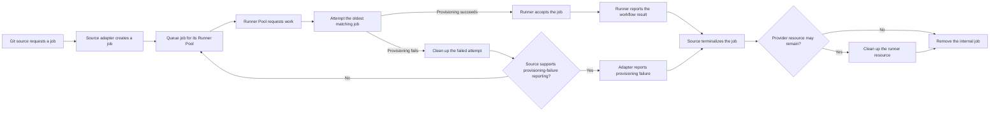

# RunnerFoundry product contract

This document is the normative product contract for RunnerFoundry. Other documentation may explain how to install, configure, operate, or contribute to the project, but it must not define a different job lifecycle.

## Purpose

RunnerFoundry accepts job demand from a supported Git source, queues that demand for the requested Runner Pool, attempts to provide a runner, ensures the outcome is reported to the source, and removes the completed internal job.

GitHub Actions is the only supported Git source today. Support for another source must be implemented behind a source adapter without changing the core contract.

Result reporting is a product outcome. The provisioned runner reports the normal workflow result directly to the Git source. RunnerFoundry reports a runner-provisioning failure only when the source exposes a supported operation for doing so. When the source does not support that operation, RunnerFoundry cleans up and retries provisioning the same job from the back of its Runner Pool queue until a runner accepts it or the source terminalizes it.

## Terms

- **Git source**: The external system that requests a job and receives its result.
- **Source adapter**: The boundary that translates source-specific requests, results, capacity, and terminology.
- **Job**: One internal unit of demand created from one source request.
- **Runner Pool**: The source-neutral capacity group requested by a job.
- **Runner**: One provisioned execution environment that attempts one job.
- **Result**: Success or failure received by the source. A provisioned runner reports its normal workflow result directly; a supported provisioning-failure operation belongs to the source adapter.

Source-specific payloads and names are not core concepts. In particular, a GitHub runner scale set is represented inside RunnerFoundry as a Runner Pool. The GitHub term remains inside the GitHub adapter and GitHub-specific operator configuration.

## Job lifecycle

The lifecycle has these rules:

1. One source request creates one internal job associated with one Runner Pool.
2. Jobs are FIFO within each Runner Pool.
3. When a Runner Pool asks for work, it receives the oldest queued job for that pool.
4. RunnerFoundry attempts to provide a runner for the job.
5. A provisioning failure is reported only when the source supports that operation. Otherwise, RunnerFoundry cleans up the failed provisioning attempt and moves the same job to the back of its Runner Pool queue.
6. Provisioning retries continue without a retry count, delay, backoff, or timeout until a runner accepts the job or the source terminalizes it.
7. Once a runner accepts the job, the runner reports the normal workflow outcome directly to the source. An execution failure after acceptance is never an internal provisioning retry.
8. A terminal source signal ends the job lifecycle. RunnerFoundry removes the internal job after cleanup reaches an accepted result. The resource must be removed, confirmed absent, or authoritatively reported by the provider as already being removed.
9. A removed job is final. RunnerFoundry does not requeue it or invent replacement demand.

## Cleanup

Cleanup is required before a failed provisioning attempt can return to the queue. RunnerFoundry accepts cleanup when the resource is removed or confirmed absent. It also accepts an authoritative provider report that removal of that exact resource is already in progress. RunnerFoundry then moves the same job to the queue tail. Cleanup failure retains the current processing ownership for another cleanup attempt.

An authoritative report means the provider has accepted removal of the exact resource and owns completing it. RunnerFoundry ends its cleanup ownership and does not retry that removal.

After runner acceptance, cleanup never returns the job to the queue. A terminal source signal removes queued demand immediately. RunnerFoundry retains processing ownership until cleanup reaches an accepted result.

## Runner Pool capacity

Publishing capacity is separate from processing jobs:

1. The runner service registers or updates Runner Pool capacity.
2. The source adapter publishes that capacity using the source's model.
3. The source can then request jobs for that capacity.
4. Heartbeats, capacity updates, and deregistration maintain availability without changing queued-job ordering or outcomes.

For GitHub, the adapter publishes Runner Pool capacity as GitHub runner scale sets. This mapping is owned entirely by the GitHub adapter.

## Deployment modes

Deployment mode is determined by the number of RunnerFoundry members, not solely by the database:

- **Standalone**: One RunnerFoundry member using SQLite or PostgreSQL.
- **Clustered**: Multiple RunnerFoundry members sharing PostgreSQL.

SQLite is restricted to one member. PostgreSQL supports either one member or multiple members.

## Documentation authority

- This document defines product behavior and terminology.
- [Architecture](architecture.md) explains the boundaries that preserve this contract.
- The root [README](../README.md) provides operator tasks.
- [Contributing](../CONTRIBUTING.md) defines the development workflow.

When another document conflicts with this contract, this contract wins and the other document must be corrected.
