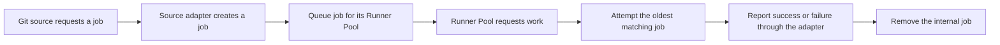

# RunnerFoundry product contract

This document is the normative product contract for RunnerFoundry. Other documentation may explain how to install, configure, operate, or contribute to the project, but it must not define a different job lifecycle.

## Purpose

RunnerFoundry accepts job demand from a supported Git source, queues that demand for the requested Runner Pool, attempts to provide a runner, reports the result to the source, and removes the completed internal job.

GitHub Actions is the only supported Git source today. Support for another source must be implemented behind a source adapter without changing the core contract.

## Terms

- **Git source**: The external system that requests a job and receives its result.
- **Source adapter**: The boundary that translates source-specific requests, results, capacity, and terminology.
- **Job**: One internal unit of demand created from one source request.
- **Runner Pool**: The source-neutral capacity group requested by a job.
- **Runner**: One provisioned execution environment that attempts one job.
- **Result**: Success or failure reported to the source through its adapter. Job failures and runner or execution failures are failures.

Source-specific payloads and names are not core concepts. In particular, a GitHub runner scale set is represented inside RunnerFoundry as a Runner Pool. The GitHub term remains inside the GitHub adapter and GitHub-specific operator configuration.

## Job lifecycle

The lifecycle has these rules:

1. One source request creates one internal job associated with one Runner Pool.
2. Jobs are FIFO within each Runner Pool.
3. When a Runner Pool asks for work, it receives the oldest queued job for that pool.
4. RunnerFoundry attempts to provide a runner and execute the job.
5. Every terminal outcome is success or failure. A runner or execution failure is a failed job outcome, not a separate queue.
6. RunnerFoundry reports the result through the source adapter before removing the internal job.
7. A removed job is final. RunnerFoundry does not requeue it or invent replacement demand.
8. Another attempt begins only when the Git source submits another job request.

## Cleanup

Cleanup applies the same terminal path to a queued job that cannot be served: report failure through the source adapter, then remove the internal job. Cleanup does not create another kind of demand or another job lifecycle.

## Runner Pool capacity

Publishing capacity is separate from processing jobs:

1. Each live member contributes its configured Runner Pool capacity.
2. Available capacity is the live configured capacity minus the number of `queued` and `attempting` jobs for that Runner Pool, clamped to zero.
3. A job stops consuming capacity when it reaches `result_pending`; result-delivery retries do not consume runner capacity.
4. The source adapter publishes available capacity using the source's model, and the source can request jobs for that capacity.
5. Heartbeats, capacity updates, and deregistration maintain availability without creating jobs or changing their ordering, ownership, or outcomes.

For GitHub, the adapter publishes Runner Pool capacity as repository-scoped GitHub runner scale sets. Every repository representation of the same Runner Pool receives the same shared availability. This lets personal GitHub accounts share RunnerFoundry capacity across repositories without requiring organization-level runners. Simultaneous requests can observe the same capacity snapshot before either request becomes a durable job; later publications reflect all durable demand. This mapping and its source consistency limit are owned entirely by the GitHub adapter.

## Deployment modes

Deployment mode is determined by the number of RunnerFoundry members, not solely by the database:

- **Standalone**: One RunnerFoundry member using SQLite or PostgreSQL.
- **Clustered**: Multiple RunnerFoundry members sharing PostgreSQL.

SQLite is restricted to one member. PostgreSQL supports either one member or multiple members.

## Documentation authority

- This document defines product behavior and terminology.
- [Architecture](architecture.md) explains the boundaries that preserve this contract.
- The root [README](../README.md) provides operator tasks.
- [Contributing](../CONTRIBUTING.md) defines the development workflow.

When another document conflicts with this contract, this contract wins and the other document must be corrected.
