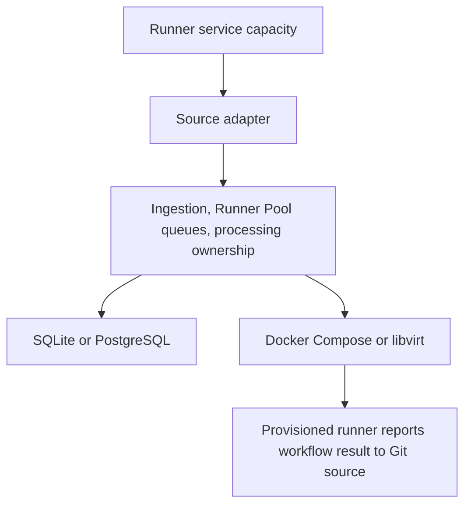

# Architecture

The [product contract](PRD.md) is the authority for RunnerFoundry behavior. This document explains the system boundaries that keep that behavior source-neutral and consistent across deployment modes.

## Components

RunnerFoundry has four core responsibilities:

1. **Ingestion** accepts a source request through an adapter and creates an internal job associated with a Runner Pool.
2. **Queueing** stores jobs by Runner Pool and returns the oldest matching job when that pool requests work.
3. **Execution** provisions one runner to attempt the selected job.
4. **Cleanup** removes the ephemeral runner and its processing record after execution ends.

The provisioned runner reports its workflow result directly to the Git source. The daemon does not observe or persist normal workflow results and has no result-delivery worker.

## Source adapter boundary

A source adapter owns everything specific to a Git hosting or CI system:

- authentication and API clients;
- inbound request payloads;
- capacity publication;
- source-specific identifiers and terminology.

The adapter translates those details into the core terms defined by the product contract. Core ingestion, queueing, execution, and persistence contracts use `Job` and `Runner Pool`; they do not expose source-specific types.

GitHub Actions is the only supported source. Its adapter maps GitHub runner scale sets and job requests to Runner Pools and internal jobs. GitHub does not expose a supported operation for reporting a provisioning failure for an individual job, so RunnerFoundry cleans up such failures without manufacturing a result. If a source later provides that operation, reporting remains specific to its adapter and must not introduce a persisted result lifecycle into the core.

## Queue boundary

The queue contains only jobs waiting to be picked up. FIFO ordering is local to each Runner Pool. A request for work selects the oldest queued job matching the requesting pool; jobs for other pools do not participate in that selection. Equal enqueue timestamps are equally eligible.

Pickup atomically removes the selected job from the queue and creates a member-owned processing record. Processing records exist only while a member owns the ephemeral runner lifecycle. They contain no workflow result or attempt-state machine.

The queue represents source demand only. RunnerFoundry does not manufacture jobs from capacity observations or create a second scheduling model.

## Execution boundary

Execution providers supply ephemeral runner environments. Docker Compose and libvirt are the current providers. Provider-specific setup and cleanup remain behind the execution boundary and do not change job ordering or workflow-result semantics.

The provisioned runner communicates its normal workflow outcome directly to the Git source. RunnerFoundry retains processing ownership until the provider resource is absent or cleanup succeeds. A provisioning failure is never requeued internally. It is reported only when the source adapter has a supported per-job operation; otherwise RunnerFoundry performs provider cleanup without synthetic reporting.

## Capacity boundary

Runner Pool registration and capacity publication are orthogonal to the job lifecycle. Members atomically renew a lease and publish their complete configured-capacity snapshot. Expired or gracefully withdrawn members contribute no capacity.

The state store calculates one shared value for each Runner Pool:

`available = max(0, live configured capacity - queued jobs - processing jobs owned by live members)`

Moving a job from the queue into processing does not change availability. Cancelling queued work or removing completed processing releases capacity. Capacity queries observe current work but cannot create, claim, reorder, move, or remove it.

For GitHub, one leader owns repository discovery and message sessions. Each repository-scoped runner scale set representing a Runner Pool receives that pool's shared availability immediately before its message request. Repository requests run concurrently, while each session has at most one request in flight. After a message arrives, other requests for that pool are cancelled and restarted with fresh availability. Independent source requests can still observe the same pre-ingestion snapshot; RunnerFoundry does not add reservations or another scheduler to hide that external consistency limit.

The GitHub representation supports repositories installed under a personal account and is not part of the core queue or execution interfaces. Leadership publishes capacity and ingests messages only; every member with a local slot independently asks the shared queue for the oldest job in its Runner Pool.

## Deployment boundary

One RunnerFoundry member is a standalone deployment. It may use SQLite or PostgreSQL. SQLite is exclusively owned by that one member.

Two or more RunnerFoundry members form a cluster and share PostgreSQL. PostgreSQL provides the shared state needed by those members; it does not change the product lifecycle.

## Dependency rule

Dependencies point inward from adapters, state backends, and execution providers toward source-neutral core contracts. Adding a Git source, database backend, or execution provider must not add another job lifecycle.
