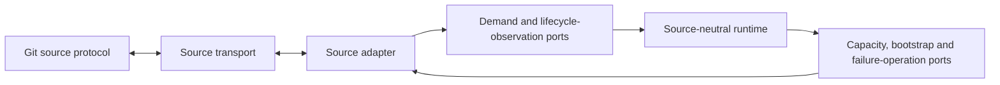
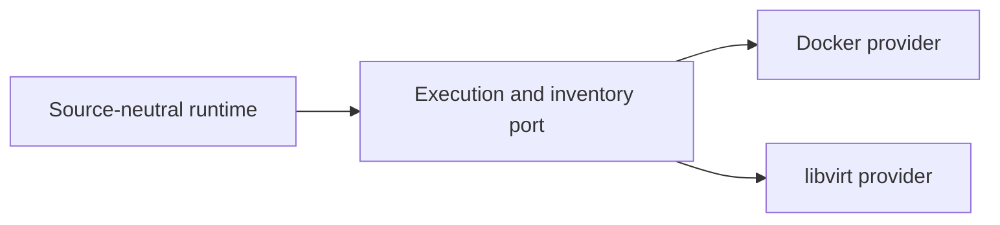
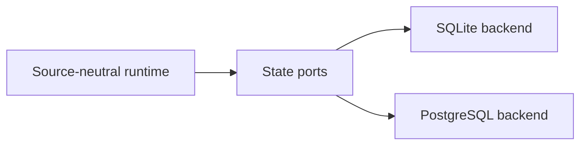

# Architecture

This document is for maintainers and contributors changing RunnerFoundry's package structure or adding integrations. It defines code ownership, architectural boundaries and allowed dependency direction.

The [product contract](PRD.md) is the authority for job lifecycle and runtime behavior. The operator [README](../README.md) owns configuration and operating procedures. Source-specific documents own source protocols. This document does not redefine those contracts.

## System responsibilities

RunnerFoundry has four core responsibilities:

1. **Ingestion** accepts source demand through an adapter and records it as a source-neutral job associated with a Runner Pool.
2. **Queueing** durably orders pending jobs by Runner Pool and claims the oldest matching job through the lifecycle defined by the product contract.
3. **Execution** provisions one ephemeral runner for claimed demand through a source-neutral provider contract.
4. **Cleanup** reconciles runner resources and processing state through the product-contract lifecycle.

The provisioned runner reports its workflow result directly to the Git source. RunnerFoundry does not introduce a persisted workflow-result lifecycle.

## Code ownership

| Area | Responsibility |
| --- | --- |
| `cmd/runnerfoundry` | CLI parsing and process entry only. |
| `internal/daemon` | Composition root, startup, reload, shutdown and runtime wiring. |
| `internal/core` | Source-neutral domain types, lifecycle contracts and source-boundary ports. |
| `internal/runtime` | Application services that implement the existing lifecycle through ports. |
| `internal/execution` | Source-neutral execution and inventory interfaces only. |
| `internal/provider/*` | Concrete Docker and libvirt implementations and provider-specific translation. |
| `internal/source/*` | A concrete Git source adapter. Each adapter owns its source policy, lifecycle translation, any source-specific sessions and auxiliary ports. |
| `internal/source/*/transport` | The source's external API and client boundary. |
| `internal/source/*/persistence/*` | Source-owned SQLite or PostgreSQL persistence adapters implementing that source's auxiliary ports. |
| `internal/state` | Source-neutral persistence interfaces. |
| `internal/state/sqlite` and `internal/state/postgres` | Source-neutral backend implementations and backend transaction mechanics. |
| `internal/cluster` | PostgreSQL connection lifecycle, leadership, migration orchestration and cluster mechanics. |
| `internal/config` | Configuration parsing and validation. |

Ownership follows responsibility rather than physical proximity. Shared code must remain source-neutral and depend on the ports of the areas it serves. Wiring that exists only to join concrete implementations belongs in `internal/daemon`.

`internal/cluster` supplies PostgreSQL connection infrastructure and runs registered migrations. Migration definitions follow data ownership: neutral backend schema belongs to its state backend, and source-specific schema belongs to the source persistence adapter. SQLite migration execution belongs to `internal/state/sqlite`; PostgreSQL migration execution belongs to `internal/cluster`. `internal/state/postgres` uses cluster infrastructure to implement source-neutral persistence queries and transactions; it does not own connection lifecycle, migration execution or leadership.

## Architectural boundaries

### Source adapters

A source adapter owns authentication, source payloads, observation validation, lifecycle translation, capacity publication, source identifiers and source-specific persistence policy. It translates source behavior into the terms and transitions in the product contract. Source-specific types do not cross into core, runtime, execution or source-neutral state contracts.

The source-neutral ports in `internal/core` cover the complete source-to-runtime lifecycle boundary: demand ingestion; runner-acceptance and terminal observations; capacity snapshots supplied for source publication; optional provisioning-failure reporting; and opaque runner bootstrap generation and cleanup. Adapter-owned auxiliary persistence and coordination ports remain at the adapter edge rather than entering core. `internal/runtime` owns the lifecycle decisions behind the core ports. A source adapter translates its protocol on one side and implements or consumes each relevant port according to that direction; the daemon wires the two sides together.

Every job carries a stable source namespace and source-owned request reference. Together they form its globally unique, replay-safe source identity. A reference may be an upstream request identifier or a deterministic adapter-derived identifier when the source exposes demand without individual request identities. In either case, the adapter must correlate the same demand to the same reference across redelivery and reconciliation without exposing source payloads through that identity.

Runner bootstrap data crosses the core boundary as an opaque artifact. The owning source adapter creates and cleans it up; the runtime passes it through the execution port; and the provider transports it without interpreting source-specific contents. The runtime obtains Runner Pool availability through neutral state ports and supplies the resulting capacity snapshot to the adapter. Adapters do not import state backends or calculate a competing capacity model.

Every Git source is a peer implementation under `internal/source/<source>`. Adapter-owned persistence interfaces are declared by that adapter. Their backend-specific implementations live at the same adapter edge, such as `internal/source/<source>/persistence/sqlite`, and may use narrow transaction facilities supplied by the selected backend. Neutral state packages do not import source adapters or duplicate adapter decision policy.

GitHub is the first source adapter, not part of the source-neutral architecture. Its [GitHub adapter](github-adapter.md) owns GitHub protocol, discovery, registration, capacity publication and cleanup behavior, including its [runner scale-set mechanics](references/github-scaleset-mechanics.md). Future source adapters neither depend on nor conform to the GitHub adapter; they conform only to RunnerFoundry's source-neutral ports and product lifecycle. Source-specific operator configuration is likewise adapter-owned and does not define the configuration shape for future sources.

### Queue and state

The queue contains source demand waiting to be claimed. Durable enqueue order and claim atomicity are state-port contracts; the runtime applies them per Runner Pool. State backends persist the existing core contracts and do not add a second scheduler or lifecycle.

Backend transaction facilities stay behind narrow interfaces. A backend exposes only capabilities required by an owning interface; it does not retain destructive or unguarded entry points that bypass that interface.

### Execution providers

Execution providers create, inspect and destroy ephemeral runner environments behind source-neutral execution and inventory ports. Docker Compose and libvirt are the current providers. Provider commands, payloads, endpoint handling and state translation remain inside their concrete packages.

The runtime owns lifecycle decisions. Providers report evidence through their ports and do not decide whether source demand is created, retried or terminal. The product contract remains authoritative for provisioning failure, runner acceptance, cleanup and retry behavior.

### Clustering and capacity

A standalone member may use SQLite or PostgreSQL. A cluster uses shared PostgreSQL for durable state, member coordination and leadership. Deployment mode does not change the job lifecycle.

Cluster mechanics coordinate members but do not own source, runtime, provider or persistence policy. Capacity is derived from live configured capacity and existing queued and processing work; it cannot create or mutate jobs. Detailed clustering and operating behavior remains in the product contract and operator documentation.

### Reload and shutdown

The daemon coordinates startup, runtime-generation replacement and shutdown. It composes source-adapter, runtime, provider, state, cluster and configuration components without taking ownership of their policy. Configuration options, including which source adapters a deployment may configure, are product and operator contracts documented outside this code-organisation boundary in the [README](../README.md).

## Responsibility flows

The diagrams in this section show runtime control and data flow. They do not show Go import direction; compile-time dependency direction is defined separately below.

Source protocols cross their adapter boundary through core-owned source ports wired by the daemon. The two directions cover source observations entering the lifecycle and runtime-owned capacity, bootstrap and supported failure operations returning to the adapter:



The runtime calls a source-neutral execution port. The daemon supplies the selected concrete provider:



The runtime calls source-neutral persistence ports. The daemon supplies the selected backend:



## Dependency rules

The daemon is the composition root and the only package area permitted to import all concrete adapters and implementations. Every other compile-time dependency points from a concrete edge toward a source-neutral or adapter-owned contract:

```text
cmd
 └─> daemon
      ├─> runtime ─> core + execution/state ports
      ├─> source/* ─> core + source-owned transport
      ├─> source/*/persistence/* ─> source-owned ports + narrow backend facilities
      ├─> provider/* ─> execution contracts
      ├─> state/* ─> core/state contracts
      └─> cluster/config
```

In this graph, `state/*` means source-neutral backend implementations. Source-specific persistence implementations remain part of their source-adapter edge and depend on adapter-owned ports plus narrow backend transaction facilities. Cluster leadership or coordination used by a source is supplied through a narrow port wired by the daemon; the adapter does not import cluster implementation packages.

These rules apply:

- `internal/core`, `internal/runtime`, `internal/execution` and source-neutral state contracts must not import any concrete Git source, Docker, libvirt, SQLite or PostgreSQL implementation.
- Concrete providers depend on execution contracts. The execution-contract package does not depend on concrete providers.
- Source-specific protocol and persistence policy belongs to its source adapter. No source adapter defines the contract that other sources must follow.
- SQLite and PostgreSQL may support adapter-specific persistence only through implementations at the adapter edge that expose adapter-owned interfaces.
- Concrete implementations expose only the capabilities required by their owning interfaces. They do not retain alternative destructive or unguarded entry points that bypass those interfaces.
- New sources, providers and state backends plug into existing ports without changing or adding another job lifecycle.

## Extension rules

### Add a Git source

- Add a peer package under `internal/source/<source>` that translates the source protocol into the existing core lifecycle.
- Implement or consume each applicable core source-boundary port according to its documented direction, including stable identity, lifecycle observations, capacity publication, bootstrap handling and supported provisioning-failure reporting.
- If the adapter owns auxiliary state, implement it for every supported state backend, define its migrations at the adapter edge and register them with the appropriate backend migration executor.
- Keep authentication, protocol payloads, source identifiers, capacity publication and source-owned persistence ports inside the adapter.
- Define and validate adapter-owned configuration and document it in the operator documentation without inheriting another source's configuration shape.
- Wire the adapter, transport and persistence implementations in the daemon.
- Do not change core lifecycle types or add source-specific types to neutral contracts.

### Add an execution provider

- Implement the existing execution and inventory ports in a concrete provider package.
- Keep provider commands, payloads, state translation and validation inside that provider.
- Wire the provider in the daemon without modifying neutral execution contracts.

### Add a state backend

- Implement the existing source-neutral state ports and their atomicity guarantees.
- Supply narrow backend transaction facilities for explicitly adapter-owned persistence implementations when required.
- Do not expand the core lifecycle or neutral state contracts to match backend-specific capabilities.

### Change daemon wiring

- Compose existing ports and implementations without moving domain, source, provider or persistence policy into the composition root.
- Preserve the operator-visible startup, reload and shutdown interface and semantics documented in the [README](../README.md).
