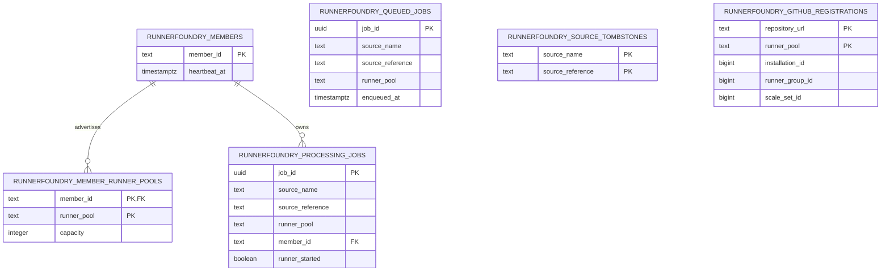
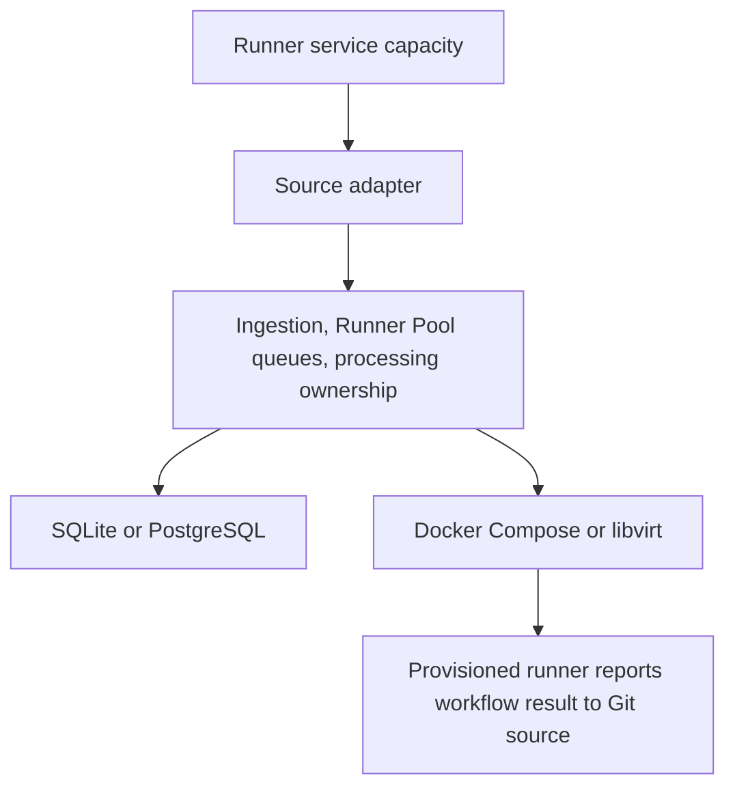

# Architecture

The [product contract](PRD.md) is the authority for RunnerFoundry behavior. This document explains the system boundaries that keep that behavior source-neutral and consistent across deployment modes.

## Components

RunnerFoundry has four core responsibilities:

1. **Ingestion** accepts a source request through an adapter and creates an internal job associated with a Runner Pool.
2. **Queueing** stores jobs by Runner Pool and returns the oldest matching job when that pool requests work.
3. **Execution** provisions one runner to attempt the selected job.
4. **Cleanup** removes the ephemeral runner and its processing record after execution ends.

The provisioned runner reports its workflow result directly to the Git source. The daemon does not observe or persist normal workflow results and has no result-delivery worker.

## Source adapter boundary

A source adapter owns everything specific to a Git hosting or CI system:

- authentication and API clients;
- inbound request payloads;
- capacity publication;
- source-specific identifiers and terminology.

The adapter translates those details into the core terms defined by the product contract. Core ingestion, queueing, execution, and persistence contracts use `Job` and `Runner Pool`; they do not expose source-specific types.

GitHub Actions is the only supported source. Its adapter maps GitHub runner scale sets and job requests to Runner Pools and internal jobs. GitHub does not expose a supported operation for reporting a provisioning failure for an individual job, so RunnerFoundry cleans up and retries the same job without manufacturing a result. If a source later provides that operation, reporting remains specific to its adapter and must not introduce a persisted result lifecycle into the core.

The GitHub adapter applies messages in their lifecycle order. `JobAvailable` acquires and enqueues demand, and `JobAssigned` provides idempotent acquisition recovery. `JobStarted` durably records that the runner accepted the job. Every `JobCompleted` message is terminal regardless of its result value. The adapter acknowledges each message only after its required state change is durable.

A delayed `JobStarted` can race with a provisioning retry. If the matching request has already returned to the queue, the adapter records a source tombstone and removes that queued retry so another runner cannot execute it. A `JobCompleted` message also records a tombstone and removes queued demand. Tombstones prevent redelivery or a concurrent retry from recreating demand.

## Queue boundary

The queue contains only jobs waiting to be picked up. FIFO ordering is local to each Runner Pool. A request for work selects the oldest queued job matching the requesting pool; jobs for other pools do not participate in that selection. Equal enqueue timestamps are equally eligible.

Pickup atomically removes the selected job from the queue and creates a member-owned processing record. The record includes the stable member hostname and a durable `runner_started` boundary. It contains no workflow result or broader attempt-state machine.

The queue represents source demand only. RunnerFoundry does not manufacture jobs from capacity observations or create a second scheduling model.

## Execution boundary

Execution providers supply ephemeral runner environments. Docker Compose and libvirt are the current providers. Launching uses the provider configured for the Runner Pool, while reconciliation uses one member-level aggregate of every provider inventory represented by the active configuration. The aggregate identifies runners by their deterministic `runnerfoundry-{job UUID}` name and carries cleanup routing only in the transient resource it returns; processing rows contain no provider identity.

Inventory is fail-closed: every represented backend must answer before RunnerFoundry treats a runner as absent. An error means the runner state is unknown and processing is retained. If an operator removes or changes an inventory endpoint, resources reachable only through the old endpoint are no longer RunnerFoundry's cleanup responsibility under `leave`; an unstarted job not visible in the active inventory can return to the queue.

The provisioned runner communicates its normal workflow outcome directly to the Git source. Before runner acceptance, RunnerFoundry owns provisioning failures. After cleanup succeeds or resource absence is confirmed, it atomically moves the same unstarted job to the back of its Runner Pool queue and removes the processing record. A tombstone or concurrent runner-start observation prevents that retry. There is no retry count, delay, backoff, or timeout.

`JobStarted` transfers outcome ownership to the runner and GitHub. Once that boundary is durable, a missing, failed, or terminated provider resource never returns the job to the queue. RunnerFoundry retains processing while it awaits `JobCompleted`, attempting cleanup when a resource may remain. A terminal message removes processing only after cleanup succeeds or absence is confirmed; cleanup failure retains processing for another cleanup attempt.

## Member ownership boundary

A member is identified by its trimmed operating-system hostname. Hostnames must be stable and unique within the cluster, and only one daemon may run for a hostname. Processing ownership is never reassigned to another hostname.

Members heartbeat to advertise liveness. The 30-second cutoff is only a capacity liveness filter: a stale member contributes no capacity, but its member row, processing records, and provider resources are not expired or removed. When the daemon restarts on the same hostname, it republishes its heartbeat, loads its processing records, inventories deterministic Docker or libvirt resources, and resumes reconciliation.

## Capacity boundary

Runner Pool registration and capacity publication are orthogonal to the job lifecycle. Members atomically renew their heartbeat and publish their complete configured-capacity snapshot. Members that have not heartbeated within 30 seconds, or that have gracefully withdrawn, contribute no capacity.

The state store calculates one shared value for each Runner Pool:

`available = max(0, live configured capacity - queued jobs - processing jobs owned by live members)`

Moving a job from the queue into processing does not change availability. Cancelling queued work or removing completed processing releases capacity. Capacity queries observe current work but cannot create, claim, reorder, move, or remove it.

For GitHub, one leader owns repository discovery and message sessions. Each repository-scoped runner scale set representing a Runner Pool receives that pool's shared availability immediately before its message request. Repository requests run concurrently, while each session has at most one request in flight. After a message arrives, other requests for that pool are cancelled and restarted with fresh availability. Independent source requests can still observe the same pre-ingestion snapshot; RunnerFoundry does not add reservations or another scheduler to hide that external consistency limit.

The GitHub representation supports repositories installed under a personal account and is not part of the core queue or execution interfaces. Leadership publishes capacity and ingests messages only; every member with a local slot independently asks the shared queue for the oldest job in its Runner Pool.

## Reload and shutdown boundary

The daemon-wide `--active-runner-policy=leave|terminate` option controls active resources during reload and graceful shutdown. It defaults to `leave` and is intentionally not part of YAML configuration, so a replacement configuration cannot choose how resources created by the previous generation are handled.

Reload validates and prepares the replacement before stopping the active generation's claims and GitHub polls. A validation or preparation failure leaves the active generation running. Runner Pools whose provider type is unchanged preserve their processing. The policy applies only to pools removed from the replacement or changed to a different provider type.

With `leave`, the replacement is applied without explicitly destroying affected runners. Reconciliation then observes the provider-agnostic inventory defined by the replacement configuration. Visible running resources are retained. An unstarted job whose resource is confirmed absent returns to the queue, while started processing waits for GitHub's terminal message. Resources made invisible by an operator-removed endpoint are left for the operator to clean up.

With `terminate`, the old provider destroys affected resources. An unstarted job returns to the queue only after cleanup succeeds; a started job remains in processing until GitHub terminalizes it. Cleanup failure retains processing, but does not prevent the otherwise-valid replacement configuration from taking effect.

On graceful shutdown, `leave` stops claims and polling, withdraws capacity, and preserves all runners and processing. `terminate` destroys owned resources, requeues successfully cleaned-up unstarted jobs, and leaves started jobs awaiting GitHub completion.

## Deployment boundary

One RunnerFoundry member is a standalone deployment. It may use SQLite or PostgreSQL. SQLite is exclusively owned by that one member.

Two or more RunnerFoundry members form a cluster and share PostgreSQL. PostgreSQL provides the shared state needed by those members; it does not change the product lifecycle.

The state relationships are:

## Dependency rule

Dependencies point inward from adapters, state backends, and execution providers toward source-neutral core contracts. Adding a Git source, database backend, or execution provider must not add another job lifecycle.
