# Architecture

`runnerfoundry` is a long-running Go application that turns GitHub Actions runner scale-set demand into ephemeral Docker containers or libvirt virtual machines. It discovers repositories through a GitHub App, creates and maintains runner scale sets for those repositories, receives GitHub's scale-set messages, admits work within configured capacity, requests just-in-time (JIT) runner configuration, and starts one provider instance for each admitted runner.

The same executable supports two runtime shapes:

- Standalone mode coordinates one provider host and keeps repository authority, confirmed scale-set registrations, unified FIFO capacity obligations, assigned observations, retry eligibility, and runner lifecycle in an exclusively owned SQLite database.
- Clustered mode combines capacity from multiple provider hosts. PostgreSQL holds repository authority, confirmed scale-set registrations, shared declarations, health, unified capacity obligations, assignments, and node-owned Docker or libvirt lifecycle obligations, while a session advisory lock selects the one host that manages GitHub-facing scale-set sessions.

Both modes preserve identifiable job demand before acknowledging the GitHub message that delivered it. Neither mode can make GitHub, the state database, and the provider participate in one transaction. Stable request-derived runner names and explicit persisted states make partial operations recoverable without claiming exactly-once execution.

## Capabilities

The application currently provides the following behavior:

- GitHub App authentication without storing the private key in either state database.
- Discovery of every installation owned by the App and every repository visible to each installation.
- Creation and deletion of repository runner scale sets and their message sessions.
- One durable FIFO per scale-set name for identified and assigned-count obligations, ordered first by GitHub queue time and then by durable observation order.
- A shared capacity limit across repositories in standalone mode.
- Per-host capacity contributions, global scheduling, and leader failover in clustered mode.
- Ephemeral runner provisioning through Docker Compose or libvirt.
- Durable recovery of identified and assigned-count capacity obligations across restart and reload.
- Durable recovery of repository identities and confirmed scale-set registrations while message sessions remain process-local.
- Durable provider-independent runner ownership with a bounded waiting lease.
- Optional removal of unmanaged GitHub runner scale sets during standalone repository discovery.
- Validated `SIGHUP` reload with mode-specific replacement behavior.
- Automatic upward PostgreSQL migration at clustered startup and explicit status, upgrade, and rollback commands, with stopped-node rollout at compatibility-floor changes.
- Text or JSON structured logging to standard output or one exclusively selected rotating file, plus systemd readiness, reload, and clustered-status notifications. File logging ensures its parent directory exists, while the packaged systemd unit provisions the standard `/var/log/runnerfoundry` path. Logging reloads prepare a replacement before atomically swapping the process-wide handler; exceptional bootstrap, destination, maintenance, and terminal failures remain visible on standard error.

## System context

The operator supplies configuration and credentials and observes the service. GitHub is the authority for installation access, repositories, runner groups, scale sets, job demand, acquisition, and runner registration. Docker Engine or libvirt owns the actual runner process environment. `runnerfoundry` coordinates these systems but does not execute workflow steps itself.

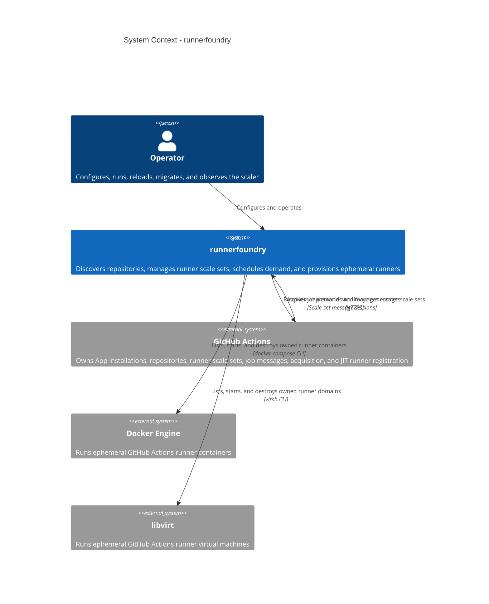

## Runtime containers

The executable is the only application process supplied by this project. It runs either the daemon command or a PostgreSQL migration command. The daemon selects exactly one state backend from configuration. SQLite belongs to one standalone process; the PostgreSQL schema is shared by every process in a cluster.

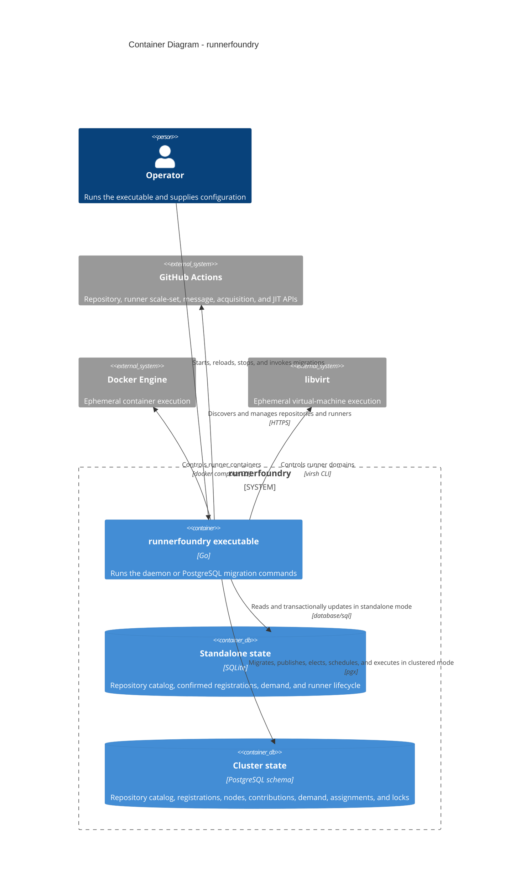

SQLite and PostgreSQL are alternatives, not replicas of one another. Changing the configured backend requires a restart. Standalone state cannot coordinate multiple processes. Cluster state is designed specifically to make every scheduling decision and recovery transition visible to all participating hosts.

## Process composition

### Command and startup path

The executable installs cancellation handlers for `SIGINT` and `SIGTERM` and coalesces `SIGHUP` into reload requests. It then dispatches either a migration subcommand or the daemon.

Daemon startup performs the following sequence:

1. Read the YAML file through a rooted filesystem handle and reject unknown fields.
2. Apply defaults and validate GitHub App, logging, state, scale-set identity, capacity, and provider settings.
3. Read and trim the GitHub App private-key file.
4. Select clustered mode when `state.postgres` exists; otherwise select standalone mode and `state.path`.
5. Compose mode-specific state, discovery, GitHub, scheduling, provider, lifecycle, logging, and notification components.
6. Complete the mode's local preflight before notifying systemd that the process is ready.

Migration commands take a narrower path. They decode and validate only `state.postgres`, so unrelated daemon configuration cannot prevent an operator from inspecting or repairing the database schema.

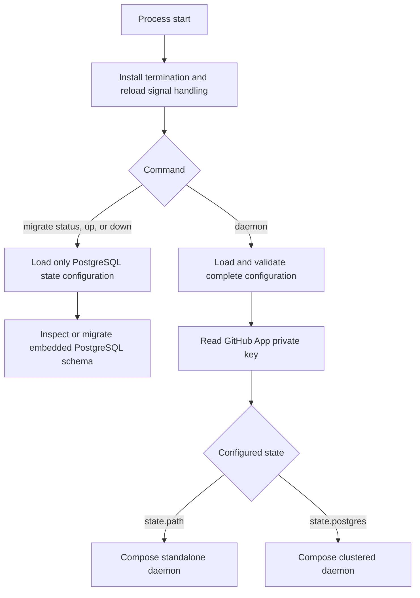

### Shared components

The daemon package is the composition root. It connects configuration and credentials to narrow interfaces implemented by discovery, scale-set, scheduler, state, JIT, and provider components.

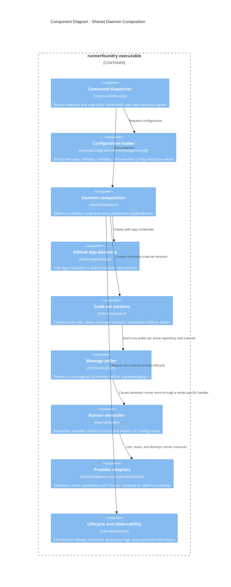

## GitHub control plane

### Repository authority and discovery

The GitHub App installation boundary decides which repositories the scaler may manage. The discovery client first lists App installations and then uses an installation-authenticated client to list repositories. Installation clients are cached by installation ID.

Failure to list installations fails the discovery pass because no new repository authority is available. Failure to list one installation's repositories is isolated and returned alongside successful repositories. Both modes retain the durable repositories and registrations for that failed installation so a transient failure does not look like access revocation. A repository missing from a successfully listed installation is removed from durable authority and receives scoped cleanup; the failure of another installation does not cause broad pruning.

SQLite and PostgreSQL persist the last initialized discovery generation, completion time, installation and repository identities, runner groups, and confirmed GitHub scale-set IDs. Each controller start increments a durable epoch. Every subsequent discovery or registration mutation must present that epoch, so work completing after reload or leader replacement is fenced from overwriting the newer controller.

Message sessions are intentionally process-local because the current GitHub scale-set client cannot adopt an existing session. Bootstrap therefore starts repository reconnect from the durable catalog while fresh discovery runs independently. Both modes audit cached registrations through the supported scale-set API, persist the registrations they confirm, and create new message sessions; stored IDs are not used to adopt old sessions. A successful discovery transaction advances the catalog generation, preserves failed installations, removes only conclusively absent authority, and feeds desired-state reconciliation. Registration and session repair remains a reconstructible in-memory queue rather than durable state.

For each desired repository, the scaler audits the complete configured registration set before it admits work. One snapshot is read per distinct runner group. Missing scale sets are created independently, so a later failure never rolls back registrations that already succeeded. Message polling and scheduling begin only after every registration and every session in the repository generation succeeds. A partial generation is closed and detached without deleting registrations, demand, runners, or lifecycle ownership.

Each active session records its confirmed GitHub scale-set ID. Discovery-cadence audits compare that ID with the current registration snapshot. A transient audit failure leaves a healthy generation serving work and schedules repository repair. Confirmed absence or ID replacement suspends the repository, repairs and persists registrations, replaces its complete session group, and resumes admission atomically. A cluster leader applies the same contract to the union declared in PostgreSQL, including scale sets that the leader cannot run locally.

### Message acknowledgement boundary

Every poller receives at most one message at a time. A message must include GitHub statistics. The handler validates and persists its durable message effects, reconciles the latest assigned observation into capacity obligations, requests scheduling, and returns success. Only then does the poller delete the GitHub message and advance its last-message ID. Provider execution remains outside this acknowledgement boundary.

If validation or durable message-effect persistence fails, the message remains unacknowledged and GitHub may redeliver it. Demand keys and state transitions are therefore idempotent at the database boundary. Acquisition, capacity inspection, or provider startup failure updates the obligation's durable attempt and next-attempt time and does not require message redelivery. A terminal `JobCompleted` message without a positive request ID is correlated by its stable runner name when available, records lifecycle cleanup, reports successful runner-name completion, and acknowledges without inventing demand identity. A completion with neither identity is warned and dropped. A failure during runner-name reconciliation remains retryable.

Pollers issue the next receive immediately after a successful empty or handled response. A failed poll waits five seconds before retrying, and the third consecutive failure adds a sustained-degradation log entry. Cancellation interrupts both an active poll and its retry wait.

Positive request identities and exact queue timestamps come from `JobAvailable` messages. These become `job_available` obligations with a present request ID. `JobStarted` requires either a positive request ID or a non-empty runner name. A runner-name-only message persists the lifecycle row matching that exact name as busy without inventing a request identity. Terminal `JobCompleted` atomically requests exact runner cleanup and removes terminal demand. In clustered mode, `JobStarted` retains demand and assignments; only `JobCompleted` makes them terminal.

GitHub's authoritative `TotalAssignedJobs` statistic represents identity-free assigned capacity. Both modes persist the observation under the current controller epoch and materialize its deficit as `assigned_count` obligations in the same queue. Those rows have no request ID and retain their assigned-observation link. The controller never turns the aggregate count into a request identity; request ID `0` appears only when provider lifecycle APIs require the explicit no-identity adapter value.

### Scale-set ownership and pruning

The scaler uses the configured scale-set name as the GitHub-facing routing identity. It creates the definition in each managed repository and opens one message session for each repository and scale-set pair.

In standalone mode, `prune: true` lists scale sets in the configured runner groups and deletes names absent from local configuration. This is safe only when the scaler is the sole owner of scale sets in those groups and repositories. Repository access removal is stronger than ordinary shutdown: the scaler removes that repository's queued demand, destroys its active local runners, closes its sessions, and attempts to delete its managed scale sets.

Clustered ownership follows declarations in PostgreSQL. Loss of a node does not withdraw its declarations. An explicit publication that omits a previous scale set withdraws it. The leader deletes a GitHub scale set only when no node declares that name.

## Standalone mode

Standalone mode has one process, one provider host, and one exclusively locked SQLite file. It is appropriate when all capacity for a scale set is available on one host and leadership failover is not required.

### Components and responsibility

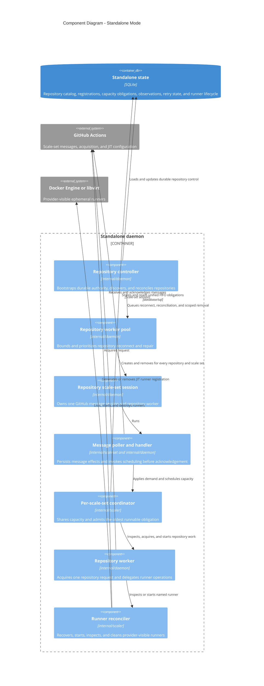

There is one coordinator for each configured scale-set name. All repository sessions for that name register a repository worker with the same coordinator. The coordinator serializes its in-memory decisions with a mutex and treats `max_runners` as one shared limit across every discovered repository.

### Durable FIFO and admission

SQLite schema version 6 contains one canonical demand table for capacity obligations. Each row identifies a scale set, repository, source, queue time, durable observation order, attempt, and next-attempt time. A `job_available` row has a positive GitHub request ID and acquisition state. An `assigned_count` row has no request ID and links to its epoch-fenced assigned observation. The positive-request unique key makes message redelivery harmless.

The database is configured for one open connection and protected by an adjacent process lock. A second daemon using the same path is rejected. Schema migration occurs when the store opens. A future schema version or a corrupt database prevents startup.

Before admitting an obligation, the coordinator asks every repository worker for its running count and checks whether the obligation's stable runner already exists. Existing named runners suppress duplicate provisioning but do not remove their queue entry; only a later GitHub started or completed message proves that work is complete.

The coordinator selects the oldest obligation that is due and runnable until shared capacity is full. Queue order is queue time followed by durable observation ID. A row whose next-attempt time is in the future or whose repository session is unavailable remains durable but is skipped, allowing later runnable work to use capacity. For a `job_available` row the coordinator:

1. Acquires the request from that repository's GitHub message session if the row is not already marked acquired.
2. Persists `acquired = true` before starting the provider instance.
3. Starts a runner whose stable name derives from the repository-qualified scale-set identity and request ID.

For an `assigned_count` row, the coordinator skips request acquisition and starts capacity from the linked assigned observation. Provider lifecycle stores request ID `0` to express the absent GitHub identity; the demand row itself keeps the request ID absent. A failed attempt persists its incremented attempt and next-attempt time. SQLite supplies exclusive single-node capacity and lifecycle operations to the same policy used by PostgreSQL.

### Standalone job sequence

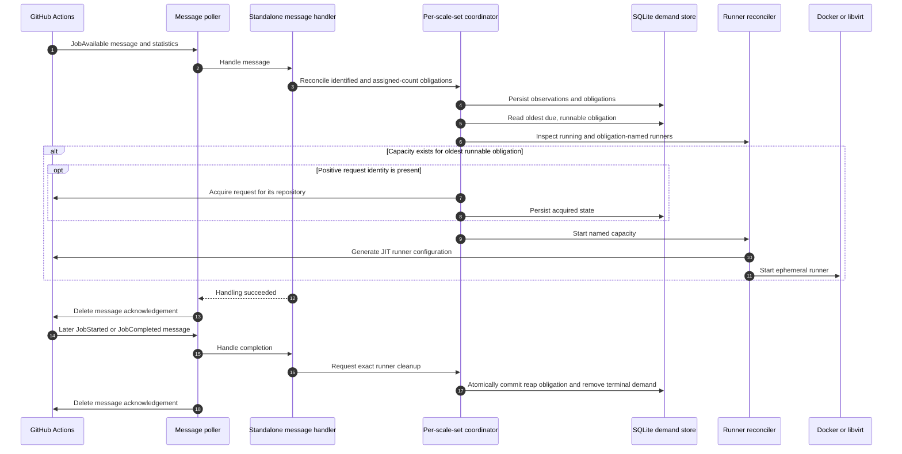

### Standalone recovery and lifecycle

On restart, the daemon reopens SQLite, increments the repository-controller epoch, and begins reconnecting sessions from the durable repository and registration catalog. Fresh discovery, desired-state calculation, and bounded repository reconciliation run independently. Repository work is prioritized so routine full-pass reconciliation cannot starve urgent reconnect or repair. Work is coalesced by repository, each GitHub attempt is bounded to 30 seconds, and failures retry after 5, 10, 20, 40, and then at most 60 seconds.

After repository sessions reconnect, the daemon schedules retained demand. Provider startup is bracketed by durable `provisioning` and `waiting_for_job` states. `JobStarted` moves the exact runner to `busy`; only waiting runners can expire. If a named runner is visible, it is not duplicated. Pre-upgrade provider instances with a GitHub registration are conservatively protected, while instances already absent from GitHub are reaped.

Each scale set applies `job_start_timeout`, defaulting to `10m`, to the persisted `waiting_since` timestamp. A reload therefore changes the lease for existing waiting runners without resetting their age. A decrease in `TotalAssignedJobs` condemns only excess identity-free waiting runners immediately; busy runners remain protected. When apparent capacity blocks demand, the coordinator verifies GitHub registration and condemns missing registrations without waiting for the lease.

Pending Docker and libvirt reaps are attempted before new provisioning and then once per second. Cleanup destroys only the exact owned provider instance, removes its exact GitHub registration, and retains `reap_pending` plus its capacity charge until both absences are confirmed. Confirmed cleanup immediately reschedules retained demand.

A reload first loads and validates the complete replacement configuration and App credentials. The SQLite path must be unchanged. It discovers replacement repositories and confirms their complete registration sets before stopping the old generation. For a retained scale-set name with a changed Docker or libvirt definition, the coordinator waits for any in-flight scheduling pass and then suspends provisioning. Pollers continue persisting demand while the old provider is inspected. The change proceeds only when inspection reports no running instances. Rejection releases the provisioning fence and schedules retained demand through the still-operational old generation.

After preflight succeeds, the daemon stops old pollers, closes old message sessions without deleting registrations, and starts a replacement controller over the same store. The replacement controller persists the preflight-confirmed catalog and registrations, then rebuilds its process-local sessions independently; reload completion does not wait for that bounded work or for provider runners to exit. Busy runners and durable lifecycle obligations survive the session-generation handover. Session-close and stale-demand cleanup failures are reported but cannot roll the process back to a controller whose pollers have already stopped. Optional pruning runs only within conclusively established repository authority. Demand belonging to removed repositories or scale sets is intentionally deleted. Durable provider lifecycle records remain until the owning configuration and host access return and confirm absence.

Normal process shutdown stops polling and closes message sessions and scale sets with bounded, concurrent cleanup. It does not destroy active runners. Repository access removal is immediate and does destroy active runners because the repository is no longer within the App's authority.

Provisioning-fence acquisition and provider inspection for a changed scale-set definition share a 30-second context. Individual session cleanup also has a 30-second context. The daemon returns systemd to ready only after a rejected preflight or the replacement reconciliation attempt finishes. A preflight failure leaves the old generation active; a post-handover cleanup failure leaves the replacement generation active and visible as incomplete cleanup in structured logs.

### Standalone deployment

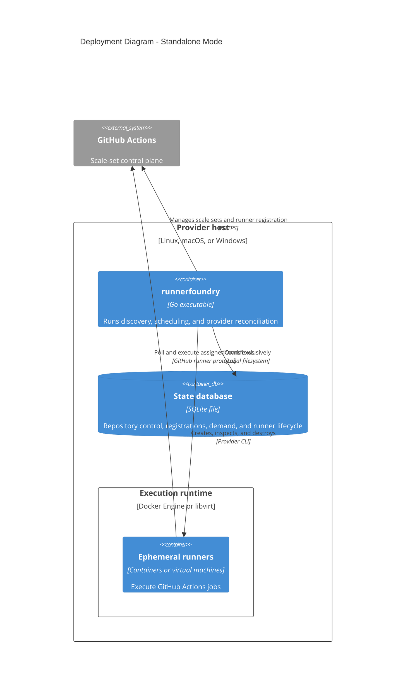

## Clustered mode

Clustered mode separates GitHub-facing coordination from host-local execution. Every host runs the same executable, publishes its own capacity, and can execute assignments addressed to its operating-system hostname. Exactly one host holds the leader lease and manages the union of repository scale-set sessions.

### Startup and node publication

Each node performs these steps before readiness:

1. Resolve PostgreSQL connection settings and the required stable database role.
2. Inspect and automatically migrate the embedded schema upward while holding the migration advisory lock.
3. Build the GitHub App discovery client and derive the node ID from the operating-system hostname.
4. Validate each local provider and atomically publish the node heartbeat, node health, and a complete replacement set of scale-set contributions.
5. Attempt the leader advisory lock immediately; if it is held elsewhere, start a blocking contender on a dedicated direct connection.
6. Report `READY=1` after migration and publication, whether the node is leader or standby.

A contribution contains the scale-set name, GitHub-facing runner group, host-local maximum, and provider health. Every ten seconds the heartbeat worker revalidates providers and republishes the complete contribution set. A node is live for scheduling while its healthy heartbeat is no more than 30 seconds old.

Node identity is exactly the operating-system hostname and is not configurable. Hostnames must therefore be unique within one scaler cluster. Two live processes with the same hostname would publish and claim work as the same node, replacing one another's contribution rows and removing the ownership distinction required for safe local execution.

Live, healthy contributors sharing a name must agree on the runner group. Compatible maximums are summed for the GitHub-facing session, while assignment selection separately enforces each host's local maximum. Stale or unhealthy declarations remain part of the managed union but do not contribute capacity or participate in compatibility checks.

### Leadership and GitHub sessions

Leadership is a session-scoped PostgreSQL advisory lock held on a dedicated direct connection. Closing or losing that connection releases the lock. Standby nodes block on the same lock instead of polling for leadership. The heartbeat loop checks the current lease; after loss, the old leader stops its sessions without deleting GitHub scale sets and returns to contention.

When leadership is acquired, the leader increments the durable repository-controller epoch. It starts fresh discovery and clustered scale-set aggregation independently, then reconnects sessions from an initialized durable repository catalog without waiting for discovery to succeed. A fresh discovery transaction replaces only conclusively observed authority and advances the durable generation. The session's advertised maximum is the current effective cluster capacity. Initial session statistics persist their assigned observations and reconcile durable obligations before polling starts. Subsequent message statistics replace the latest epoch-fenced observation and reconcile the corresponding obligation count before acknowledgement. Full reconciliation runs after leadership acquisition, after a successful local configuration reload, and periodically at `github.discovery_interval`. Heartbeats continue publishing state independently, and assignment eligibility reads current PostgreSQL contributions on every scheduling transaction.

Repository registration and session failures are isolated from leader health. Bounded, prioritized execution prevents routine full-pass reconciliation from starving urgent reconnect or repair. Work is coalesced by repository and each attempt has an independent 30-second GitHub timeout. Failed repositories remain in a non-durable repair queue and retry after 5, 10, 20, 40, and then 60 seconds until their complete configured session group activates. Leadership loss cancels the active work; a successor reconstructs it from durable registrations and desired state.

If fresh discovery fails after the catalog has been initialized, the leader logs the durable generation as stale and remains operational with that authority. Discovery failure before the first durable catalog, repository-state publication failure, or clustered scale-set aggregation failure prevents desired state from being established and leaves the leader degraded. An individual repository repair never changes an otherwise established leader to degraded.

An incompatible scale set receives no session. When effective capacity or a confirmed registration ID changes, reconciliation replaces the repository's complete session generation. A transient registration audit failure preserves the healthy generation and enters repository repair. When the last declaration is explicitly withdrawn, the leader stops the session and deletes the GitHub scale set. Leadership loss retains the GitHub scale set so a successor can attach a replacement session.

As long as incompatible live declarations remain, the aggregate capacity is zero, the leader logs the conflict during reconciliation, and no message session is created for that scale set. Stale or unhealthy conflicting declarations do not have this effect because compatibility considers only live, healthy contributors.

### Components and concurrency

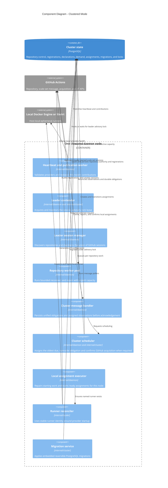

Long-running control loops and bounded worker pools isolate failure domains:

- The heartbeat loop publishes health and checks leader-lease liveness.
- The assignment executor loop repairs or claims host-local work once per second.
- Obligation scheduling reads durable eligibility and retry state. Its correctness does not depend on a fixed worker count or an in-memory retry queue.
- The reconciliation loop serializes full leader reconciliation and repository repair attempts. Its repair timer wakes only for the earliest pending repository retry.
- Repository execution is bounded and prioritizes urgent reconnect and repair over routine full-pass work.

Provider starts occur outside the heartbeat path and may take up to five minutes. Coordination database calls use five-second bounds, each repository GitHub reconciliation attempt and job acquisition uses a 30-second bound, and provider inspection uses a 30-second bound. Obligation failures persist an incremented attempt and next-attempt time. Repository failures retry after 5, 10, 20, 40, and then at most 60 seconds. A failed leadership wait retries after two seconds. After GitHub confirms acquisition, the leader retries the database confirmation every two seconds until it succeeds or its context ends. Failed or ambiguous `starting` assignments are revisited by the one-second executor loop. These boundaries prevent a slow provider, repository, or GitHub request from consuming unrelated recovery work or the node-health failover window.

### Global FIFO and contributor selection

The leader's message handler writes both demand sources to `scaler_demand` before acknowledgement. A `job_available` row carries its positive request ID; the unique scale-set, repository, source, and request-ID key deduplicates redelivery. An `assigned_count` row has a null request ID and references its epoch-fenced assigned observation. The observation reconciles the number of aggregate obligation rows without fabricating request identities.

One queue orders both sources by queue time and database observation ID. PostgreSQL selects the oldest row whose next-attempt time is due and whose session and contributor prerequisites make it runnable. A backed-off or temporarily ineligible row remains durable but does not block a later runnable row. Failure increments the durable attempt and moves `next_attempt_at`; restart and leader replacement therefore preserve retry position and eligibility. Started entries require either a positive request ID or a runner name, and a runner-name-only entry uses that name for lifecycle correlation.

For the selected scale set, PostgreSQL transactionally:

1. Completes assignments owned by expired nodes while retaining their demand.
2. Selects the oldest due, runnable obligation without an active assignment.
3. Selects a live, healthy, compatible contributor whose active assignment count is below that node's contribution for this scale set.
4. Inserts a `reserved` assignment for that demand and node.

For a `job_available` obligation, the leader records the installation and GitHub scale-set identifiers by moving the assignment to `acquiring`, asks GitHub to acquire the exact request ID, and moves it to `ready` only after GitHub confirms the requested identity. A database failure after GitHub confirmation retries only the `acquiring -> ready` transition in the same process.

An `assigned_count` assignment refers to both its canonical demand row and durable assigned-job observation and begins in `ready`. Its selected node derives the provider runner name from the assignment ID, but records lifecycle request ID `0`. This gives provider work a stable distributed identity without claiming that GitHub supplied a request identity.

### Assignment lifecycle

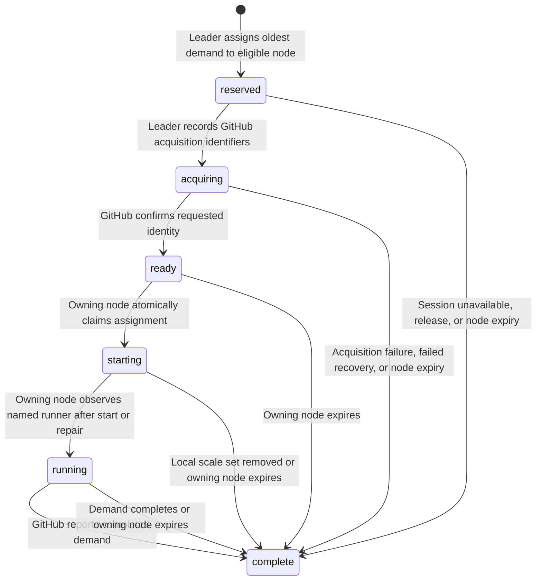

Every non-complete assignment and pending runner reap consumes the selected node's local capacity. Transitions include the expected prior state and, for host-owned transitions, the expected node ID. A stale or repeated transition fails with an assignment conflict instead of silently overwriting newer state.

The `acquiring` state is the boundary around GitHub's non-transactional acquisition API. A replacement leader may retry an interrupted acquisition only if GitHub's response confirms the requested identity. An unconfirmed acquisition never makes the assignment executable.

The `starting` state is the boundary around provider startup. Before starting, and again after an ambiguous provider error, the owning node checks for the stable request-derived runner name. A process restart repairs all of its `starting` assignments before claiming new `ready` assignments. A failed or ambiguous start remains `starting` for later repair rather than returning to the ready queue.

`JobStarted` persists a lifecycle as busy without completing clustered demand. A runner-name-only message selects the exact lifecycle by name and leaves its stored request ID unchanged; a positive-request message retains the existing request-identity path. Terminal `JobCompleted` transactionally requests registered Docker or libvirt cleanup, marks active assignments complete, and removes demand before acknowledgement. An expired waiting lease makes the runner `reap_pending`, completes its assignment, and retains demand for a fresh assignment after capacity is safe. When a node expires, its active assignments are completed but their demand remains, allowing a compatible live host to receive replacement assignments.

### Clustered job sequence

```mermaid
sequenceDiagram
    autonumber
    participant GH as GitHub Actions
    participant L as Leader message handler
    participant DB as PostgreSQL
    participant S as Leader scheduler
    participant E as Selected host executor
    participant R as Runner reconciler
    participant X as Local provider

    GH->>L: JobAvailable message
    L->>DB: Upsert durable demand
    L->>S: Schedule scale set
    S->>DB: Complete expired assignments
    S->>DB: Reserve oldest demand on eligible host
    S->>DB: reserved -> acquiring with GitHub IDs
    S->>GH: Acquire exact request ID
    GH-->>S: Confirm requested identity
    S->>DB: acquiring -> ready
    L-->>GH: Acknowledge message after handler succeeds
    E->>DB: Claim local ready assignment
    DB-->>E: starting assignment
    E->>R: Check stable runner name
    alt Runner is absent
        R->>GH: Generate JIT runner configuration
        R->>X: Start ephemeral runner
        E->>R: Check stable runner name again
    end
    E->>DB: starting -> running
    GH->>L: JobStarted
    L-->>GH: Acknowledge without completing assignment
    GH->>L: JobCompleted
    L->>DB: Request exact runner reap; complete assignment and demand
    L-->>GH: Acknowledge after cleanup obligation commits
    E->>DB: Load node-owned Docker and libvirt pending reaps
    E->>X: List exact owned domain; destroy if active; list again
    E->>DB: Delete lifecycle only after confirmed absence
```

### PostgreSQL state

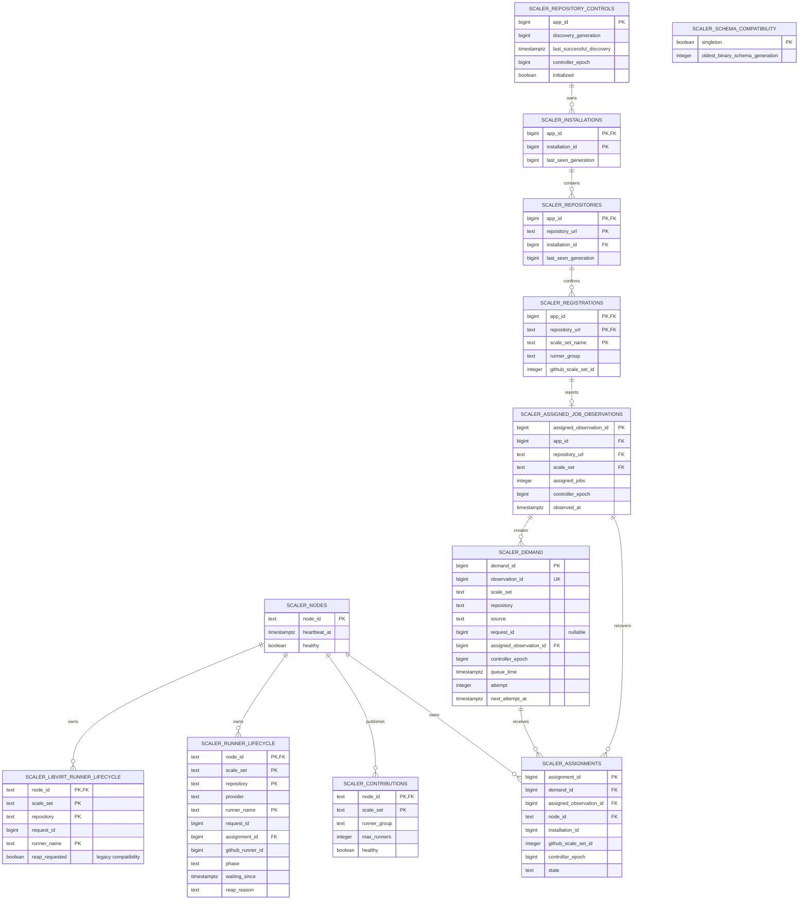

The schema enforces one active assignment per demand obligation with a partial unique index. `job_available` demand has a positive request ID; `assigned_count` demand has no request ID and references the assigned observation that justified it. Aggregate assignments reference both that demand and observation. The repository tables retain one App's fenced controller epoch, discovery generations, conclusively managed installations and repositories, and confirmed registration IDs. Assigned observations retain the latest aggregate count under that epoch. Demand rows retain attempt and next-attempt eligibility for oldest-runnable selection. The generic lifecycle table records provider, exact identities, lifecycle phase, timestamps, and reap reason. Additional indexes support repository generation cleanup, FIFO eligibility, active-assignment counts, assigned observations, waiting leases, and node-owned pending reaps. Node publication replaces all of one node's contributions in one transaction. It also removes demand only when no node declares the associated scale set; runner lifecycle records remain until confirmed provider and GitHub absence.

Ordinary state calls use the primary PostgreSQL endpoint. Migrations and advisory-lock sessions use the optional direct endpoint, or the primary endpoint when it preserves session affinity. All sessions assume the configured stable role. Login credentials may rotate, but database objects and migration metadata remain owned by the stable role.

Configuration values may be literals, environment references, or file references. References are resolved immediately before opening each new connection and are never cached. Existing connections, including a leader lease, are not recycled when a referenced file changes.

### Migrations and compatibility

Cluster startup inspects the schema and automatically migrates upward before contribution publication. A dedicated advisory lock serializes version inspection, migration, and compatibility validation among simultaneous nodes. Migrations are embedded, ordered, transactional, and reversible.

`migrate status` is read-only and reports an empty database as version zero without creating metadata. `migrate up` applies the current binary's target. Migration 007 unifies `job_available` and `assigned_count` obligations in `scaler_demand`, makes request identity optional, links aggregate rows to their assigned observations, and adds durable attempt and next-attempt eligibility. It advances the compatibility floor and requires a coordinated rollout with every RunnerFoundry node stopped. The equivalent standalone change is SQLite schema version 6, applied automatically while the database has its exclusive process owner. `migrate down --to` must be run with the currently deployed binary, acquires both migration and leader locks, and refuses rollback while a live leader or node heartbeat exists. It also refuses to discard capacity or cleanup obligations that the target schema cannot represent. The compatibility row prevents a binary from using a schema generation below the schema's supported floor. After migration, ordinary operation remains multi-node.

### Reload, failover, and shutdown

A clustered reload validates a complete replacement configuration and App key before replacing the in-memory snapshot. It cannot change PostgreSQL configuration or switch state backends. The node then republishes its complete contribution set atomically. If it is the leader, it requests immediate session reconciliation. Running assignments continue and provider configuration remains local to their owning host.

When a leader lease fails, the daemon stops scheduling obligations, cancels bounded active calls, cancels leader reconciliation and the non-durable repository repair queue, stops message pollers, closes message sessions, retains GitHub scale sets, releases the lease, and returns to standby. A waiting node receives the advisory lock, increments the controller epoch, and reconstructs sessions from durable repository authority and PostgreSQL declarations while discovery refreshes independently. Initial session statistics persist current assigned observations and reconcile their obligations under the new epoch before polling begins. Durable repository control, obligations, retry eligibility, assigned observations, and assignments do not belong to the old leader process.

On process shutdown, worker pools stop accepting work, active calls are canceled and joined within their operation bounds, any contender connection is canceled, an active leader closes its sessions without deleting scale sets, and the node publishes itself unhealthy. If that final publication fails, its heartbeat still expires after the node lifetime.

### Cluster deployment

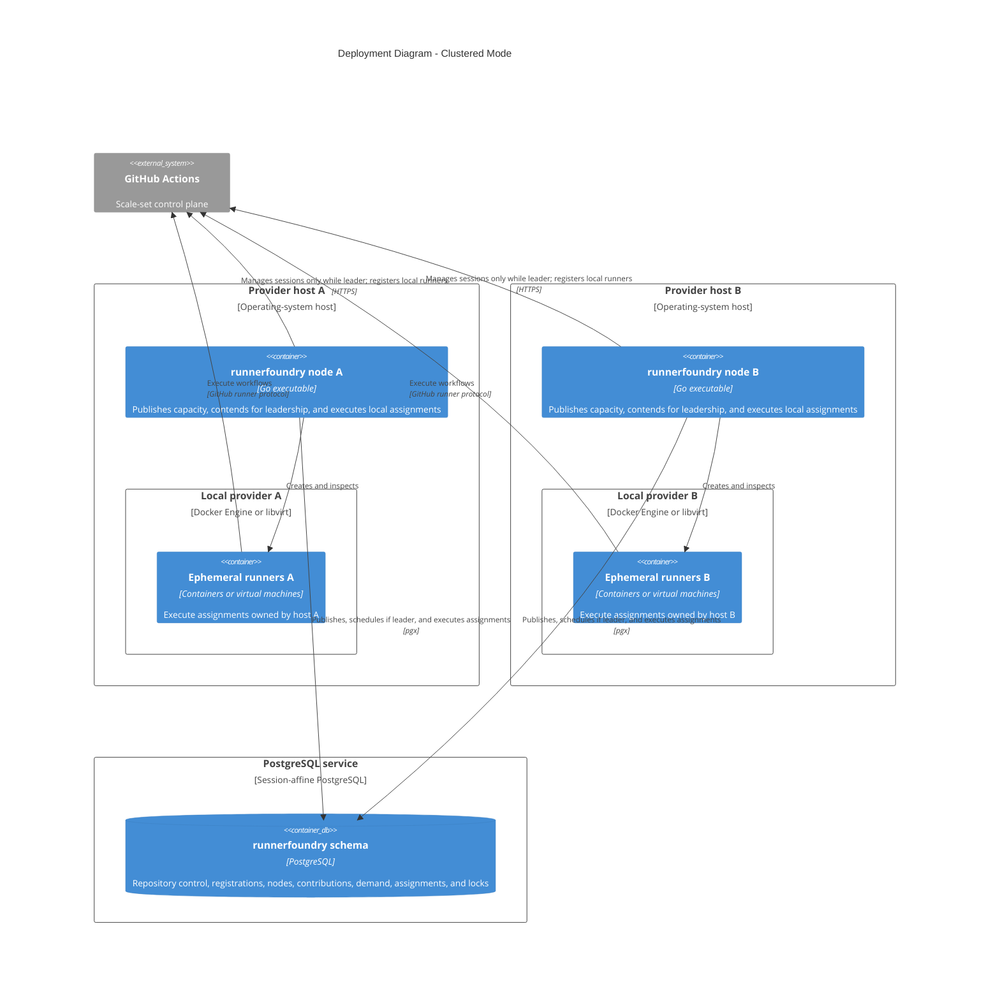

## Runner execution boundary

The scheduling layers do not know Docker or libvirt command details. They depend on a repository worker or assignment executor, which delegates provider-visible operations to `scaler.Reconciler`. The reconciler depends on two interfaces:

- `Provider` lists, starts, and destroys instances identified by scale-set and runner names.
- `JITConfigGenerator` creates GitHub runner registrations and removes a generated registration when provider startup fails.

This boundary centralizes runner capacity checks, lifecycle registration before provider startup, bounded waiting, completed-runner cleanup, stable identity, JIT cleanup, and provider-independent recovery.

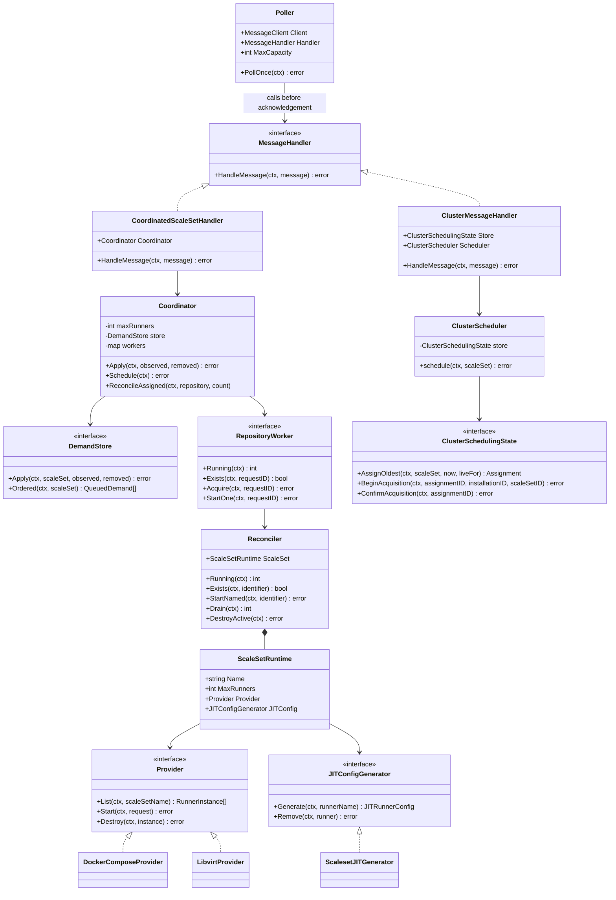

### Stable runner identity

Provider runner names include the repository-qualified scale-set identity. Request-bound runners also include a compact representation of the positive GitHub request ID. This prevents repositories sharing one configured scale-set name from colliding on the same provider host and gives restart recovery a deterministic lookup key.

When generating JIT configuration, an existing GitHub runner with the same name is treated as stale. The scaler finds and removes it, then retries JIT generation. If provider startup fails after JIT generation, the scaler removes the generated GitHub runner registration so a later retry does not inherit a false conflict.

### Docker Compose provider

The Docker provider treats the configured Compose file and service as the operator-owned runner template. For each runner it invokes `docker compose run` in detached, auto-remove mode, adds scaler ownership labels, sets the stable container name, and injects the encoded JIT configuration through `ACTIONS_RUNNER_INPUT_JITCONFIG`.

Listing uses Docker labels to find only scaler-owned containers for the local scale-set identity. Running and completed states are translated into the provider-independent runner model. Destruction removes the selected owned container. The scaler does not own image, volume, network, command, user, or other Compose service configuration.

### libvirt provider

The libvirt provider treats the configured domain XML as an operator-owned template. It renders a unique domain name, scaler metadata, and the JIT configuration into SMBIOS OEM strings, then starts a transient domain through `virsh create`. RunnerFoundry persists the runner lifecycle before that command.

Listing finds domains carrying the scaler metadata, inspects their state, and translates them into the provider-independent runner model. Terminal reaping matches the exact runner metadata, force-stops any active state, and lists again. The durable obligation is removed only when that second inspection, or an initial inspection, confirms absence. Provider validation checks both XML rendering and libvirt connectivity. libvirt execution is unavailable on Windows.

## Readiness, observability, and security boundaries

### Readiness and operating status

Standalone readiness means configuration, credentials, local state, and initial composition are valid. Clustered readiness additionally means PostgreSQL migration and initial contribution publication succeeded. Readiness does not mean GitHub discovery or reconciliation succeeded.

Clustered nodes report a separate systemd status:

- `standby` while another node owns leadership.
- `leader reconciling` while discovering repositories and reading clustered scale-set declarations.
- `leader operational` after durable or freshly discovered repository authority and clustered desired state are established, including while discovery is stale or individual repository repairs are pending.
- `leader degraded` when no usable repository catalog exists, repository state cannot be published, or clustered scale-set aggregation cannot establish desired state.

Structured logs describe lifecycle actions and include non-secret repository, scale-set, node, request, assignment, and operation identifiers. Debug logging adds individual discovery, polling, scheduling, recovery, migration, reload, provider, and cleanup actions.

### Credential and URL handling

The GitHub App private key is read from its configured file and held in process memory. Plaintext private keys in YAML and legacy personal-access-token fields are rejected. JIT configuration is passed directly from GitHub to the selected provider and is not persisted in SQLite or PostgreSQL.

PostgreSQL credentials and connection references are resolved only when opening a connection. Diagnostic errors deliberately omit resolved connection values, stable role names, reference paths, generated connection strings, SQL bodies, raw driver connection errors, and JIT secrets.

GitHub repository URLs must use HTTPS. GitHub-hosted Actions service URLs must use the trusted `actions.githubusercontent.com` suffix and default HTTPS port. GitHub Enterprise service URLs must remain on the repository origin. Cross-origin redirects are rejected.

## Recovery guarantees and limits

The architecture protects the following invariants:

| Invariant | Mechanism | Remaining limit |
| --- | --- | --- |
| A handled message is not silently lost before durable effects | Poller acknowledges only after its handler succeeds | An acknowledgement failure can redeliver an already handled message |
| Capacity obligations survive process restart | SQLite or PostgreSQL stores both obligation sources and retry eligibility before acknowledgement | Assigned counts still cannot supply per-job identity |
| Already-assigned capacity is recovered in both modes | Initial and subsequent session statistics persist epoch-fenced observations and unified `assigned_count` obligations before acknowledgement; durable retry state drives oldest-runnable scheduling | The aggregate count cannot restore per-job identity or original queue order |
| Repository control survives process or leader replacement | SQLite or PostgreSQL stores the last conclusive repository catalog and confirmed scale-set IDs; controller epochs fence older mutations | Message sessions remain process-local and must be recreated |
| Redelivery does not create duplicate demand | Unique demand identity and idempotent upsert | External APIs and providers are still separate transaction domains |
| Capacity is not exceeded | Standalone counts provider-visible runners and pending reaps; PostgreSQL counts active assignments and pending reaps per contributor | Pending cleanup deliberately retains capacity while provider state is ambiguous |
| Accepted runner cleanup is not forgotten | Provider-independent lifecycle intent commits before `JobCompleted` acknowledgement and retries until provider and GitHub absence are confirmed | The owning host must regain its configuration and provider access; GitHub must respond |
| Waiting capacity cannot strand demand forever | `job_start_timeout`, assigned-count reduction, and GitHub registration checks move unusable waiting runners to durable cleanup | Busy runners are protected; cleanup retains capacity while absence is ambiguous |
| A discovered repository cannot silently lose part of its configured registration set | Durable confirmed IDs and grouped audits retain successful creations and activate only complete repository session generations | Active generations remain in use while an audit result is inconclusive |
| Interrupted provider starts do not blindly duplicate runners | Stable runner name is checked before and after start and during repair | A provider that cannot report accurate identity cannot provide this guarantee |
| Cluster leadership has one active owner | Session advisory lock on a dedicated connection | PostgreSQL availability is required for leadership and shared scheduling |
| Node loss does not lose queued demand | Expired-node assignments complete while demand remains | Work may be retried on another host after the original host becomes unreachable |
| Credentials do not enter durable state or diagnostic output | Files and environment are resolved at connection time; secrets are filtered | Existing database connections are not forcibly rotated |

The scaler deliberately favors retained or retried demand over silent loss. GitHub acquisition, database transitions, and provider startup cannot be atomic. The persisted `acquiring` and `starting` boundaries, confirmation checks, stable identities, and idempotent completion rules make those gaps observable and repairable.
