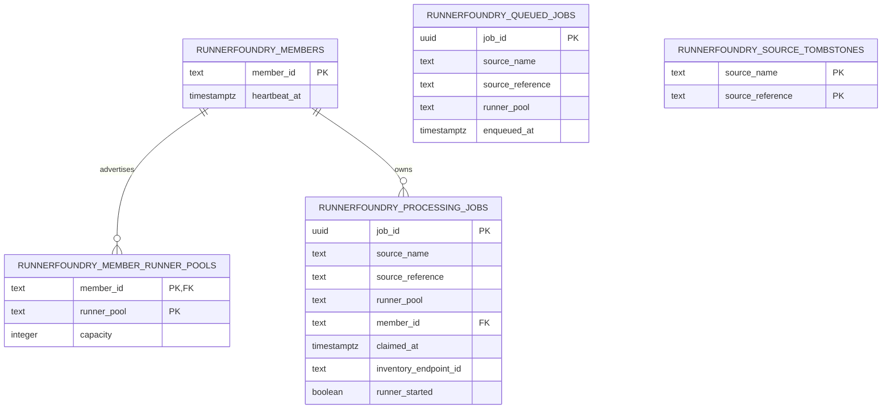
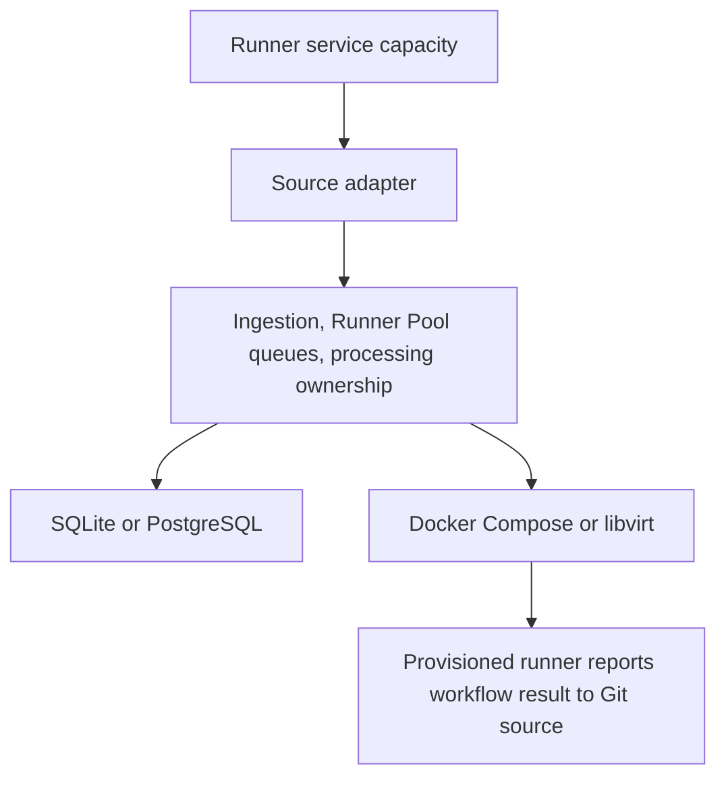

# Architecture

The [product contract](PRD.md) is the authority for RunnerFoundry behavior. This document explains the system boundaries that keep that behavior source-neutral and consistent across deployment modes.

## Components

RunnerFoundry has four core responsibilities:

1. **Ingestion** accepts a source request through an adapter and creates an internal job associated with a Runner Pool.
2. **Queueing** stores jobs by Runner Pool and returns the oldest matching job when that pool requests work.
3. **Execution** provisions one runner to attempt the selected job.
4. **Cleanup** removes the ephemeral runner and its processing record after execution ends.

The provisioned runner reports its workflow result directly to the Git source. The daemon does not observe or persist normal workflow results and has no result-delivery worker.

## Source adapter boundary

A source adapter owns everything specific to a Git hosting or CI system:

- authentication and API clients;
- inbound request payloads;
- observation validation and lifecycle translation;
- capacity publication;
- source-specific identifiers and terminology.

The adapter translates those details into the core terms and transitions defined by the product contract. Core ingestion, queueing, execution, and persistence contracts use jobs, Runner Pools, runner acceptance, and terminal source signals; they do not expose source-specific types.

Source-specific declaration, registration, and ownership persistence is an adapter-owned auxiliary port. State backends implement that port at their adapter edges without adding source-specific types or methods to the source-neutral state contract. For a clustered source, live-member declarations establish shared reconciliation intent independently of which member holds leadership. Active registrations publish current routes; durable ownership records exist only to verify safe source cleanup and do not create jobs or capacity.

An adapter accepts only actionable source observations and maps them to durable core state changes. Source redelivery must be idempotent. A stale or redelivered observation cannot recreate terminal demand or bypass the core cleanup and retry rules.

Provisioning-failure reporting is also adapter-owned. When a source supports that operation, its adapter reports the failure and terminalizes the job through the core contract. Otherwise, the core cleans up and retries the same job without manufacturing a result or adding a persisted result lifecycle.

GitHub Actions is the only supported source today. The [GitHub adapter](github-adapter.md) owns its protocol, discovery, registration, capacity-publication, and cleanup details.

## Queue boundary

The queue contains only jobs waiting to be picked up. FIFO ordering is local to each Runner Pool. A request for work selects the oldest queued job matching the requesting pool; jobs for other pools do not participate in that selection. Equal enqueue timestamps are equally eligible.

Pickup atomically removes the selected job from the queue and creates a processing record. The record includes the claiming member, claim time, exact inventory endpoint, and durable runner-acceptance boundary. It contains no workflow result or broader attempt-state machine.

The queue represents source demand only. Each source adapter owns the translation from its exact or aggregate upstream demand signals into jobs. Provider inventory and published Runner Pool capacity cannot create jobs, and source translation cannot create a second scheduling model.

## Execution boundary

Execution providers supply ephemeral runner environments. Docker Compose and libvirt are the current providers. Launching uses the provider configured for the Runner Pool, while reconciliation uses one aggregate of every provider inventory represented by the active configuration. Docker endpoint identity is the member's Docker host, independent of the Compose mechanism used to provision a Runner Pool; libvirt endpoint identity uses the normalized connection URI. Duplicate endpoints are queried once per maintenance cycle. Each observation includes its Runner Pool, and the cycle snapshot is partitioned for pool reconciliation and occupied-capacity calculation.

Inventory is fail-closed: every represented endpoint must answer before RunnerFoundry treats a runner as absent. An error means runner state is unknown and processing is retained. Failed provisioning performs a fresh inspection of the recorded endpoint before cleanup or absence confirmation. Removing an endpoint never turns invisibility into proof of absence; processing recorded against an unknown endpoint is retained for operator action.

The provisioned runner communicates its normal workflow outcome directly to the Git source. Before runner acceptance, RunnerFoundry owns provisioning failures. After cleanup succeeds or resource absence is confirmed, it atomically moves the same unstarted job to the back of its Runner Pool queue and removes the processing record. A source tombstone or concurrent runner-acceptance observation prevents that retry. There is no retry count, delay, backoff, or timeout.

Runner acceptance transfers outcome ownership to the runner and Git source. Once that boundary is durable, a missing, failed, or terminated provider resource never returns the job to the queue. RunnerFoundry retains processing while it awaits a terminal source signal, attempting cleanup when a resource may remain. A terminal source signal removes processing only after cleanup succeeds or absence is confirmed; cleanup failure retains processing for another cleanup attempt.

## Member ownership boundary

A member is identified by its trimmed operating-system hostname. Hostnames must be stable and unique within the cluster, and only one daemon may run for a hostname. Ordinary processing remains member-local, but the leader may recover an unstarted claim after its fixed five-minute lease or clean terminal processing across members.

Members heartbeat to advertise liveness. The 30-second cutoff removes only advertised capacity. It does not authorize processing recovery. After five minutes, an unstarted, non-terminal claim is recoverable only when the leader can inspect its exact recorded endpoint and either destroy the deterministic runner or positively confirm absence. An unknown, unavailable, or incomplete endpoint retains processing. The guarded state transition loses to a concurrent runner-acceptance or terminal source signal, and started jobs never return to the queue.

## Capacity boundary

Runner Pool registration and capacity publication are orthogonal to the job lifecycle. Members atomically renew their heartbeat and publish their complete configured-capacity snapshot. Members that have not heartbeated within 30 seconds, or that have gracefully withdrawn, contribute no capacity.

The state store calculates one shared value for each Runner Pool:

`available = max(0, live configured capacity - queued jobs - all processing jobs)`

Moving a job from the queue into processing does not change availability. Cancelling queued work or removing completed processing releases capacity. Capacity queries observe current work but cannot create, claim, reorder, move, or remove it.

Source leadership and durable queue processing are separate responsibilities. Durable source registrations survive leadership changes and are restored without filtering through the new leader's local provider configuration. Discovery may reconcile shared live-member declarations independently, but it cannot replace unchanged registrations merely because leadership moved. A source leadership term is fenced: losing leadership cancels source operations, and late results cannot mutate core state or restore the old term. Cleanup failure from an old term cannot prevent a new term from starting.

Every active member owns one member-local durable-queue processor, independent of source leadership. It starts with the runtime generation and waits for successful local inventory refresh and reconciliation before claiming from an eligible Runner Pool. SQLite enqueues cause an immediate coalesced local wake after persistence. PostgreSQL queue inserts broadcast a best-effort wake after commit to every member listening through its primary pool; members still discover durable work during maintenance when notifications are unavailable or missed.

Source-specific registration, observation, and capacity-publication behavior remains inside each adapter and cannot create another scheduler or job lifecycle.

## Reload and shutdown boundary

The daemon-wide `--active-runner-policy=leave|terminate` option controls active resources during reload and graceful shutdown. It defaults to `leave` and is intentionally not part of YAML configuration, so a replacement configuration cannot choose how resources created by the previous generation are handled.

Reload validates and prepares the replacement without claiming work, then deactivates the old generation and activates the replacement. Deactivation cancels and joins both maintenance and queued-job processing before releasing the local gate, so old and replacement generations cannot claim concurrently. Activation commits after the replacement acquires the gate and starts both loops, so `READY` certifies configuration validation, required local and durable-state initialization, provider validation, and local generation ownership. It does not certify Git source discovery or connectivity, inventory, reconciliation, recovery, claims, or provisioning. The first maintenance cycle starts immediately in the background and controls operational health; its failure degrades the active generation without rejecting it. A preparation or local-activation failure closes or rolls back the replacement and reactivates the old generation. The old generation is closed only after activation commits. Close timeouts leave unfinished resource cleanup retryable.

With `leave`, the replacement is applied without explicitly destroying affected runners. Reconciliation then observes the provider-agnostic inventory defined by the replacement configuration. Visible running resources are retained. An unstarted job whose recorded endpoint proves absence can return to the queue after the five-minute recovery lease, while started processing waits for a terminal source signal. Processing tied to an operator-removed endpoint is retained for operator action.

With `terminate`, the old provider destroys affected resources after replacement activation commits. An unstarted job returns to the queue only after cleanup succeeds; a started job remains in processing until the Git source terminalizes it. Cleanup failure retains processing, but does not prevent the otherwise-valid replacement configuration from taking effect.

On graceful shutdown, `leave` stops claims and source activity, withdraws capacity, and preserves all runners and processing. `terminate` destroys owned resources, requeues successfully cleaned-up unstarted jobs, and leaves started jobs awaiting a terminal source signal.

## Deployment boundary

One RunnerFoundry member is a standalone deployment. It may use SQLite or PostgreSQL. SQLite is exclusively owned by that one member.

Two or more RunnerFoundry members form a cluster and share PostgreSQL. PostgreSQL provides the shared state needed by those members; it does not change the product lifecycle.

The state relationships are:

## Dependency rule

Dependencies point inward from adapters, state backends, and execution providers toward source-neutral core contracts. Adding a Git source, database backend, or execution provider must not add another job lifecycle.
