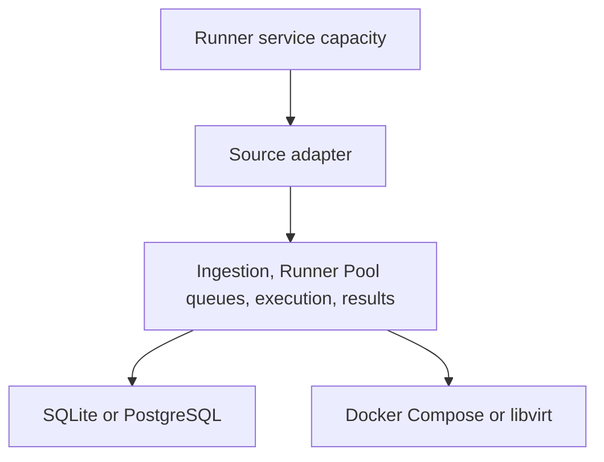

# Architecture

The [product contract](PRD.md) is the authority for RunnerFoundry behavior. This document explains the system boundaries that keep that behavior source-neutral and consistent across deployment modes.

## Components

RunnerFoundry has four core responsibilities:

1. **Ingestion** accepts a source request through an adapter and creates an internal job associated with a Runner Pool.
2. **Queueing** stores jobs by Runner Pool and returns the oldest matching job when that pool requests work.
3. **Execution** provisions one runner to attempt the selected job.
4. **Result reporting** sends success or failure through the source adapter and removes the internal job after reporting.

The core does not define an alternative path for runner failures. A provisioning or execution failure is reported as failure through the same result boundary.

## Source adapter boundary

A source adapter owns everything specific to a Git hosting or CI system:

- authentication and API clients;
- inbound request payloads;
- outbound result reporting;
- capacity publication;
- source-specific identifiers and terminology.

The adapter translates those details into the core terms defined by the product contract. Core ingestion, queueing, execution, result, and persistence contracts use `Job` and `Runner Pool`; they do not expose source-specific types.

GitHub Actions is the only supported source. Its adapter maps GitHub runner scale sets to Runner Pools and maps GitHub job requests and results at the adapter boundary. GitHub terminology may appear in that adapter and in GitHub-specific operator configuration, but nowhere else in the architecture.

## Queue boundary

The queue contains job-and-Runner-Pool entries. FIFO ordering is local to each Runner Pool. A request for work selects the oldest queued job matching the requesting pool; jobs for other pools do not participate in that selection.

The queue represents source demand only. RunnerFoundry does not manufacture jobs from capacity observations or create a second scheduling model.

## Execution boundary

Execution providers supply ephemeral runner environments. Docker Compose and libvirt are the current providers. Provider-specific setup and cleanup remain behind the execution boundary and do not change job ordering or result semantics.

Each execution attempt ends in success or failure. Failure includes failure to provision a runner, loss of a runner, or failure while executing the job. The source adapter owns the source-specific reporting operation.

## Capacity boundary

Runner Pool registration and capacity publication are orthogonal to the job lifecycle. The runner service manages available capacity, and the source adapter translates that capacity into the source's representation. Capacity updates do not create jobs.

For GitHub, the adapter represents Runner Pool capacity with runner scale sets. That representation is not part of the core queue or execution interfaces.

## Deployment boundary

One RunnerFoundry member is a standalone deployment. It may use SQLite or PostgreSQL. SQLite is exclusively owned by that one member.

Two or more RunnerFoundry members form a cluster and share PostgreSQL. PostgreSQL provides the shared state needed by those members; it does not change the product lifecycle.

## Dependency rule

Dependencies point inward from adapters, state backends, and execution providers toward source-neutral core contracts. Adding a Git source, database backend, or execution provider must not add another job lifecycle.
