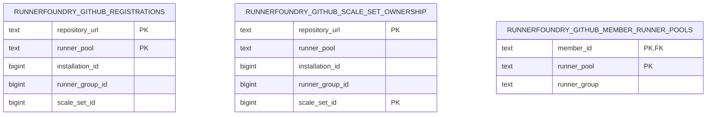

# GitHub adapter

The [product contract](PRD.md) defines RunnerFoundry's source-neutral behavior. The [architecture](architecture.md) defines the boundaries every source adapter must preserve. This document owns the GitHub-specific protocol and persistence rules inside those boundaries.

GitHub Actions is the only supported Git source today. The adapter supports repositories installed under a personal account and represents each configured Runner Pool as a repository-scoped GitHub runner scale set. A Runner Pool name is also the `runs-on` value published to GitHub.

For the upstream polling, messaging, demand, and assignment model, see
[GitHub runner scale-set mechanics](references/github-scaleset-mechanics.md).

## Demand and lifecycle translation

Each runner scale-set message can contain exact lifecycle events and an authoritative assigned-job count. The adapter validates and applies the exact events before reconciling the assigned count:

1. Actionable `JobAvailable` events are offered to GitHub's acquire operation. Only acquired requests become jobs.
2. `JobAssigned` events provide lifecycle history only. They do not create jobs or participate in acquisition.
3. Actionable `JobStarted` events durably record runner acceptance.
4. Actionable `JobCompleted` events terminalize the matching job regardless of the event's `Result` value.
5. The message's assigned-job statistic reconciles the total durable demand for that repository and Runner Pool.
6. The adapter acknowledges the message only after every required state change succeeds.

A message without its required statistics fails handling and remains unacknowledged. A durable-handling or acknowledgement failure leaves the acknowledgement cursor unchanged so GitHub can redeliver the message.

`JobAvailable` is the only exact demand input. It is actionable only when it identifies a positive runner request, and duplicate entries for the same request within one message are considered once. Positive, zero, negative, nil, and redelivered `JobAssigned` entries are non-actionable protocol history: they create no job, require no identity validation, and do not block acknowledgement.

Runner-started and runner-completed events may identify work by a positive runner request ID or by runner name. A zero request ID therefore remains actionable when the event carries the RunnerFoundry runner name. Nil events, negative request IDs, and events with neither identity are recorded as ignored evidence. They do not change job state. An acknowledgement failure after durable handling leaves the message available for redelivery, so all translated state changes remain idempotent.

GitHub's initial session statistics are reconciled before ordinary message polling. A session without its initial statistics cannot begin polling. Later messages reconcile their statistics after all actionable lifecycle events in that message are durable.

GitHub's `TotalAssignedJobs` value is the desired active demand for one repository and Runner Pool. Exact queued jobs and all processing jobs count toward that total. A deficit becomes deterministic aggregate queued demand. A contraction removes only the newest aggregate queued jobs; it never removes exact or processing demand merely to match the statistic.

Aggregate entries preserve the authoritative demand count, not an individual GitHub job identity or GitHub's original queue order. The adapter uses the observation time as their FIFO time because the statistic exposes neither per-job identity nor ordering. Once an exact or aggregate entry is durable in `runnerfoundry_queued_jobs`, claiming and execution use the source-neutral job and Runner Pool contracts; the GitHub adapter does not control which member claims it.

## Acceptance, terminalization, and redelivery

`JobStarted` is GitHub's runner-acceptance signal. Once it is durable, a missing or failed provider resource cannot return the job to the queue. The provisioned runner owns normal workflow-result delivery to GitHub.

An actionable `JobCompleted` is GitHub's terminal source signal and is submitted to the core terminalization boundary regardless of its `Result` value. It removes matching queued demand immediately. Unmatched observations are reported without manufacturing state. Matching processing remains only while provider cleanup is incomplete or resource absence is not yet proven.

A delayed `JobStarted` can arrive after an unstarted provisioning attempt has returned to the queue. The durable transition records a source tombstone and removes that queued retry. A matched, durably applied `JobCompleted` also records a tombstone and removes queued demand. Tombstones prevent redelivery of that source identity or a concurrent provisioning retry from recreating the same demand.

Source tombstones are source-neutral lifecycle state keyed by source name and source reference. The GitHub adapter relies on them, but they are not adapter-owned registration or ownership records.

GitHub does not expose a supported operation for reporting an individual provisioning failure. RunnerFoundry therefore cleans up the failed attempt and retries the same unstarted job from the back of its Runner Pool queue. The adapter never manufactures a GitHub workflow result.

## Discovery and active registrations

Each member transactionally publishes its complete local set of Runner Pool and runner-group declarations. The source leader reconciles the union declared by members inside the cluster liveness cutoff, not its own local configuration. This allows heterogeneous members to contribute different pools without making leadership placement significant. If live members declare different runner-group names for one Runner Pool, the adapter preserves that pool's established registrations and degrades only its reconciliation. Other pools continue normally.

The source leader discovers every installation visible to the configured GitHub App and every repository visible to each installation, including paginated results. Repository reconciliation runs with a fixed concurrency of four. Each repository and declared Runner Pool pair converges independently. Failure to enumerate installations or any installation's repositories is inconclusive and does not delete registrations that the pass could not disprove.

Each successfully ensured repository and Runner Pool pair is persisted immediately. An upsert atomically records its active route and ownership evidence; later passes recover pairs missed by a partial failure or recreated in GitHub. Newly discovered records from an accessible installation replace the active record for the same repository and Runner Pool route. GitHub installation IDs are opaque, so records with different installation IDs may coexist while independent routes converge. Inability to discover access is inconclusive and does not justify inferring that one installation ID replaces another.

Each active registration contains the repository URL, Runner Pool, installation ID, runner-group ID, and scale-set ID. Every committed registration is leader reconnect authority even when the new leader cannot execute that Runner Pool locally. A member creates bootstrap routes only for its locally configured pools and verifies their configured runner-group name against the stored runner-group ID. A local mismatch degrades that member route but cannot delete or reinterpret the shared registration.

When source leadership begins, every committed repository and Runner Pool candidate has an independent session lifecycle while discovery runs independently. Repository and Runner Pool sessions run concurrently, and one session can activate when another route is missing or temporarily fails. Authentication, rate-limit, cancellation, conflict, and server failures, along with inability to discover access, are inconclusive. They retain their exact records for retry without inferring an installation remap. A definitive repository or session not-found through an old installation is terminal and uses the complete stored fingerprint to delete only that exact active registration and ownership record. Later discovery starts one configured discovery interval after the preceding pass finishes and recreates routes that become valid again.

## Leadership and message polling

One source leader owns GitHub discovery, capacity publication, and message sessions. Each leadership term has a cancellation fence. Losing leadership cancels polls and source operations before cleanup. Results from an old term cannot handle or acknowledge messages, install sessions, or restore that term. Cleanup failure cannot block a new leader.

Message sessions are process-local. The pinned `github.com/actions/scaleset` library exposes session creation but not adoption of an existing session. Graceful leadership loss therefore cancels polling and best-effort closes sessions. After an ungraceful loss, restoration keeps a route-local `409 Conflict` as retry work until GitHub expires the old lease. Sibling routes continue polling, and the replacement session's initial statistics restore assigned demand when it opens. Session retirement runs only after active polls have launched and processes at most four retries per maintenance cycle. Close-time `BadRequest` and `NotFound` mean the session is already absent; other failures remain retryable.

Each active session has at most one message request in flight. Immediately before requesting a message, the adapter samples and publishes the shared availability for that Runner Pool. That value remains a poll-time hint for the repository session until its request returns. A completed session samples current availability for its next request, while sibling sessions finish their existing long polls and converge when they poll again. Capacity changes never cancel or wait for those sibling polls.

Concurrent repository sessions can observe the same availability before either accepts demand, so published capacity does not reserve shared capacity across repositories. RunnerFoundry does not add reservations or another scheduler to hide that external consistency limit. Demand accepted from any capacity snapshot enters the durable source-neutral FIFO and is processed at RunnerFoundry's available pace. Durable queue processing remains member-local on every active member and does not depend on GitHub leadership. Committed active registrations remain the session admission authority, and leadership cancellation fencing prevents a stale in-flight result from mutating the replacement term.

## Durable registration and ownership state

Active registrations and durable ownership serve different purposes:

- Active registrations are the current routes used for member bootstrap, capacity publication, and message sessions.
- Durable ownership records prove which runner scale sets RunnerFoundry may safely prune. They survive configuration removal and temporary discovery absence.

Both SQLite and PostgreSQL implement these adapter-owned records without adding GitHub types to the source-neutral state contract.

The active-registration key is repository URL plus Runner Pool. The ownership key is repository URL plus scale-set ID. Member declarations use member ID plus Runner Pool and are replaced transactionally from that member's local configuration. A successful ensure commits one active registration and its ownership together. Guarded deletions match the complete stored fingerprint so a stale restoration or pruning result cannot erase a newer replacement. Registration rows change only when an individual registration changes; there is no full-table delete and reinsert cycle.

## Pruning safety

Pruning is disabled by default. When enabled, it considers stored ownership only for repositories present in the current successful discovery result. Ownership for an undiscovered or temporarily unavailable repository remains intact.

Before deleting an absent scale set, the adapter requires pruning to be enabled and no live member to declare its Runner Pool. It then reads GitHub's current scale sets for the stored runner group and checks the scale-set ID, name, and runner-group ID against the ownership record. A matching scale set is deleted and its ownership removed. An already absent scale set loses its ownership record without another delete. A mismatched fingerprint remains owned for later verification and is not deleted. Labels and update settings are not ownership evidence. With pruning disabled, registrations and ownership survive absent declarations. A pruning failure likewise retains ownership and does not block activation of successfully reconciled routes.

GitHub configuration, credentials, and operator procedures remain in the root [README](../README.md#github-adapter-settings).
