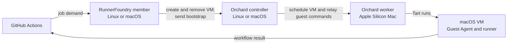

# Set up Orchard macOS runners

RunnerFoundry uses Orchard to provide one disposable macOS runner for an attempted job. RunnerFoundry owns the job and its cleanup;
Orchard manages the VM. The Orchard controller accepts authenticated VM requests and schedules them on a worker.
The worker uses Tart to run the VM. Inside the VM, Tart Guest Agent receives the runner bootstrap through Orchard, and the
runner reports its workflow result directly to GitHub.



[Orchard's architecture and security guide](https://tart.run/orchard/architecture-and-security/) explains its controller,
worker and client roles. [Tart's quick start](https://tart.run/quick-start/) explains VM images and local VM commands.
Tart is required on each Mac that prepares or runs these VMs. A remote Orchard controller or RunnerFoundry member does not
need Tart. The guest needs Tart Guest Agent for Orchard's guest command transport.

## Choose where each component runs

You can run the controller, worker and RunnerFoundry member on one Apple Silicon Mac. In that layout, all three use
`https://localhost:6120` to reach the controller. You can instead run the controller and RunnerFoundry member on Linux
and one or more workers on Apple Silicon Macs. They can also be on separate hosts. In a separated layout, give the
controller a reachable HTTPS hostname and use that same URL on every worker and member. The controller needs inbound
access from them; workers and members do not need inbound access from the controller.

| Component | Host and configuration | Purpose |
| --- | --- | --- |
| Orchard controller | Linux or Mac: Orchard 0.58.0, `--data-dir`, TLS certificate and administrator token | Stores the cluster and authenticates workers, CLI operators and RunnerFoundry |
| Orchard worker | Each Apple Silicon Mac: Orchard 0.58.0, Tart, image in the worker account's `TART_HOME`, bootstrap token on standard input | Runs the VM selected by the controller |
| VM guest | Prepared image: Tart Guest Agent 0.15.0, isolated `runner` account, unregistered runner template and supplied services | Receives one bootstrap and runs one job without storing GitHub App credentials |
| Operator CLI | Controller host or separate operator host: Orchard administrative context in its local Orchard home | Creates service accounts and worker bootstrap tokens; RunnerFoundry does not use this context |
| RunnerFoundry member | Linux or Mac: `config.yaml`, GitHub App key, Orchard token, controller trust and VM JSON | Requests and removes VMs and sends bootstrap data; it needs no local image unless it is also a worker |

Install RunnerFoundry using the [macOS package](../installation-macos.md) or the [Linux package](../installation.md),
and complete [GitHub App setup](../installation.md#create-the-github-app). This guide uses Orchard 0.58.0 and
Tart Guest Agent 0.15.0. Workers need Apple Silicon and macOS 14 or later. Follow [Tart installation and image guidance](https://tart.run/quick-start/)
and the [licence requirements](https://tart.run/licensing/). Install the published [Orchard 0.58.0 release](https://github.com/cirruslabs/orchard/releases/tag/0.58.0)
on the controller and workers; [Orchard's CLI guide](https://tart.run/orchard/using-orchard-cli/) covers operator hosts.
Check `orchard --version` on each Orchard host. Reserve names beginning `runnerfoundry-orchard-` for managed attempts.

## Prepare the VM image on a Mac worker

On a worker, prepare the base under the account that runs Orchard's Tart processes.
For a compatible upstream image:

```sh
export TART_HOME="$HOME/.tart"
tart clone ghcr.io/cirruslabs/macos-tahoe-base:latest macos-runner-base
tart run macos-runner-base
```

Select an upstream macOS release supported by the worker. Pin a specific tag or digest when repeatable contents matter;
`latest` may change. The upstream base includes Homebrew and Tart Guest Agent.
Sign in through the VM window as `admin` using its default password `admin`, and replace that password before sealing the image.

For a fresh installation instead, follow [Tart image creation](https://tart.run/quick-start/#creating-a-macos-vm-image-from-scratch):

```sh
export TART_HOME="$HOME/.tart"
tart create --from-ipsw=/absolute/path/to/macos.ipsw macos-runner-base
tart run macos-runner-base
```

Complete macOS setup with an administrator account. Install Homebrew and
[Tart Guest Agent 0.15.0](https://github.com/cirruslabs/tart-guest-agent/releases/tag/v0.15.0) in the guest:

```sh
brew install openai/tools/tart-guest-agent
tart-guest-agent --version
```

Verify version 0.15.0, including when starting from an upstream base. Keep its executable at `/opt/homebrew/bin/tart-guest-agent`.

## Configure the macOS guest

Add Xcode or other tools only when your workflows need them.
The services below run without a GUI login; workflows needing a GUI session or unlocked login keychain need additional guest preparation.

### Create the runner account

The base image can link `/Users/runner` to `/Users/admin`. Remove only that symbolic link, leaving the administrator's home intact:

```sh
if [ -L /Users/runner ]; then
  sudo unlink /Users/runner
fi
```

Do not remove an existing real directory. Inspect its ownership and contents before reusing it for the runner.

In macOS Users and Groups, create a standard account named `runner` with home `/Users/runner`. Then prepare its group and private home:

```sh
sudo dseditgroup -o create runner
sudo dseditgroup -o edit -a runner -t user runner
sudo install -d -o runner -g runner -m 0700 /Users/runner
id runner
ls -ld /Users/runner
```

Skip the group creation command if that group already exists. Confirm that `runner` is not an administrator and owns a real home directory
with mode `0700`. The launcher writes and removes `/Users/runner/actions-runner` on every attempt, so this home must be isolated from the administrator.

### Install the runner template

Download the macOS ARM64 archive from [GitHub Actions runner releases](https://github.com/actions/runner/releases)
and verify its SHA-256 against the release. Set `runner_archive` below to the downloaded file:

```sh
runner_archive=/absolute/path/to/actions-runner-osx-arm64-VERSION.tar.gz
sudo install -d -o root -g wheel -m 0755 /opt/actions-runner-template
sudo tar -xzf "$runner_archive" -C /opt/actions-runner-template
sudo chown -R root:wheel /opt/actions-runner-template
sudo chmod -R a+rX,go-w /opt/actions-runner-template
```

The template must contain executable `run.sh` directly. Leave it unregistered; do not run `config.sh` or install the runner's own service.

### Install the guest services

The supplied agent expects `/opt/homebrew/bin/tart-guest-agent`. Replace the image's administrator RPC agent with this non-root runner agent.
In the administrator's guest terminal, unload the upstream agent if loaded, then remove its plist:

```sh
launchctl bootout "gui/$(id -u)/org.cirruslabs.tart-guest-agent"
sudo rm /Library/LaunchAgents/org.cirruslabs.tart-guest-agent.plist
```

Run those commands only when the corresponding service and plist exist. Keep `org.cirruslabs.tart-guest-daemon`, which handles disk resizing without RPC.
Only the new `runner` service should provide RPC; do not leave a competing administrator or root RPC instance running.
The guest needs a root launcher that receives bootstrap data through a private `/var/run/runnerfoundry/bootstrap` FIFO,
starts one runner as the non-root user, and powers off after it exits. Bootstrap must pass in memory to the runner's
`ACTIONS_RUNNER_INPUT_JITCONFIG` environment, not a command argument or regular file.

Before sealing an upstream base, replace the `admin` account's default password.
In the guest, open System Settings → Users & Groups, choose the info button for `admin`, then Change.
Follow [Apple's password-change instructions](https://support.apple.com/guide/mac-help/mchlp1550/mac).
Otherwise every clone inherits the known `admin` / `admin` login.

Remove preparation downloads, personal credentials, shell history containing secrets, registrations, diagnostics, and job workspaces before sealing the base.
Keep GitHub App keys and JIT bootstrap data out of the image. Leave the runner launcher unloaded during preparation.
If you loaded it, unload it with `sudo launchctl bootout system/com.runnerfoundry.runner` before sealing.

For the supplied launcher and agent services, follow the [guest example's install commands](../../examples/orchard-macos-runner/README.md).
They install the three files and shut down the guest. For your own guest services, finish installation and shut down cleanly before using the base.

## Make the image available on every worker

After shutdown, check `tart list --format json` on the preparation host and confirm `macos-runner-base` is stopped.
Do not boot or edit a base while jobs use it. The example's `IfNotPresent` pull policy uses that local image on the selected worker.
Prepare the same base name and contents on every eligible worker, or publish the prepared base to a private OCI registry with
[Tart push](https://tart.run/quick-start/#pushing-a-local-image) and set the VM file's `image` to that pinned registry reference.
Configure registry access for the worker account, and keep registry credentials out of the guest.

## Start the Orchard controller

Run one controller for the workers and members in this setup. Orchard stores its database in `--data-dir` and puts
its certificate there when it generates one. Keep that directory across restarts. `ORCHARD_HOME` selects a parent
for the administrator CLI's local configuration. It does not select the controller data directory when `--data-dir`
is set. Use a private directory owned by the
controller account. The following commands are for a controller on a Mac in the single-host layout:

```sh
umask 077
mkdir -p "$HOME/Library/Application Support/Orchard/controller"
openssl rand -hex 32 > "$HOME/Library/Application Support/Orchard/bootstrap-admin-token"
export ORCHARD_HOME="$HOME/Library/Application Support/Orchard"
export ORCHARD_BOOTSTRAP_ADMIN_TOKEN="$(cat "$ORCHARD_HOME/bootstrap-admin-token")"
orchard controller run --listen 127.0.0.1:6120 \
  --data-dir "$ORCHARD_HOME/controller"
```

Run the secret-generation command only for a new installation. Preserve the token securely for later starts.
Supplying `ORCHARD_BOOTSTRAP_ADMIN_TOKEN` suppresses the default display of its value in controller logs.
Keep shell tracing off. Orchard appends `.orchard` to `ORCHARD_HOME` for its CLI configuration.

For a Linux controller, use a private Linux data directory instead, such as `$HOME/.local/share/Orchard/controller`.
Obtain a TLS certificate and key for the hostname used by workers and members. On the Linux controller host, start
Orchard under the account that owns its data directory:

```sh
umask 077
export ORCHARD_HOME="$HOME/.local/share/Orchard"
mkdir -p "$ORCHARD_HOME/controller"
openssl rand -hex 32 > "$ORCHARD_HOME/bootstrap-admin-token"
export ORCHARD_BOOTSTRAP_ADMIN_TOKEN="$(cat "$ORCHARD_HOME/bootstrap-admin-token")"
orchard controller run --listen 0.0.0.0:6120 \
  --data-dir "$ORCHARD_HOME/controller" \
  --controller-cert /absolute/path/controller.crt \
  --controller-key /absolute/path/controller.key
```

Create the token file only for a new installation. Protect the key, token and data directory. Use the same token
on later starts. [Orchard's controller deployment guide](https://tart.run/orchard/deploying-controller/) covers
persistent Linux services and TLS options. The controller does not run Tart or macOS VMs.

Use `https://localhost:6120` in the remaining single-host commands. In a separated layout, replace it with the
controller's HTTPS URL, for example `https://orchard.example.net:6120`. Allow workers and members to reach this
address through the firewall, including WebSocket upgrades for guest-agent connections.

## Create Orchard accounts and trust

On the single-host Mac, leave the controller running. In another terminal under the same account:

```sh
export ORCHARD_HOME="$HOME/Library/Application Support/Orchard"
orchard context default bootstrap-context
orchard create service-account runnerfoundry --roles compute:read --roles compute:write
orchard create service-account runnerfoundry-worker --roles compute:read --roles compute:write
```

The controller creates `bootstrap-context` locally with its admin credentials and certificate trust.
Protect this CLI configuration as administrator credentials.

For a remote controller, install the Orchard CLI on an operator host and create an administrative context:

```sh
orchard context create --name runnerfoundry-admin https://orchard.example.net:6120
orchard context default runnerfoundry-admin
orchard create service-account runnerfoundry --roles compute:read --roles compute:write
orchard create service-account runnerfoundry-worker --roles compute:read --roles compute:write
```

Enter `bootstrap-admin` and its token at the prompts. Independently verify any displayed certificate fingerprint
before trusting it. The operator CLI context stays on that operator host; do not copy it to the RunnerFoundry member.

RunnerFoundry's service account requires both `compute:read` and `compute:write`.
Orchard uses `compute:write` to authorize VM creation, deletion and the guest-agent transport.
RunnerFoundry checks authentication, inventory reads and the local VM specification during pool activation;
it does not test those write permissions or boot a guest. Grant both roles before sending work.

## Start an Orchard worker on each Mac

The worker needs Orchard and Tart under the account that owns the prepared image. For the single-host layout, run:

```sh
orchard get bootstrap-token runnerfoundry-worker | \
  orchard worker run --bootstrap-token-stdin https://localhost:6120
```

The pipe keeps the bootstrap token out of process arguments. The token carries controller certificate trust.
Keep the worker running and use another terminal for later commands.
On macOS 15 or later, accept the Local Network permission prompt for the worker.
For unattended hosts, use Orchard's privilege-dropping helper instead:

```sh
orchard get bootstrap-token runnerfoundry-worker | \
  sudo "$(command -v orchard)" worker run --user "$USER" --bootstrap-token-stdin https://localhost:6120
```

For a separate Mac worker, generate the bootstrap token on the operator host and send it to the worker's standard input.
For example, with SSH access to the worker account that owns the image:

```sh
orchard get bootstrap-token runnerfoundry-worker | \
  ssh worker.example.net 'PATH=/opt/homebrew/bin:/usr/local/bin:$PATH orchard worker run --bootstrap-token-stdin https://orchard.example.net:6120'
```

The bootstrap token carries the controller certificate trust from the operator context. Do not place it in a process
argument, image or log. Replace both hostnames with your worker and controller names. Keep the SSH session open while
the worker runs.

Do not run both local worker commands on the same host. Confirm `orchard list workers` reports each worker online
using the authorized operator CLI context.
For persistent deployment, use [Orchard's controller](https://tart.run/orchard/deploying-controller/) and
[worker deployment guidance](https://tart.run/orchard/deploying-workers/). Keep the controller data directory and
provide secrets through environment or standard input.

## Give the member Orchard credentials

For the single-host Mac, use the authorized Orchard CLI context from the RunnerFoundry working directory
to save the member's token and copy the controller certificate:

```sh
umask 077
orchard get service-account runnerfoundry/token > orchard-token
cp "$ORCHARD_HOME/controller/controller.crt" orchard-ca.pem
chmod 0600 orchard-token
```

For a remote member, generate `orchard-token` on the authorized operator host in a private staging directory.
Obtain `controller.crt` from the controller operator, then transfer the token and certificate securely to the member host.
Place them in the member's configuration directory: its private RunnerFoundry working directory on macOS,
or `/etc/runnerfoundry` on Linux. Restrict the token to the account running RunnerFoundry and remove the staging copy after transfer.
The member does not need an Orchard administrator CLI context.
For a certificate trusted by the host's system roots, omit `trusted_certificate_file` instead.
RunnerFoundry needs the service-account name, token file and certificate trust; it does not consume the Orchard CLI context.

## Check guest startup on a worker

Before submitting real work, check a disposable clone on a prepared worker:

```sh
export TART_HOME="$HOME/.tart"
tart clone macos-runner-base runnerfoundry-preflight
tart run --no-graphics --no-clipboard runnerfoundry-preflight
```

Leave that terminal running. In another terminal under the same worker account:

```sh
tart exec runnerfoundry-preflight /usr/bin/id
tart exec runnerfoundry-preflight /bin/test -p /var/run/runnerfoundry/bootstrap
tart exec runnerfoundry-preflight /bin/test -w /var/run/runnerfoundry/bootstrap
```

Require identity `runner` and successful FIFO checks without output.
Use `/bin/test` rather than a shell built-in. Do not deliver fake bootstrap data.
These checks establish that the launcher reached readiness.
Stop and delete the disposable clone afterwards:

```sh
tart stop runnerfoundry-preflight
tart delete runnerfoundry-preflight
```

## Configure the RunnerFoundry member

The member reads its own `config.yaml`, GitHub App key, Orchard token, controller certificate and `macos-vm.json`.
Keep these files on the member host, not in the guest image. The VM JSON tells Orchard which image to run;
`config.yaml` tells RunnerFoundry which controller and credentials to use. The member reads the token, certificate
and VM JSON at startup and reload. All Orchard file paths in `config.yaml` must be absolute.

### macOS member on the single-host Mac

On macOS, use the private working directory from [installation](../installation-macos.md#prepare-configuration-and-provider-access).
Copy the example [vm.json](../../examples/orchard-macos-runner/vm.json) into that directory as `macos-vm.json`.
The file is a native flat Orchard VM resource, with `image: macos-runner-base`, `imagePullPolicy: IfNotPresent`,
and `restart_policy: Never`.
Use the [Orchard settings reference](../configuration.md#orchard-settings) for other native VM options and validation.

Set `config.yaml`, retaining your GitHub App credentials. Replace `/Users/ci/Library/Application Support/RunnerFoundry`
with your actual absolute working directory, as shown by `pwd`:

```yaml
github:
  apps:
    - app_id: 123456
      private_key_file: ./github-app.pem
state:
  path: ./state.db
scale_sets:
  - name: macos-orchard
    max_runners: 1
    orchard:
      controller_url: https://localhost:6120
      service_account: runnerfoundry
      token_file: /Users/ci/Library/Application Support/RunnerFoundry/orchard-token
      trusted_certificate_file: /Users/ci/Library/Application Support/RunnerFoundry/orchard-ca.pem
      vm_spec_file: /Users/ci/Library/Application Support/RunnerFoundry/macos-vm.json
```

Use the controller address and trust file established during controller setup.

Start the installed member from its working directory:

```sh
chmod 0600 config.yaml github-app.pem orchard-token
/usr/local/bin/runnerfoundry --config ./config.yaml
```

Confirm discovery and Runner Pool registration in the terminal.

### Linux member with a remote controller

On Linux, copy the example [vm.json](../../examples/orchard-macos-runner/vm.json) as
`/etc/runnerfoundry/macos-vm.json`. Place the service-account token and certificate under `/etc/runnerfoundry`, and use
`/etc/runnerfoundry/config.yaml`. Set their absolute paths in the Orchard block, and retain the package
configuration's `/etc/runnerfoundry/github-app.pem` and `/var/lib/runnerfoundry/state.db` settings.
Make the token and App key readable only by the `runnerfoundry` service account, and the VM file and certificate readable by that account.
For a controller at `https://orchard.example.net:6120`, add this pool to the package configuration:

```yaml
scale_sets:
  - name: macos-orchard
    max_runners: 1
    orchard:
      controller_url: https://orchard.example.net:6120
      service_account: runnerfoundry
      token_file: /etc/runnerfoundry/orchard-token
      trusted_certificate_file: /etc/runnerfoundry/orchard-ca.pem
      vm_spec_file: /etc/runnerfoundry/macos-vm.json
```

Use the controller certificate supplied by its operator for `orchard-ca.pem`. If the controller certificate is
trusted by the host's system roots, omit `trusted_certificate_file`. The Linux member does not need Orchard CLI,
Tart or a local VM image. Use [Linux service startup](../../README.md#3-start-runnerfoundry) after completing configuration.

### Set capacity for either layout

`max_runners` bounds this member's contribution; it does not guarantee worker capacity.
A macOS worker supports at most 2 concurrent macOS VMs. Across multiple workers, a value such as 10 is an upper bound,
subject to worker CPU, memory, disk capacity and scheduling constraints. Coordinate contributions when several members use one controller.
For shared PostgreSQL state, follow [deployment](../deployment.md).

## Run a job

In a repository where the GitHub App is installed, add this workflow to the default branch:

```yaml
name: Orchard runner check
on:
  workflow_dispatch:
jobs:
  verify:
    runs-on: macos-orchard
    steps:
      - run: uname -sm
```

Dispatch it from Actions. The job logs should report Darwin and ARM64, and the step should complete.
Check this job directly; host provisioning logs do not establish that it accepted work.
After the attempt, check `orchard list vms` for removal of the managed VM.
Orchard accepts deletion asynchronously: RunnerFoundry may release ownership once the controller has accepted removal,
before the VM has physically disappeared. Investigate prolonged deletion at the controller and worker.

## Maintain and diagnose the setup

### Reload and stop the member

After editing configuration, send `SIGHUP` to the member:

```sh
kill -HUP <daemon-pid>
```

Require `Runtime reload applied`; follow [reload diagnosis](../operations.md#reload-configuration) on rejection.
Every state setting requires restart. Reload also rereads the Orchard token, certificate and VM JSON.
Press Control-C for graceful shutdown of a foreground member. Check the [active runner policy](../operations.md#choose-active-runner-shutdown-behaviour)
before stopping during work; the default leaves active runners running. Linux package service commands are in that guide.

### Update images

1. Prepare an updated runner and tools in a distinct versioned base.
2. Remove credentials and attempt state, then shut it down cleanly.
3. Make it available on every eligible worker or publish its pinned registry reference.
4. Change the VM JSON's `image`, reload RunnerFoundry, and run the first-job check.
5. Retain the former image for active attempts and rollback until their cleanup is accepted.

Follow the [runner update requirements](../providers.md#update-runner-images).

### Recover after changing the controller

Changing `controller_url` does not move existing VMs. Drain and clean up attempts before changing it.
If attempts retain processing ownership after their endpoint is removed from configuration,
restore a pool using the former controller URL with working service-account credentials and a valid VM specification.
Reload or restart the member, then confirm cleanup succeeds. Merely restoring files does not restore an endpoint to active configuration.
Other members can manage the same controller endpoint when they share state and have access; recovery is not tied to a worker's hostname.

### Diagnose a queued job

If activation fails, check the exact controller URL, service-account roles, token file and certificate trust.
Check `orchard list workers` and `orchard list vms` using authorized operator credentials.
A scheduled VM that never runs needs worker capacity, the configured image, registry access and compatible worker labels.

If the VM boots but does not accept work, check Guest Agent 0.15.0 runs as `runner` and the guest can reach GitHub.
Check that the guest launcher created its private bootstrap FIFO at `/var/run/runnerfoundry/bootstrap`.

Repeat the [disposable guest checks](#check-guest-startup-on-a-worker) after correcting an image.
RunnerFoundry bootstrap uses Orchard's native guest-agent transport and needs no guest SSH credentials.

For cleanup failures, restore access to the original controller and inspect its deletion result and worker logs.
Use [queued-job diagnosis](../operations.md#jobs-stay-queued) for GitHub routing and registration.
Arrange [external runner diagnostics](../providers.md#security-and-diagnostic-logs) before production use;
the example services discard console output. Keep tokens and JIT data out of diagnostics and shell traces.
